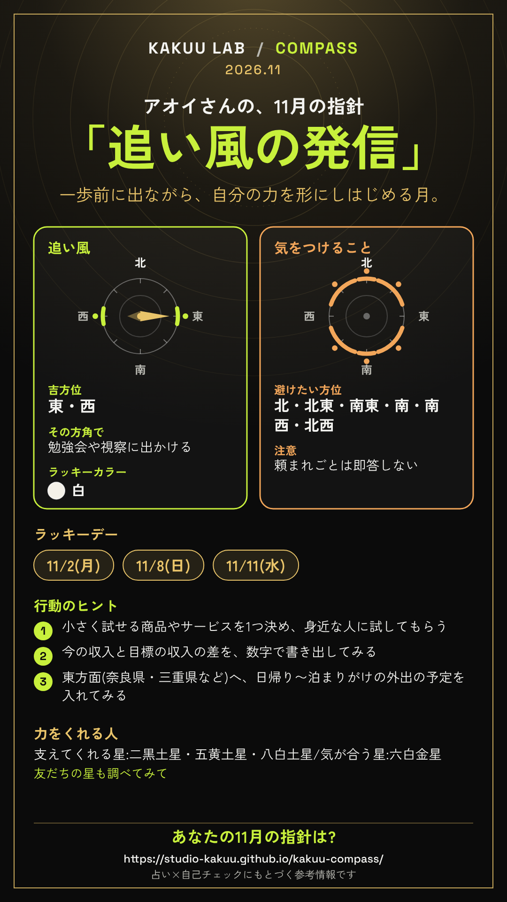
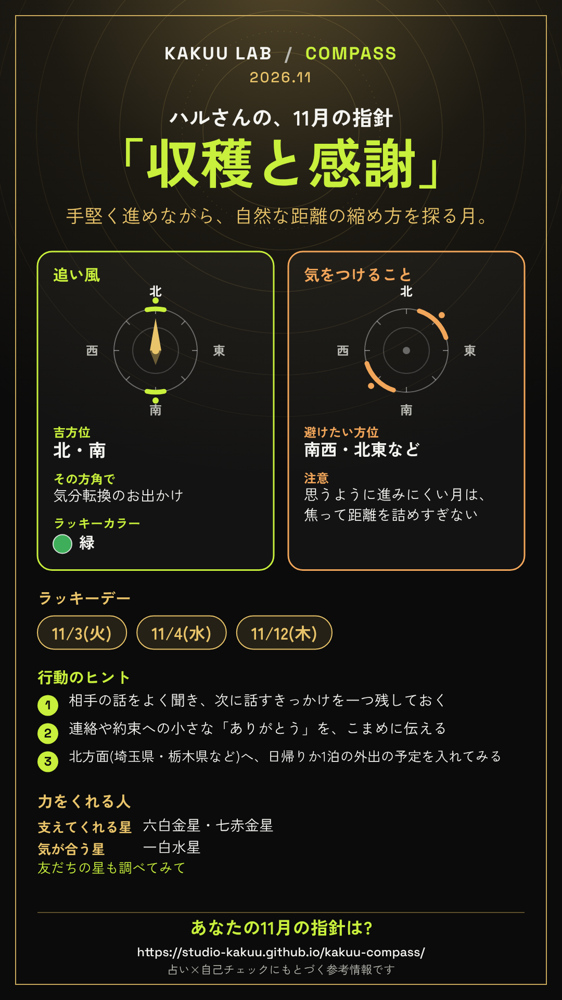
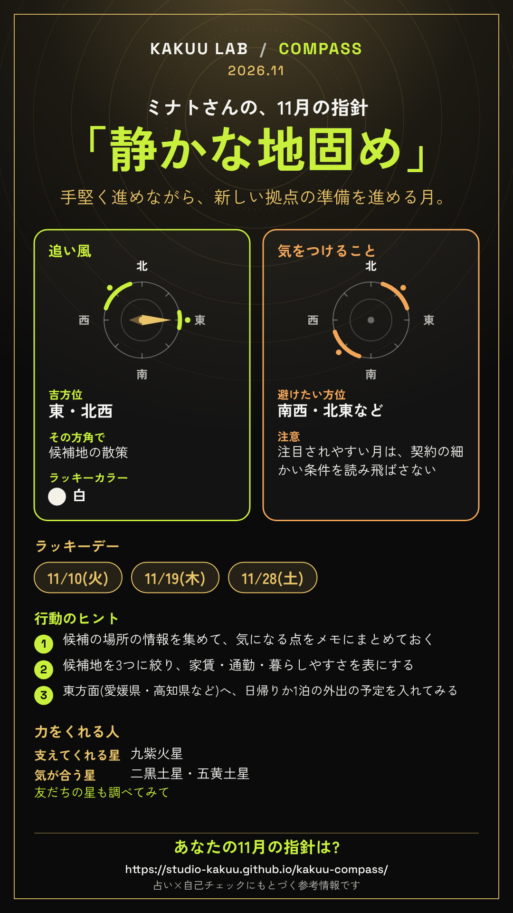

# COMPASS 公開前の確認ページ(REVIEW)

> このファイルは `npm run review` で自動生成しています。文章を直すときは `data/texts.js` を直し、もう一度生成してください。

## 目次
1. [全文章パーツの一覧](#1-全文章パーツの一覧)
2. [サンプルレポート(3人分・全文)と6テーマの作戦の抜粋](#2-サンプルレポート3人分全文)
3. [計算方式・採用したルール・出典](#3-計算方式採用したルール出典)
4. [判断に迷った点と、こちらで決めた内容](#4-判断に迷った点とこちらで決めた内容)

## 1. 全文章パーツの一覧

- 文章はすべて `data/texts.js` にあります。直したいときは **「ID[番号]」** で指定してください(例:「`SIGN-leo[2]` をもっと柔らかく」「`CAU-EL-fire[1]` の3つ目の注意を差し替えて」)。
- `[1]` `[2]` … は同じ内容の言い回し違いです。入力内容から1つが自動で選ばれます(同じ入力なら毎回同じ文)。
- `{name}` などの `{…}` は差し込み文字です(ニックネームや星座名などが入ります)。

### 1-1. 性格の質問(10問)と、今回の見直し(変更前→変更後)

各因子2問(1問は逆転項目)の仕組みはそのままです。同じ因子の2問が「同じことの言い換え」に見えないよう、別の場面を聞く文にしました。

| ID | 因子 | 逆転 | 聞いている場面 | 変更前 | 変更後(現在) |
| --- | --- | --- | --- | --- | --- |
| Q01 | 外向性 |  | 初対面での話しかけ | (変更なし) | 初対面の人とも、自分から話しかけるほうだ |
| Q06 | 外向性 | 逆転 | 集まりのあとの回復 | (変更なし) | 大勢の集まりのあとは、ひとりの時間で回復したくなる |
| Q02 | 協調性 | 逆転 | 意見の対立 | (変更なし) | 意見がぶつかると、相手を言い負かしたくなる |
| Q07 | 協調性 |  | 困っている人への手助け | 相手の立場になって考えることが多い | 困っている人を見ると、自分の用事より先に手を貸すほうだ |
| Q03 | 勤勉性 |  | 準備・計画(段取り) | 締め切りより前に、余裕をもって準備を終わらせるほうだ | 旅行や大事な予定の前には、段取りを先に決めておくほうだ |
| Q08 | 勤勉性 | 逆転 | 片付け・継続 | 予定や片付けを、つい後回しにしがちだ | 始めた習慣や片付けが、三日坊主で終わりやすい |
| Q04 | 神経症傾向 |  | 失敗のあとの思い返し | (変更なし) | 小さな失敗を、あとから何度も思い返してしまう |
| Q09 | 神経症傾向 | 逆転 | 本番前の緊張 | 予想外のことが起きても、わりと落ち着いていられる | 大事な発表や面接の前でも、あまり緊張せずにいられる |
| Q05 | 開放性 |  | アイデア・知らない分野 | (変更なし) | 知らない分野の話や新しいアイデアに、わくわくする |
| Q10 | 開放性 | 逆転 | 体験の選び方(お店) | 慣れたやり方を変えるのは、できれば避けたい | 出かけた先では、初めての店より知っている店を選びがちだ |

### 1-1b. 追加の質問(性格の10問のあとに表示)

| ID | 質問文 | 選び方 | 選択肢(ID) | 使い道 |
| --- | --- | --- | --- | --- |
| X1 | やる気が冷めやすいのは、どんなとき? | 2つまで | 頭ごなしに否定されたとき(`denied`) / 敬意を感じられないとき(`disrespect`) / 何のためにやっているのか見失ったとき(`purpose`) / 成果や手ごたえが見えないとき(`noresult`) / 同じことの繰り返しが続くとき(`routine`) / 計画どおりに進まないとき(`offplan`) / 一人で抱え込んでいるとき(`alone`) | 人物像の「ブレーキ」(`COOL-…`)と、3-3の落とし穴の対策(`COOL-….fix`) |
| X2 | これまでうまくいったときに近いのは? | 1つ | 勢いで飛び込んだとき=勢い型(`leap`) / 準備を重ねたとき=準備型(`prepare`) / 誰かと組んだとき=協働型(`team`) / 期限に追われたとき=締め切り型(`deadline`) / 納得できる目的があったとき=目的型(`purpose`) | 人物像(`SUCCESS-…`)と、3-4の行動プランの形(`PLAN-WEEK/MONTH/KEEP-…`) |

文言の調整:「理不尽に否定されたとき」→「頭ごなしに否定されたとき」(理不尽かどうかを本人が判断しなくても選べるように)、「成果が見えないとき」→「成果や手ごたえが見えないとき」、「一人で抱え込んだとき」→「一人で抱え込んでいるとき」(今の状態として選びやすく)。

回答の目盛り(1→7):1=まったくあてはまらない / 2=あてはまらない / 3=あまりあてはまらない / 4=どちらともいえない / 5=ややあてはまる / 6=あてはまる / 7=とてもよくあてはまる

### 1-2. 見出し・固定の文

| ID | 文 |
| --- | --- |
| sectionTitles.summary | 0. 要約と目次 |
| sectionTitles.guide | 1. {monthLabel}の指針 |
| sectionTitles.persona | 2. あなたの人物像(アクセルとブレーキ) |
| sectionTitles.strategy | 3. テーマ別の作戦:{themeName} |
| sectionTitles.strategyOverview | 3. 全体の作戦 |
| sectionTitles.s31 | 3-1 今の状況の読み |
| sectionTitles.s32 | 3-2 {month}月の勝ち筋 |
| sectionTitles.s33 | 3-3 落とし穴と対策 |
| sectionTitles.s34 | 3-4 行動プラン |
| sectionTitles.s35 | 3-5 ラッキーデーの使いどころ |
| sectionTitles.s36 | 3-6 方角の使い方 |
| sectionTitles.caution | 4. 気をつけること:{monthLabel} |
| sectionTitles.question | 5. 最後の問いかけ |
| sectionTitles.appendix | 6. 付録 |
| sectionTitles.appBasis | 根拠の詳細 |
| sectionTitles.appDirs | 方位の全一覧(年の盤を含む) |
| sectionTitles.appGloss | 用語集 |
| frameworks.western | 西洋占星術(トロピカル方式・地心黄経) |
| frameworks.numerology | 数秘術(ピタゴラス式・全桁加算) |
| frameworks.kyusei | 九星気学(立春・節入り基準/後天定位盤) |
| frameworks.bigfive | Big Five(5因子)の考え方にもとづく簡易版の自己チェック(学術的な検査ではありません) |
| themes.career | 仕事・キャリア(転職・独立・昇進など) |
| themes.money | お金の判断(大きな買い物・貯め方など) |
| themes.love | 恋愛・パートナー |
| themes.relation | 人間関係(職場・友人・家族) |
| themes.move | 引越し・旅行・移動 |
| themes.overview | まずは全体を見たい ※初期選択 |
| disclaimer | このツールは占い・心理学の考え方を組み合わせた参考情報です。入力内容は保存・送信されません。 |
| toolUrl | https://studio-kakuu.github.io/kakuu-compass/ |
| card.lead | {name}さんの、{month}月の指針 |
| card.tailwind | 追い風 |
| card.caution | 気をつけること |
| card.goodDirs | 吉方位 |
| card.doThere | その方角で |
| card.color | ラッキーカラー |
| card.badDirs | 避けたい方位 |
| card.luckyDays | ラッキーデー |
| card.actions | 行動のヒント |
| card.friends | 力をくれる人 |
| card.friendsNote | 友だちの星も調べてみて |
| card.question | あなたの{month}月の指針は? |
| card.note | 占い×自己チェックにもとづく参考情報です |
| card.noGood | 近場で過ごすのが◎ |
| card.friendsSupports | 支えてくれる星 |
| card.friendsSame | 気が合う星 |
| card.more | など |
| card.cautionLabel | 注意 |
| card.doThereNone | おすすめ |
| card.noGoodDo | 近所の散歩や、家でゆっくり過ごす時間 |
| card.noBad | 特になし |
| card.noDays | 自分の調子のよい日を大切に |
| card.birth | {birth}生まれ |
| share.title | KAKUU LAB / COMPASS |
| share.head | {name}さんの{month}月の指針「{guide}」 |
| share.birth | 生年月日:{birth} |
| share.good | 吉方位:{dirs} |
| share.days | ラッキーデー:{days} |
| share.color | ラッキーカラー:{color} |
| share.actions | 行動のヒント |
| share.footer | COMPASS(占い×自己チェックの参考情報) |
| share.persona | アクセル:{accel}/ブレーキ:{brake} |

`card.*` はカード画像の見出し、`share.*` は「共有する」で渡す要約文の型です。

- themeShort.career:仕事・キャリア(本文の「「〇〇」のテーマでは/でも」に入る言葉。「まずは全体を見たい」は差し込みを使わず専用の文 `READ-AXIS-ALL-…`)
- themeShort.money:お金の判断(本文の「「〇〇」のテーマでは/でも」に入る言葉。「まずは全体を見たい」は差し込みを使わず専用の文 `READ-AXIS-ALL-…`)
- themeShort.love:恋愛・パートナー(本文の「「〇〇」のテーマでは/でも」に入る言葉。「まずは全体を見たい」は差し込みを使わず専用の文 `READ-AXIS-ALL-…`)
- themeShort.relation:人間関係(本文の「「〇〇」のテーマでは/でも」に入る言葉。「まずは全体を見たい」は差し込みを使わず専用の文 `READ-AXIS-ALL-…`)
- themeShort.move:引越し・旅行・移動(本文の「「〇〇」のテーマでは/でも」に入る言葉。「まずは全体を見たい」は差し込みを使わず専用の文 `READ-AXIS-ALL-…`)

盲点(ブレーキ)の呼び方(見出しと本文 `BRAKE-…`・`TRAP-…` で同じ言葉を使います):推進力の出すぎ / 慎重さの出すぎ / 外向の出すぎ / 内向の出すぎ / 変化の求めすぎ / 安定志向の出すぎ / 共感の出すぎ / 独立心の出すぎ / 決め手の不足

### 1-3. テーマ別「今の状況」の質問(各2問・3択)

「まずは全体を見たい」を選んだ人には質問を出しません。選んだ答えの ID が、行動のヒント(`ACT-S1-…` / `ACT-S2-…`)と指針の説明(`GUIDE-TAIL-…`)の文章パーツにつながります。

| テーマ | 質問ID | 質問文 | 選択肢(ID) |
| --- | --- | --- | --- |
| 仕事・キャリア | career.S1 | いま考えていることは? | 今の場所で伸ばしたい(`grow`) / 転職したい(`change`) / 独立・副業を始めたい(`indep`) |
| 仕事・キャリア | career.S2 | いちばん大事にしたいことは? | 成長・やりがい(`growth`) / 働き方・時間のゆとり(`balance`) / 収入・条件(`income`) |
| お金の判断 | money.S1 | 考えている判断は? | 大きな買い物をするか迷っている(`buy`) / 貯め方・家計を見直したい(`save`) / 収入を増やす方法を考えたい(`earn`) |
| お金の判断 | money.S2 | お金の判断で、自分に近いのは? | つい勢いで決めがち(`impulse`) / 迷って決められないことが多い(`hesitate`) / わりと計画的に決める(`steady`) |
| 恋愛・パートナー | love.S1 | 今の状況は? | パートナーがいる(`partner`) / 気になる人がいる(`crush`) / 出会いを探している(`seeking`) |
| 恋愛・パートナー | love.S2 | いちばん大切にしたいことは? | 安心・信頼(`trust`) / ときめき・楽しさ(`fun`) / 将来のこと(`future`) |
| 人間関係 | relation.S1 | 気になっている相手は? | 職場の人(`work`) / 友人(`friend`) / 家族(`family`) |
| 人間関係 | relation.S2 | その関係をどうしたい? | もっと仲良くしたい(`closer`) / 少し距離をとりたい(`distance`) / ぎくしゃくを直したい(`repair`) |
| 引越し・旅行・移動 | move.S1 | 考えている移動は? | 引越し・移住(`relocate`) / 旅行・お出かけ(`trip`) / 仕事での移動・出張(`work`) |
| 引越し・旅行・移動 | move.S2 | 時期の目安は? | 1〜3か月以内(`soon`) / 半年〜1年くらい先(`later`) / まだ決めていない(`undecided`) |
| まずは全体を見たい | — | (質問なし) | — |

**答えで何が変わるか**

- 質問1の答え × 今の戦略(攻め/中間/整える)→ 行動のヒント1つ目(`ACT-S1-テーマ-答え-戦略`)
- 質問2の答え → 行動のヒント2つ目(`ACT-S2-テーマ-答え`)
- 質問1の答え → 指針の説明の後半(`GUIDE-TAIL-テーマ-答え`)
- 一部の答えは、判断の罠(認知バイアス)の選び方にも使います(例:お金「つい勢いで決めがち」→ 計画錯誤、「迷って決められない」→ 損失回避、恋愛「出会いを探している」→ スポットライト効果、仕事「転職/独立」・移動「引越し」→ 現状維持バイアス)。

### 1-4. 0. 要約(導入)

| ID | 文 |
| --- | --- |
| INTRO[1] | {name}さん、こんにちは。ここから先は、生まれた日の暦のデータと、{name}さん自身の回答を組み合わせた「戦略プロファイル」です。当たり外れを見るものではなく、自分の考えを整理するための材料として使ってください。 |
| INTRO[2] | {name}さんのための戦略プロファイリングレポートです。星や数字が未来を決めるわけではありません。「自分はこういう傾向があるかもしれない」という仮説として読み、使えるところだけ持ち帰ってください。 |
| INTRO[3] | ようこそ、{name}さん。このレポートは、西洋占星術・数秘術・九星気学という3つの「ものの見方」と、性格の自己チェックを重ね合わせたものです。答え合わせではなく、作戦会議のつもりで読んでみてください。 |

### 1-5. 1. 〇月の指針(指針)

| ID | 文 |
| --- | --- |
| GUIDE-NAME-spring(条件) | *種まき* |
| GUIDE-NAME-spring[1] | 小さな種まき |
| GUIDE-NAME-spring[2] | はじめの一歩 |
| GUIDE-NAME-spring[3] | 芽吹きの準備 |
| GUIDE-NAME-summer(条件) | *拡大* |
| GUIDE-NAME-summer[1] | 追い風の発信 |
| GUIDE-NAME-summer[2] | ひろげる季節 |
| GUIDE-NAME-summer[3] | 光を浴びる月 |
| GUIDE-NAME-turning(条件) | *転換期* |
| GUIDE-NAME-turning[1] | 静かな地固め |
| GUIDE-NAME-turning[2] | 足元の点検 |
| GUIDE-NAME-turning[3] | 立ち止まる勇気 |
| GUIDE-NAME-autumn(条件) | *収穫* |
| GUIDE-NAME-autumn[1] | 実りの仕上げ |
| GUIDE-NAME-autumn[2] | 収穫と感謝 |
| GUIDE-NAME-autumn[3] | 区切りをつける月 |
| GUIDE-NAME-winter(条件) | *整備* |
| GUIDE-NAME-winter[1] | 静かな充電 |
| GUIDE-NAME-winter[2] | 整えの時間 |
| GUIDE-NAME-winter[3] | 内側を磨く月 |
| GUIDE-LEAD-attack[1] | 一歩前に出ながら、 |
| GUIDE-LEAD-attack[2] | 動きを広げつつ、 |
| GUIDE-LEAD-balance[1] | 手堅く進めながら、 |
| GUIDE-LEAD-balance[2] | できることを積み重ねつつ、 |
| GUIDE-LEAD-prepare[1] | ペースを落として、 |
| GUIDE-LEAD-prepare[2] | 焦らず整えながら、 |
| GUIDE-TAIL-career-grow(条件) | *仕事・キャリア/今の場所で伸ばしたい* |
| GUIDE-TAIL-career-grow[1] | 今の場所で強みを育てる月。 |
| GUIDE-TAIL-career-grow[2] | 今いる場所での信頼を深める月。 |
| GUIDE-TAIL-career-change(条件) | *仕事・キャリア/転職したい* |
| GUIDE-TAIL-career-change[1] | 次の働き方の条件を確かめる月。 |
| GUIDE-TAIL-career-change[2] | 新しい場所への準備を進める月。 |
| GUIDE-TAIL-career-indep(条件) | *仕事・キャリア/独立・副業を始めたい* |
| GUIDE-TAIL-career-indep[1] | 小さく試して手ごたえを確かめる月。 |
| GUIDE-TAIL-career-indep[2] | 自分の力を形にしはじめる月。 |
| GUIDE-TAIL-money-buy(条件) | *お金の判断/大きな買い物をするか迷っている* |
| GUIDE-TAIL-money-buy[1] | 納得できる選び方を探す月。 |
| GUIDE-TAIL-money-buy[2] | 買う理由をはっきりさせる月。 |
| GUIDE-TAIL-money-save(条件) | *お金の判断/貯め方・家計を見直したい* |
| GUIDE-TAIL-money-save[1] | お金の流れを見える化する月。 |
| GUIDE-TAIL-money-save[2] | 無理のない仕組みをつくる月。 |
| GUIDE-TAIL-money-earn(条件) | *お金の判断/収入を増やす方法を考えたい* |
| GUIDE-TAIL-money-earn[1] | 自分の力の活かし方を探る月。 |
| GUIDE-TAIL-money-earn[2] | 収入の種を見つける月。 |
| GUIDE-TAIL-love-partner(条件) | *恋愛・パートナー/パートナーがいる* |
| GUIDE-TAIL-love-partner[1] | 二人の安心を育てる月。 |
| GUIDE-TAIL-love-partner[2] | いつもの関係に小さな新しさを足す月。 |
| GUIDE-TAIL-love-crush(条件) | *恋愛・パートナー/気になる人がいる* |
| GUIDE-TAIL-love-crush[1] | 自然な距離の縮め方を探る月。 |
| GUIDE-TAIL-love-crush[2] | 相手を知る時間を楽しむ月。 |
| GUIDE-TAIL-love-seeking(条件) | *恋愛・パートナー/出会いを探している* |
| GUIDE-TAIL-love-seeking[1] | 新しい出会いに心をひらく月。 |
| GUIDE-TAIL-love-seeking[2] | 自分に合う人の輪郭をつかむ月。 |
| GUIDE-TAIL-relation-work(条件) | *人間関係/職場の人* |
| GUIDE-TAIL-relation-work[1] | 職場での伝え方を整える月。 |
| GUIDE-TAIL-relation-work[2] | 心地よい距離感を見つける月。 |
| GUIDE-TAIL-relation-friend(条件) | *人間関係/友人* |
| GUIDE-TAIL-relation-friend[1] | 大切な友人とのつながりを温める月。 |
| GUIDE-TAIL-relation-friend[2] | 気の合う人との時間を増やす月。 |
| GUIDE-TAIL-relation-family(条件) | *人間関係/家族* |
| GUIDE-TAIL-relation-family[1] | 家族との関わり方を見直す月。 |
| GUIDE-TAIL-relation-family[2] | 身近な人との安心を育てる月。 |
| GUIDE-TAIL-move-relocate(条件) | *引越し・旅行・移動/引越し・移住* |
| GUIDE-TAIL-move-relocate[1] | 暮らす場所の候補を確かめる月。 |
| GUIDE-TAIL-move-relocate[2] | 新しい拠点の準備を進める月。 |
| GUIDE-TAIL-move-trip(条件) | *引越し・旅行・移動/旅行・お出かけ* |
| GUIDE-TAIL-move-trip[1] | 行き先選びで気分を切り替える月。 |
| GUIDE-TAIL-move-trip[2] | 出かけることで視野を広げる月。 |
| GUIDE-TAIL-move-work(条件) | *引越し・旅行・移動/仕事での移動・出張* |
| GUIDE-TAIL-move-work[1] | 移動をチャンスに変える月。 |
| GUIDE-TAIL-move-work[2] | 移動の負担を軽くする工夫をする月。 |
| GUIDE-TAIL-overview(条件) | *まずは全体を見たい* |
| GUIDE-TAIL-overview[1] | 自分の流れを確かめる月。 |
| GUIDE-TAIL-overview[2] | 今の自分を見つめ直す月。 |
| GUIDE-INTRO[1] | {monthLabel}の盤の流れと、相談テーマ・今の状況への答えから、{name}さんの{month}月の指針をまとめました。 |
| GUIDE-INTRO[2] | {month}月({monthRange})の{name}さんへの指針です。決まりごとではなく、迷ったときに立ち返る合言葉として使ってください。 |
| GUIDE-SWITCH[1] | 気学の暦では、{setsu}({setsuDate}ごろ)から{month}月の流れに切り替わります。それまでの数日は、前の月の流れも残っています。 |
| GUIDE-SWITCH[2] | {month}月の流れは、{setsu}の{setsuDate}ごろから始まります。それまでは前の月の流れとの重なりの時期です。 |

### 1-6. 1. 〇月の指針(ラッキーカラー)

| ID | 文 |
| --- | --- |
| COLOR-best[1] | {month}月の最大吉方({dir})にいる{star}の色、「{color}」。小物や持ち物に、少し取り入れてみてください。 |
| COLOR-best[2] | 「{color}」。{month}月の最大吉方({dir})にいる{star}にちなんだ色です。身につけるものに取り入れてみてください。 |
| COLOR-good[1] | {month}月の吉方位({dir})にいる{star}の色、「{color}」。小物や持ち物に、少し取り入れてみてください。 |
| COLOR-good[2] | 「{color}」。{month}月の吉方位({dir})にいる{star}にちなんだ色です。身につけるものに取り入れてみてください。 |
| COLOR-supports[1] | {name}さんの本命星を生かす{star}の色、「{color}」。{month}月は吉方位が少ないので、色で気分を整えてみてください。 |
| COLOR-supports[2] | 「{color}」。本命星を生かす星({star})にちなんだ色です。小物や持ち物に取り入れてみてください。 |

### 1-7. 1. 〇月の指針(力をくれる人)

| ID | 文 |
| --- | --- |
| FRIEND[1] | {supports}の人は、{name}さんに力をくれやすい星とされます。{same}の人とは似た感覚で話しやすく、{drains}の人には{name}さんが力を貸せる場面がありそうです。友だちの星も調べてみて。 |
| FRIEND[2] | 九星の相性では、{supports}の人が{name}さんを支えてくれやすいとされます。{same}の人とは気が合いやすく、{drains}の人とは{name}さんが支える側になりやすい関係です。友だちの星も調べてみて。 |
| FRIEND-NOSAME[1] | {supports}の人は、{name}さんに力をくれやすい星とされます。同じ{star}の人とは似た感覚で話しやすく、{drains}の人には{name}さんが力を貸せる場面がありそうです。友だちの星も調べてみて。 |
| FRIEND-NOSAME[2] | 九星の相性では、{supports}の人が{name}さんを支えてくれやすいとされます。同じ{star}の人とは気が合いやすく、{drains}の人とは{name}さんが支える側になりやすい関係です。友だちの星も調べてみて。 |

### 1-8. 人物像

| ID | 文 |
| --- | --- |
| PERSONA-OPEN[1] | ここでは、性格の自己チェック(Big Five)を中心に、生まれの暦のデータを補助として重ね、{name}さんの人物像を4つの軸で読み解きました。 |
| PERSONA-OPEN[2] | {name}さんの回答と生まれの暦のデータを、4つの軸(推進力⇔慎重さ/外向⇔内向/安定⇔変化/共感⇔独立)にまとめ、人物像を1本のストーリーにしました。 |
| PERSONA-CLOSE[1] | アクセルは思い切り使い、ブレーキは「ここで一度止まる」合図として使う。この組み合わせが、{name}さんらしい進み方につながりそうです。 |
| PERSONA-CLOSE[2] | 強みと盲点はコインの表と裏です。どちらも{name}さんの一部として、場面に合わせて使い分けてみてください。 |

### 1-9. 人物像:アクセル(強み)

| ID | 文 |
| --- | --- |
| ACCEL-drive(条件) | *推進力* |
| ACCEL-drive[1] | {name}さんのいちばんのアクセルは「推進力」。迷うより先に一歩目を踏み出し、動きながら形にしていく力が強いタイプです。止まっている状況を動かす役回りで、周りから頼られやすいでしょう。 |
| ACCEL-drive[2] | アクセルは「推進力」。考えがまとまりきる前でも動き出せるので、物事の最初の扉を開けるのが得意なタイプです。{name}さんの勢いが周りに伝わり、場が動きやすくなります。 |
| ACCEL-caution(条件) | *慎重さ* |
| ACCEL-caution[1] | {name}さんのいちばんのアクセルは「慎重さ」。先を見通して危ない芽に早く気づき、準備を整えてから動く力が強いタイプです。大きなつまずきを避けながら、着実に前へ進めます。 |
| ACCEL-caution[2] | アクセルは「慎重さ」。決める前に情報を集め、条件を確かめる丁寧さがあります。周りが見落としがちな点に気づけるので、{name}さんは計画の質を上げる役回りで力を発揮しやすいでしょう。 |
| ACCEL-extro(条件) | *外向* |
| ACCEL-extro[1] | {name}さんのいちばんのアクセルは「外向」。人と話し、つながる中でアイデアや元気が湧いてくるタイプです。新しい人の輪に入っていく力が、チャンスを運んできやすいでしょう。 |
| ACCEL-extro[2] | アクセルは「外向」。声をかける、場を盛り上げる、人と人をつなぐ、といった動きが自然にできます。{name}さんは人と関わるほど調子が上がりやすいタイプです。 |
| ACCEL-intro(条件) | *内向* |
| ACCEL-intro[1] | {name}さんのいちばんのアクセルは「内向」。ひとりで考え、深く掘り下げる時間から良い答えを見つけるタイプです。じっくり積み上げたものが、ほかの人にはまねしにくい強みになります。 |
| ACCEL-intro[2] | アクセルは「内向」。にぎやかさより集中できる環境で力を発揮し、物事の本質を自分の言葉でつかむのが得意です。{name}さんは少人数や一対一の関係で信頼を深めやすいでしょう。 |
| ACCEL-change(条件) | *変化* |
| ACCEL-change[1] | {name}さんのいちばんのアクセルは「変化」。新しいやり方や知らない世界に心が動き、変化を楽しみながら伸びていくタイプです。行き詰まった場面で、別の道を見つける発想力があります。 |
| ACCEL-change[2] | アクセルは「変化」。慣れた道にこだわらず、試しながら工夫できる柔らかさがあります。{name}さんは新しい環境や役割に飛び込むときほど、持ち味が出やすいでしょう。 |
| ACCEL-stable(条件) | *安定* |
| ACCEL-stable[1] | {name}さんのいちばんのアクセルは「安定」。決めたことを続け、土台を固める力が強いタイプです。派手さより確かさで信頼を積み上げ、時間がたつほど評価されやすいでしょう。 |
| ACCEL-stable[2] | アクセルは「安定」。生活や仕事のリズムを整え、同じ質を保ち続けられます。周りが揺れているときほど、{name}さんの落ち着きが支えになりやすいタイプです。 |
| ACCEL-empathy(条件) | *共感* |
| ACCEL-empathy[1] | {name}さんのいちばんのアクセルは「共感」。相手の気持ちを感じとり、寄り添いながら物事を進める力が強いタイプです。安心できる関係をつくれることが、大きな信頼につながります。 |
| ACCEL-empathy[2] | アクセルは「共感」。言葉にされない気持ちにも気づき、相手に合わせた伝え方ができます。{name}さんは人と人の間をつなぐ役回りで力を発揮しやすいでしょう。 |
| ACCEL-indep(条件) | *独立* |
| ACCEL-indep[1] | {name}さんのいちばんのアクセルは「独立」。周りに流されず、自分の考えで判断し、ひとりでもやり切る力が強いタイプです。自分の基準を持っていることが、ぶれない強さになります。 |
| ACCEL-indep[2] | アクセルは「独立」。人に頼りきらず、自分で考えて決める姿勢があります。{name}さんは前例のないことや、自分の裁量で進められる場面で持ち味が出やすいでしょう。 |
| ACCEL-balance(条件) | *バランス型* |
| ACCEL-balance[1] | {name}さんは、4つの軸のどれにも大きく偏らない「バランス型」。場面に合わせて、動く・待つ・話す・考えるを使い分けられるのが強みです。 |
| ACCEL-balance[2] | {name}さんのアクセルは、どの軸にも偏りすぎない「バランス型」。状況に合わせて役割を変えられる柔軟さがあり、いろいろなタイプの人と組みやすいでしょう。 |

### 1-10. 人物像:ブレーキ(盲点)

| ID | 文 |
| --- | --- |
| BRAKE-drive(条件) | *推進力の出すぎ* |
| BRAKE-drive[1] | 一方で、ブレーキとして気をつけたいのは「推進力の出すぎ」。勢いがつくと確認を飛ばしたり、周りを置いていったりしやすい面があります。 |
| BRAKE-drive[2] | ブレーキとして気をつけたい盲点は「推進力の出すぎ」。始めることに夢中になって、後始末や説明が手薄になりやすいかもしれません。 |
| BRAKE-caution(条件) | *慎重さの出すぎ* |
| BRAKE-caution[1] | 一方で、ブレーキとして気をつけたいのは「慎重さの出すぎ」。確かめることが増えすぎると、動き出すタイミングを逃しやすい面があります。 |
| BRAKE-caution[2] | ブレーキとして気をつけたい盲点は「慎重さの出すぎ」。準備が整うのを待つうちに、チャンスが通り過ぎてしまうことがあるかもしれません。 |
| BRAKE-extro(条件) | *外向の出すぎ* |
| BRAKE-extro[1] | 一方で、ブレーキとして気をつけたいのは「外向の出すぎ」。人と動く予定が増えるほど、ひとりで考える時間が足りなくなりやすい面があります。 |
| BRAKE-extro[2] | ブレーキとして気をつけたい盲点は「外向の出すぎ」。その場の盛り上がりで約束を増やし、あとで手が回らなくなるかもしれません。 |
| BRAKE-intro(条件) | *内向の出すぎ* |
| BRAKE-intro[1] | 一方で、ブレーキとして気をつけたいのは「内向の出すぎ」。ひとりで考え込むうちに、助けを求めるタイミングが遅れやすい面があります。 |
| BRAKE-intro[2] | ブレーキとして気をつけたい盲点は「内向の出すぎ」。考えがまとまるまで外に出さないので、良いアイデアが周りに伝わりにくいかもしれません。 |
| BRAKE-change(条件) | *変化の求めすぎ* |
| BRAKE-change[1] | 一方で、ブレーキとして気をつけたいのは「変化の求めすぎ」。新しいことに目移りして、続けてきたことが途中で止まりやすい面があります。 |
| BRAKE-change[2] | ブレーキとして気をつけたい盲点は「変化の求めすぎ」。仕上げの手前で次のことに移り、成果になりきらないことがあるかもしれません。 |
| BRAKE-stable(条件) | *安定志向の出すぎ* |
| BRAKE-stable[1] | 一方で、ブレーキとして気をつけたいのは「安定志向の出すぎ」。変えたほうがよい場面でも、慣れたやり方を続けてしまいやすい面があります。 |
| BRAKE-stable[2] | ブレーキとして気をつけたい盲点は「安定志向の出すぎ」。新しい選択肢を、試す前に外してしまうことがあるかもしれません。 |
| BRAKE-empathy(条件) | *共感の出すぎ* |
| BRAKE-empathy[1] | 一方で、ブレーキとして気をつけたいのは「共感の出すぎ」。相手を優先するうちに、自分の本音や予定が後回しになりやすい面があります。 |
| BRAKE-empathy[2] | ブレーキとして気をつけたい盲点は「共感の出すぎ」。断りにくさから引き受けすぎて、気づかないうちに疲れをためるかもしれません。 |
| BRAKE-indep(条件) | *独立心の出すぎ* |
| BRAKE-indep[1] | 一方で、ブレーキとして気をつけたいのは「独立心の出すぎ」。ひとりで決めて進めるうちに、周りの協力を得る機会を逃しやすい面があります。 |
| BRAKE-indep[2] | ブレーキとして気をつけたい盲点は「独立心の出すぎ」。人に頼るのが遅れて、ひとりで抱え込むことがあるかもしれません。 |
| BRAKE-balance(条件) | *決め手の不足* |
| BRAKE-balance[1] | 一方で、どの軸にも偏らないぶん、ブレーキとして気をつけたいのは「決め手の不足」。「自分は何を優先したいか」が見えにくくなるので、迷ったときの決め手を一つ持っておくと動きやすくなります。 |
| BRAKE-balance[2] | ブレーキとして気をつけたい盲点は「決め手の不足」。どれも平均的にこなせるぶん迷いやすいので、大事にしたい基準を一つ言葉にしておくと楽になります。 |

### 1-11. 人物像:うまくいった型

| ID | 文 |
| --- | --- |
| SUCCESS-leap(条件) | *勢いで飛び込んだとき* |
| SUCCESS-leap[1] | うまくいったときは「勢いで飛び込んだとき」と答えた{name}さん。考えすぎる前に小さく動き出すと、本来の力が出やすいようです。 |
| SUCCESS-leap[2] | 「勢いで飛び込んだとき」にうまくいった経験がある{name}さんは、最初の一歩を軽くすることが成功の近道になりやすいタイプです。 |
| SUCCESS-prepare(条件) | *準備を重ねたとき* |
| SUCCESS-prepare[1] | うまくいったときは「準備を重ねたとき」と答えた{name}さん。段取りが見えているときほど、安心して力を出せるようです。 |
| SUCCESS-prepare[2] | 「準備を重ねたとき」にうまくいった経験がある{name}さんは、計画を先に作ることが自信のもとになりやすいタイプです。 |
| SUCCESS-team(条件) | *誰かと組んだとき* |
| SUCCESS-team[1] | うまくいったときは「誰かと組んだとき」と答えた{name}さん。相談できる相手や役割を分け合える仲間がいると、力が伸びやすいようです。 |
| SUCCESS-team[2] | 「誰かと組んだとき」にうまくいった経験がある{name}さんは、ひとりで抱えず、相棒を決めることが成功の近道になりやすいタイプです。 |
| SUCCESS-deadline(条件) | *期限に追われたとき* |
| SUCCESS-deadline[1] | うまくいったときは「期限に追われたとき」と答えた{name}さん。締め切りがあると集中力が一気に高まるようです。 |
| SUCCESS-deadline[2] | 「期限に追われたとき」にうまくいった経験がある{name}さんは、自分で締め切りを決めることがエンジンになりやすいタイプです。 |
| SUCCESS-purpose(条件) | *納得できる目的があったとき* |
| SUCCESS-purpose[1] | うまくいったときは「納得できる目的があったとき」と答えた{name}さん。「何のために」が腹に落ちていると、粘り強く進めるようです。 |
| SUCCESS-purpose[2] | 「納得できる目的があったとき」にうまくいった経験がある{name}さんは、目的を言葉にしてから動くことが力のもとになりやすいタイプです。 |

### 1-12. 作戦3-3:冷めるきっかけへの対策

| ID | 文 |
| --- | --- |
| COOL-denied(条件) | *頭ごなしに否定されたとき* |
| COOL-denied[1] | 意見をもらう前に「良い点と直す点を一つずつ聞かせて」と、聞き方を決めておく |
| COOL-denied[2] | 否定的な言葉は「内容」と「言い方」に分けて受け取り、内容だけを次に活かす |
| COOL-disrespect(条件) | *敬意を感じられないとき* |
| COOL-disrespect[1] | 関わる相手や場を選ぶ基準を、自分の中で一つ決めておく |
| COOL-disrespect[2] | 「ここでは大事にされている」と感じられる場に、時間を多めに配分する |
| COOL-purpose(条件) | *何のためにやっているのか見失ったとき* |
| COOL-purpose[1] | 着手する前に「何のためにやるか」を1行書いてから始める |
| COOL-purpose[2] | 週に一度、「これは何のためだったか」を見直す時間をとる |
| COOL-noresult(条件) | *成果や手ごたえが見えないとき* |
| COOL-noresult[1] | 小さな進み具合を記録して、手ごたえを自分で見える形にする |
| COOL-noresult[2] | 大きな目標を1週間で終わる大きさに分け、終わったら印をつける |
| COOL-routine(条件) | *同じことの繰り返しが続くとき* |
| COOL-routine[1] | いつもの作業に、やり方や場所を変える小さな工夫を一つ足す |
| COOL-routine[2] | 繰り返しの作業は時間を決めて片づけ、空いた時間に新しいことを入れる |
| COOL-offplan(条件) | *計画どおりに進まないとき* |
| COOL-offplan[1] | 計画に最初から2割の余白を入れておく |
| COOL-offplan[2] | 予定がずれたときの「次の一手」を、あらかじめ一つ決めておく |
| COOL-alone(条件) | *一人で抱え込んでいるとき* |
| COOL-alone[1] | 困ったときに声をかける相手を、先に一人決めておく |
| COOL-alone[2] | 途中経過を誰かに短く報告する習慣をつくる |

### 1-13. 人物像:冷めやすい理由(きっかけ×アクセル)

| ID | 文 |
| --- | --- |
| PERSONA-COOL-LEAD(条件) | *やる気が冷めやすい場面の文の前に置くつなぎの文* |
| PERSONA-COOL-LEAD[1] | 答えてもらった「やる気が冷めやすい場面」も、この人物像とつながっていそうです。 |
| PERSONA-COOL-LEAD[2] | やる気が冷めやすい場面にも、{name}さんの強みの裏側が関係していそうです。 |
| COOLWHY-denied-drive(条件) | *頭ごなしに否定されたとき×アクセル=推進力* |
| COOLWHY-denied-drive[1] | 動きながら形にしていく推進力の強い人ほど、走り出した直後の一言に勢いをそがれやすく、頭ごなしに否定されると一気に足が止まってしまうのかもしれません。 |
| COOLWHY-denied-caution(条件) | *頭ごなしに否定されたとき×アクセル=慎重さ* |
| COOLWHY-denied-caution[1] | 準備を重ねて慎重に出した考えほど思い入れが強いぶん、頭ごなしに否定されると、積み上げた時間ごと否定されたように感じやすいのかもしれません。 |
| COOLWHY-denied-extro(条件) | *頭ごなしに否定されたとき×アクセル=外向* |
| COOLWHY-denied-extro[1] | 人とのやりとりから元気をもらうタイプだからこそ、相手からの頭ごなしの否定は、エネルギーの源そのものを止めてしまいやすいのかもしれません。 |
| COOLWHY-denied-intro(条件) | *頭ごなしに否定されたとき×アクセル=内向* |
| COOLWHY-denied-intro[1] | ひとりでじっくり考えてから出した答えには深い思い入れがあるぶん、頭ごなしに否定されると、もう一度外に出すのをためらいやすいのかもしれません。 |
| COOLWHY-denied-change(条件) | *頭ごなしに否定されたとき×アクセル=変化* |
| COOLWHY-denied-change[1] | 新しいことを試したい気持ちが強いぶん、挑戦の芽を頭ごなしに否定されると、試す楽しさそのものがしぼみやすいのかもしれません。 |
| COOLWHY-denied-stable(条件) | *頭ごなしに否定されたとき×アクセル=安定* |
| COOLWHY-denied-stable[1] | 決めたことを着実に続けるタイプだからこそ、積み上げてきたやり方を頭ごなしに否定されると、足場ごと揺らぐように感じやすいのかもしれません。 |
| COOLWHY-denied-empathy(条件) | *頭ごなしに否定されたとき×アクセル=共感* |
| COOLWHY-denied-empathy[1] | 共感の力が強いぶん、言葉の温度や相手の敬意にも敏感なので、頭ごなしの否定で一気に気持ちが止まりやすいのかもしれません。 |
| COOLWHY-denied-indep(条件) | *頭ごなしに否定されたとき×アクセル=独立* |
| COOLWHY-denied-indep[1] | 自分の基準で考え抜いて決めるタイプだからこそ、理由を聞かれないまま頭ごなしに否定されると、納得できずに気持ちが離れやすいのかもしれません。 |
| COOLWHY-denied-balance(条件) | *頭ごなしに否定されたとき×アクセル=バランス型* |
| COOLWHY-denied-balance[1] | 場面に合わせて動き方を変えられるぶん、合わせようとしている最中の否定がこたえやすく、頭ごなしに言われると気持ちが止まりやすいのかもしれません。 |
| COOLWHY-disrespect-drive(条件) | *敬意を感じられないとき×アクセル=推進力* |
| COOLWHY-disrespect-drive[1] | 先頭に立って動く人ほど、その動きが当たり前のように扱われると報われなさを感じやすく、敬意のない場では力を出す理由を見失いやすいのかもしれません。 |
| COOLWHY-disrespect-caution(条件) | *敬意を感じられないとき×アクセル=慎重さ* |
| COOLWHY-disrespect-caution[1] | 見えないところで確認や準備を重ねるタイプだからこそ、その手間に敬意が払われないと、続ける意味を感じにくくなりやすいのかもしれません。 |
| COOLWHY-disrespect-extro(条件) | *敬意を感じられないとき×アクセル=外向* |
| COOLWHY-disrespect-extro[1] | 人と関わることが力の源になっているぶん、関わる相手から大切に扱われていないと感じると、エネルギーがすっと引いていきやすいのかもしれません。 |
| COOLWHY-disrespect-intro(条件) | *敬意を感じられないとき×アクセル=内向* |
| COOLWHY-disrespect-intro[1] | 少人数の深い信頼の中で力を出すタイプだからこそ、敬意を感じられない関係では、心を開ける場所がなくなりやすいのかもしれません。 |
| COOLWHY-disrespect-change(条件) | *敬意を感じられないとき×アクセル=変化* |
| COOLWHY-disrespect-change[1] | 新しいアイデアを持ち込むことが多いぶん、それが軽く扱われると、工夫する意欲そのものがしぼみやすいのかもしれません。 |
| COOLWHY-disrespect-stable(条件) | *敬意を感じられないとき×アクセル=安定* |
| COOLWHY-disrespect-stable[1] | コツコツと積み重ねる誠実さが強みだからこそ、その積み重ねが軽んじられると、続ける力の土台が揺らぎやすいのかもしれません。 |
| COOLWHY-disrespect-empathy(条件) | *敬意を感じられないとき×アクセル=共感* |
| COOLWHY-disrespect-empathy[1] | 相手を大切にする気持ちが強いぶん、自分が大切に扱われていないと感じたときの落差も大きく、やる気が続きにくいのかもしれません。 |
| COOLWHY-disrespect-indep(条件) | *敬意を感じられないとき×アクセル=独立* |
| COOLWHY-disrespect-indep[1] | 自分の判断に責任を持って動くタイプだからこそ、その判断が尊重されない場では、力を出す意味を見いだしにくいのかもしれません。 |
| COOLWHY-disrespect-balance(条件) | *敬意を感じられないとき×アクセル=バランス型* |
| COOLWHY-disrespect-balance[1] | 周りに合わせて役割を変えられるぶん、その柔軟さが当たり前のように扱われると、報われなさがたまりやすいのかもしれません。 |
| COOLWHY-purpose-drive(条件) | *何のためにやっているのか見失ったとき×アクセル=推進力* |
| COOLWHY-purpose-drive[1] | 前に進む力が強い人ほど、行き先が見えなくなると急にブレーキがかかりやすいものです。 |
| COOLWHY-purpose-caution(条件) | *何のためにやっているのか見失ったとき×アクセル=慎重さ* |
| COOLWHY-purpose-caution[1] | 先を見通してから動くタイプだからこそ、目的があいまいになると、確かめる基準がなくなって手が止まりやすいのかもしれません。 |
| COOLWHY-purpose-extro(条件) | *何のためにやっているのか見失ったとき×アクセル=外向* |
| COOLWHY-purpose-extro[1] | 人と一緒に盛り上がる中で動けるぶん、何のためかが共有されないまま進むと、熱が冷めるのも早くなりやすいのかもしれません。 |
| COOLWHY-purpose-intro(条件) | *何のためにやっているのか見失ったとき×アクセル=内向* |
| COOLWHY-purpose-intro[1] | 物事の意味を自分の言葉で深く考えるタイプだからこそ、何のためにやっているのかが腹に落ちないと、気持ちがついてきにくいのかもしれません。 |
| COOLWHY-purpose-change(条件) | *何のためにやっているのか見失ったとき×アクセル=変化* |
| COOLWHY-purpose-change[1] | 新しい方向に目が向きやすいぶん、今の取り組みの目的がぼやけると、関心が別のことへ移りやすいのかもしれません。 |
| COOLWHY-purpose-stable(条件) | *何のためにやっているのか見失ったとき×アクセル=安定* |
| COOLWHY-purpose-stable[1] | 決めたことを続ける力が強いぶん、続ける理由が見えなくなったときの迷いも大きく、手が止まりやすいのかもしれません。 |
| COOLWHY-purpose-empathy(条件) | *何のためにやっているのか見失ったとき×アクセル=共感* |
| COOLWHY-purpose-empathy[1] | 誰かのために動くときに力が出やすいタイプだからこそ、その「誰のため」が見えなくなると、やる気の行き場を失いやすいのかもしれません。 |
| COOLWHY-purpose-indep(条件) | *何のためにやっているのか見失ったとき×アクセル=独立* |
| COOLWHY-purpose-indep[1] | 自分で考えて決めたい気持ちが強いぶん、目的に納得できないまま進むことに、人一倍抵抗を感じやすいのかもしれません。 |
| COOLWHY-purpose-balance(条件) | *何のためにやっているのか見失ったとき×アクセル=バランス型* |
| COOLWHY-purpose-balance[1] | どの方向にも動けるバランス型だからこそ、目的という軸がないと、どこへ進めばよいか決めにくくなりやすいのかもしれません。 |
| COOLWHY-noresult-drive(条件) | *成果や手ごたえが見えないとき×アクセル=推進力* |
| COOLWHY-noresult-drive[1] | 動いた分だけ前に進んでいる実感がほしい推進力の強い人ほど、手ごたえが見えない時間が続くと、勢いを保ちにくいものです。 |
| COOLWHY-noresult-caution(条件) | *成果や手ごたえが見えないとき×アクセル=慎重さ* |
| COOLWHY-noresult-caution[1] | 準備に時間をかけるタイプだからこそ、その準備がどこにつながっているのか見えないと、続けてよいのか迷いやすいのかもしれません。 |
| COOLWHY-noresult-extro(条件) | *成果や手ごたえが見えないとき×アクセル=外向* |
| COOLWHY-noresult-extro[1] | 人からの反応を力に変えるタイプなので、まわりの手ごたえが返ってこない時期は、エネルギーが目減りしやすいのかもしれません。 |
| COOLWHY-noresult-intro(条件) | *成果や手ごたえが見えないとき×アクセル=内向* |
| COOLWHY-noresult-intro[1] | ひとりで黙々と取り組むことが多いぶん、進み具合を誰にも見せない時間が長くなり、手ごたえを感じにくくなりやすいのかもしれません。 |
| COOLWHY-noresult-change(条件) | *成果や手ごたえが見えないとき×アクセル=変化* |
| COOLWHY-noresult-change[1] | 変化を楽しむ人ほど、景色が変わらないように感じる時期が退屈に思えやすく、成果が見えないと別のことに目が移りやすいのかもしれません。 |
| COOLWHY-noresult-stable(条件) | *成果や手ごたえが見えないとき×アクセル=安定* |
| COOLWHY-noresult-stable[1] | 着実に積み上げるタイプだからこそ、積み上げた分が形として見えないと、続けてきた意味を見失いやすいのかもしれません。 |
| COOLWHY-noresult-empathy(条件) | *成果や手ごたえが見えないとき×アクセル=共感* |
| COOLWHY-noresult-empathy[1] | 誰かの役に立っている実感が力になるタイプなので、その実感が得られないと、やる気が続きにくいのかもしれません。 |
| COOLWHY-noresult-indep(条件) | *成果や手ごたえが見えないとき×アクセル=独立* |
| COOLWHY-noresult-indep[1] | 自分で決めた道を自分の力で進むタイプだからこそ、結果が見えない時期は、確かめる相手もいないまま不安を抱えやすいのかもしれません。 |
| COOLWHY-noresult-balance(条件) | *成果や手ごたえが見えないとき×アクセル=バランス型* |
| COOLWHY-noresult-balance[1] | いろいろなことをそつなくこなせるぶん、どれも手ごたえが薄く感じられて、やる気につながりにくいことがあるのかもしれません。 |
| COOLWHY-routine-drive(条件) | *同じことの繰り返しが続くとき×アクセル=推進力* |
| COOLWHY-routine-drive[1] | 新しい一歩を踏み出すときに力が出るタイプなので、同じことの繰り返しでは推進力の使い道がなく、気持ちが冷めやすいのかもしれません。 |
| COOLWHY-routine-caution(条件) | *同じことの繰り返しが続くとき×アクセル=慎重さ* |
| COOLWHY-routine-caution[1] | 丁寧に確かめながら進むタイプでも、確かめることがなくなるほど同じ作業が続くと、注意力の向け先を失って飽きやすいのかもしれません。 |
| COOLWHY-routine-extro(条件) | *同じことの繰り返しが続くとき×アクセル=外向* |
| COOLWHY-routine-extro[1] | 人や出来事との出会いから刺激を受けるタイプなので、毎日が同じ流れになると、元気の補給が途切れやすいのかもしれません。 |
| COOLWHY-routine-intro(条件) | *同じことの繰り返しが続くとき×アクセル=内向* |
| COOLWHY-routine-intro[1] | 深く考えることが好きなぶん、考える余地のない繰り返しの作業では、頭が退屈してやる気が落ちやすいのかもしれません。 |
| COOLWHY-routine-change(条件) | *同じことの繰り返しが続くとき×アクセル=変化* |
| COOLWHY-routine-change[1] | 変化を楽しむ力が強いぶん、同じことの繰り返しは人一倍退屈に感じやすく、気持ちが冷めるのも早いのかもしれません。 |
| COOLWHY-routine-stable(条件) | *同じことの繰り返しが続くとき×アクセル=安定* |
| COOLWHY-routine-stable[1] | 安定したリズムが得意なタイプでも、変化がまったくない状態が長く続くと、続ける理由が薄れてきやすいのかもしれません。 |
| COOLWHY-routine-empathy(条件) | *同じことの繰り返しが続くとき×アクセル=共感* |
| COOLWHY-routine-empathy[1] | 人の気持ちに触れることで力が出るタイプなので、人との関わりが少ない繰り返しの作業では、やる気がわきにくいのかもしれません。 |
| COOLWHY-routine-indep(条件) | *同じことの繰り返しが続くとき×アクセル=独立* |
| COOLWHY-routine-indep[1] | 自分で工夫して決めたいタイプだからこそ、やり方が決まりきった繰り返しの作業では、自分らしさを出す余地がなく冷めやすいのかもしれません。 |
| COOLWHY-routine-balance(条件) | *同じことの繰り返しが続くとき×アクセル=バランス型* |
| COOLWHY-routine-balance[1] | 何でも器用にこなせるぶん、慣れた作業はすぐに手ごたえがなくなり、繰り返しが続くと退屈を感じやすいのかもしれません。 |
| COOLWHY-offplan-drive(条件) | *計画どおりに進まないとき×アクセル=推進力* |
| COOLWHY-offplan-drive[1] | 勢いで前に進むタイプだからこそ、予定外の足止めに出会うと、その勢いが空回りしてやる気が落ちやすいのかもしれません。 |
| COOLWHY-offplan-caution(条件) | *計画どおりに進まないとき×アクセル=慎重さ* |
| COOLWHY-offplan-caution[1] | 慎重に段取りを組むタイプだからこそ、その段取りが崩れたときの落胆も大きく、立て直す前に気持ちが沈みやすいのかもしれません。 |
| COOLWHY-offplan-extro(条件) | *計画どおりに進まないとき×アクセル=外向* |
| COOLWHY-offplan-extro[1] | 人と予定を合わせて動くことが多いぶん、予定が崩れると周りへの気づかいも重なり、疲れからやる気が落ちやすいのかもしれません。 |
| COOLWHY-offplan-intro(条件) | *計画どおりに進まないとき×アクセル=内向* |
| COOLWHY-offplan-intro[1] | 頭の中でじっくり組み立ててから動くタイプなので、計画が崩れると、考え直す負担が一気にのしかかりやすいのかもしれません。 |
| COOLWHY-offplan-change(条件) | *計画どおりに進まないとき×アクセル=変化* |
| COOLWHY-offplan-change[1] | 変化には強いタイプでも、自分で選んだ変化ではなく思いどおりにいかないことが続くと、楽しさより疲れが先に立ちやすいのかもしれません。 |
| COOLWHY-offplan-stable(条件) | *計画どおりに進まないとき×アクセル=安定* |
| COOLWHY-offplan-stable[1] | 決めた流れを守ることで力を出すタイプだからこそ、計画どおりに進まないと、足場が崩れたように感じやすいのかもしれません。 |
| COOLWHY-offplan-empathy(条件) | *計画どおりに進まないとき×アクセル=共感* |
| COOLWHY-offplan-empathy[1] | 周りに合わせて予定を組むことが多いぶん、計画が崩れると、自分のせいだと感じて抱え込みやすいのかもしれません。 |
| COOLWHY-offplan-indep(条件) | *計画どおりに進まないとき×アクセル=独立* |
| COOLWHY-offplan-indep[1] | 自分で立てた計画に責任を持つタイプだからこそ、思いどおりに進まないと、ひとりで悔しさを抱えやすいのかもしれません。 |
| COOLWHY-offplan-balance(条件) | *計画どおりに進まないとき×アクセル=バランス型* |
| COOLWHY-offplan-balance[1] | どの場面にも対応できるぶん、予定外のことまで引き受けてしまい、計画が崩れると負担が一気に増えやすいのかもしれません。 |
| COOLWHY-alone-drive(条件) | *一人で抱え込んでいるとき×アクセル=推進力* |
| COOLWHY-alone-drive[1] | 自分で動いて解決しようとする力が強いぶん、人に頼る前にひとりで抱え込み、気づいたときには息切れしやすいのかもしれません。 |
| COOLWHY-alone-caution(条件) | *一人で抱え込んでいるとき×アクセル=慎重さ* |
| COOLWHY-alone-caution[1] | 最後まできちんとやり遂げようとするタイプだからこそ、人に任せる不安から物事を抱え込み、負担が重くなりやすいのかもしれません。 |
| COOLWHY-alone-extro(条件) | *一人で抱え込んでいるとき×アクセル=外向* |
| COOLWHY-alone-extro[1] | 人と関わることで力が出るタイプなので、ひとりで抱え込む状況は、元気の源から切り離されたように感じやすいのかもしれません。 |
| COOLWHY-alone-intro(条件) | *一人で抱え込んでいるとき×アクセル=内向* |
| COOLWHY-alone-intro[1] | ひとりで考える時間が心地よいぶん、困ったときも自分の中だけで解決しようとして、気づかないうちに抱え込みやすいのかもしれません。 |
| COOLWHY-alone-change(条件) | *一人で抱え込んでいるとき×アクセル=変化* |
| COOLWHY-alone-change[1] | 新しいことにどんどん手を伸ばすぶん、気づくと抱えるものが増えすぎて、ひとりで回しきれなくなりやすいのかもしれません。 |
| COOLWHY-alone-stable(条件) | *一人で抱え込んでいるとき×アクセル=安定* |
| COOLWHY-alone-stable[1] | 責任感をもって最後まで続けるタイプだからこそ、「自分がやらなければ」と抱え込み、やる気がすり減りやすいのかもしれません。 |
| COOLWHY-alone-empathy(条件) | *一人で抱え込んでいるとき×アクセル=共感* |
| COOLWHY-alone-empathy[1] | 相手の負担を思いやる気持ちが強いぶん、自分の困りごとは言い出しにくく、ひとりで抱え込みやすいのかもしれません。 |
| COOLWHY-alone-indep(条件) | *一人で抱え込んでいるとき×アクセル=独立* |
| COOLWHY-alone-indep[1] | 自分の力でやり切りたい気持ちが強いぶん、人に頼るのが後回しになり、ひとりで抱えるものが増えやすいのかもしれません。 |
| COOLWHY-alone-balance(条件) | *一人で抱え込んでいるとき×アクセル=バランス型* |
| COOLWHY-alone-balance[1] | 何でもひととおりこなせるぶん、周りから任されることが増えて、気づかないうちにひとりで抱え込みやすいのかもしれません。 |

### 1-14. 作戦:導入

| ID | 文 |
| --- | --- |
| STRAT-INTRO[1] | ここからが、このレポートの中心です。「{themeName}」について、今の状況の読み、{month}月の勝ち筋、落とし穴、行動プランの順にまとめました。 |
| STRAT-INTRO[2] | 相談テーマ「{themeName}」の作戦です。答えてもらった今の状況をもとに、{month}月にどう動くかを具体的にしていきます。 |
| STRAT-INTRO-overview[1] | ここからが、このレポートの中心です。テーマを一つに絞らず、{month}月の過ごし方全体の作戦を、流れの読み、勝ち筋、落とし穴、行動プランの順にまとめました。 |
| STRAT-INTRO-overview[2] | 「まずは全体を見たい」{name}さんのための作戦です。{monthLabel}をどう過ごすかを、流れの読みから行動プランまで具体的にしていきます。 |

### 1-15. 作戦3-1:今の状況の読み(質問1)

| ID | 文 |
| --- | --- |
| READ-career-grow(条件) | *仕事・キャリア/今の場所で伸ばしたい* |
| READ-career-grow[1] | 今の場所で伸ばしたいと考えている{name}さん。環境を変えずに成長するには、「何で評価されたいか」をはっきりさせることが近道です。すでに持っている信頼を足場に、任される範囲を少しずつ広げていく流れが合いやすいでしょう。 |
| READ-career-grow[2] | {name}さんは、今いる場所で力を伸ばす道を考えています。ここでの鍵は、周りから見えている強みと、自分が伸ばしたい強みをそろえること。足場があるぶん、小さな挑戦を重ねやすい状況です。 |
| READ-career-change(条件) | *仕事・キャリア/転職したい* |
| READ-career-change[1] | 転職を考えている{name}さん。今は「何から離れたいか」と「何に近づきたいか」が混ざりやすい時期です。離れたい理由だけで選ぶと同じ悩みをくり返しやすいので、次に求める条件を先に言葉にしておくと、判断がぶれにくくなります。 |
| READ-career-change[2] | {name}さんは、働く場所を変えることを考えています。大事なのは、今の不満の解消と、次の場所で得たいものを分けて考えること。条件がはっきりするほど、集まってくる情報の見え方も変わってきます。 |
| READ-career-indep(条件) | *仕事・キャリア/独立・副業を始めたい* |
| READ-career-indep[1] | 独立や副業を考えている{name}さん。自分の力で稼ぐ道は、自由が増えるぶん、決めることも増えます。いきなり大きく始めるより、小さく試して手ごたえを確かめながら育てる進め方が合いやすいでしょう。 |
| READ-career-indep[2] | {name}さんは、自分の名前で仕事をする道を考えています。ここでの鍵は、「やりたいこと」と「お金を払ってもらえること」の重なりを見つけること。小さな実績が、次の一歩の自信になります。 |
| READ-money-buy(条件) | *お金の判断/大きな買い物をするか迷っている* |
| READ-money-buy[1] | 大きな買い物を迷っている{name}さん。迷いが続くのは、決めるための基準がまだはっきりしていないサインかもしれません。値段だけでなく、使う頻度や、買ったあとにかかる費用まで並べると、気持ちが整理しやすくなります。 |
| READ-money-buy[2] | {name}さんは、大きな買い物をするかどうかで迷っています。こういうときは「欲しい理由」と「今でなければならない理由」を分けてみるのがおすすめです。急ぐ理由が見つからなければ、待つことも立派な選択肢です。 |
| READ-money-save(条件) | *お金の判断/貯め方・家計を見直したい* |
| READ-money-save[1] | 貯め方や家計を見直したい{name}さん。お金の見直しは、我慢を増やすより「流れを見えるようにする」ことから始めると続きやすくなります。毎月決まって出ていくお金が見えると、無理のない改善点が見つかりやすいでしょう。 |
| READ-money-save[2] | {name}さんは、お金の使い方や貯め方を整えたいと考えています。大事なのは、気合いではなく仕組みで続けること。一度決めれば毎月くり返せる形にできると、気持ちの負担も軽くなります。 |
| READ-money-earn(条件) | *お金の判断/収入を増やす方法を考えたい* |
| READ-money-earn[1] | 収入を増やす方法を考えている{name}さん。収入アップの道は、働く時間を増やす以外にもいくつかあります。今持っているスキルや経験のうち、人の役に立っているものを棚おろしすると、無理のない選択肢が見えやすくなります。 |
| READ-money-earn[2] | {name}さんは、収入を増やす方法を探しています。ここでは「すぐできること」と「育てると大きくなること」を分けて考えるのがおすすめです。焦って手を広げるより、一つを確かめてから次へ進むほうが続きやすいでしょう。 |
| READ-love-partner(条件) | *恋愛・パートナー/パートナーがいる* |
| READ-love-partner[1] | パートナーがいる{name}さん。関係が続くほど、伝えたいことを「言わなくてもわかる」と思いこみやすくなります。小さな感謝や気持ちを言葉にし直すことが、今の関係をもう一段深める鍵になりそうです。 |
| READ-love-partner[2] | {name}さんは、今のパートナーとの関係について考えています。大切なのは、二人の「いつも」に小さな新しさと、ゆっくり話せる時間を足すこと。安心と新鮮さの両方が、関係を育ててくれます。 |
| READ-love-crush(条件) | *恋愛・パートナー/気になる人がいる* |
| READ-love-crush[1] | 気になる人がいる{name}さん。相手のことを考える時間が増えるほど、反応の一つひとつを深読みしやすくなります。まずは相手を知る時間を楽しみ、自然な会話を重ねることが、距離を縮める近道になりそうです。 |
| READ-love-crush[2] | {name}さんには、気になる人がいます。こういうときは、結果を急ぐより「一緒にいて心地よいか」を確かめる時間を大切にするのがおすすめです。相手を知るほど、次の一歩も自然に見えてきます。 |
| READ-love-seeking(条件) | *恋愛・パートナー/出会いを探している* |
| READ-love-seeking[1] | 出会いを探している{name}さん。出会いは、場所を増やすことと、自分がどんな人と安心できるかを知ることの両方で近づいてきます。条件を決めすぎず、人と話す機会そのものを楽しむ姿勢が、良いご縁を呼びやすいでしょう。 |
| READ-love-seeking[2] | {name}さんは、新しい出会いを探しています。大切なのは、出会いの場に出ることと、自分に合う人の輪郭を言葉にしておくこと。この二つがそろうと、ご縁に気づきやすくなります。 |
| READ-relation-work(条件) | *人間関係/職場の人* |
| READ-relation-work[1] | 職場の人との関係が気になっている{name}さん。仕事の人間関係は、気持ちの相性より「伝え方」と「距離感」で楽になることが多いものです。必要なことを短く丁寧に伝える工夫が、関係を少しずつ変えていきます。 |
| READ-relation-work[2] | {name}さんは、職場の人間関係について考えています。ここでの鍵は、相手を変えようとするより、関わり方の型を自分で決めること。距離感が整うと、仕事そのものにも集中しやすくなります。 |
| READ-relation-friend(条件) | *人間関係/友人* |
| READ-relation-friend[1] | 友人との関係が気になっている{name}さん。友人関係は、会う回数より「気をつかわずにいられるか」で心地よさが決まりやすいものです。大切にしたい人との時間を、自分から少し増やしてみるのがおすすめです。 |
| READ-relation-friend[2] | {name}さんは、友人との関係について考えています。友だち付き合いは、無理に合わせるほど疲れやすくなります。自分のペースを守ることと、会いたい人には自分から声をかけること。この二つのバランスが鍵になりそうです。 |
| READ-relation-family(条件) | *人間関係/家族* |
| READ-relation-family[1] | 家族との関係が気になっている{name}さん。近い関係ほど「言わなくてもわかる」と思いこみ、すれ違いが生まれやすくなります。気持ちや頼みごとを、あらためて言葉にすることが、関係を楽にする第一歩です。 |
| READ-relation-family[2] | {name}さんは、家族との関わり方について考えています。家族の中では、気づかないうちに役割を引き受けすぎていることがあります。自分が抱えているものを一度見える形にすると、関わり方を整えやすくなります。 |
| READ-move-relocate(条件) | *引越し・旅行・移動/引越し・移住* |
| READ-move-relocate[1] | 引越しや移住を考えている{name}さん。住む場所を変えるときは、物件の条件だけでなく、毎日の暮らしの流れが変わることまで想像するのが大切です。候補地で過ごす時間を持つほど、自分に合う場所がはっきりしてきます。 |
| READ-move-relocate[2] | {name}さんは、住む場所を変えることを考えています。ここでの鍵は、「今の場所で困っていること」と「新しい場所で叶えたいこと」を分けて書き出すこと。それが比べるときの物差しになります。 |
| READ-move-trip(条件) | *引越し・旅行・移動/旅行・お出かけ* |
| READ-move-trip[1] | 旅行やお出かけを考えている{name}さん。出かけることは、気分転換だけでなく、考えを整理したり新しい刺激を受けたりする機会にもなります。行き先や日程を早めに決めると、楽しみが日々の張り合いになりやすいでしょう。 |
| READ-move-trip[2] | {name}さんは、旅行やお出かけを考えています。いつもと違う景色の中では、普段は浮かばない考えが出てきやすくなります。無理のない日程で、気になっていた場所に足を運んでみてください。 |
| READ-move-work(条件) | *引越し・旅行・移動/仕事での移動・出張* |
| READ-move-work[1] | 仕事での移動や出張が気になっている{name}さん。移動が多い時期は、予定の組み方しだいで疲れ方が大きく変わります。移動の時間を、準備や考えごとに使える時間として組み立てると、負担が軽くなりやすいでしょう。 |
| READ-move-work[2] | {name}さんは、仕事での移動について考えています。移動はうまく使えば、新しい人や情報に出会う機会にもなります。前後の予定に余裕を持たせることが、移動を味方にする鍵になりそうです。 |

### 1-16. 作戦3-1:今の状況の読み(質問2)

| ID | 文 |
| --- | --- |
| VALUE-career-growth(条件) | *仕事・キャリア/成長・やりがい* |
| VALUE-career-growth[1] | 大事にしたいのは「成長・やりがい」。給料や肩書きより、手ごたえを感じられるかどうかが、{name}さんの満足を左右しやすいようです。 |
| VALUE-career-growth[2] | 「成長・やりがい」を大事にしたい{name}さんには、昨日より一歩進んだと感じられる仕事の組み立て方が合っています。 |
| VALUE-career-balance(条件) | *仕事・キャリア/働き方・時間のゆとり* |
| VALUE-career-balance[1] | 大事にしたいのは「働き方・時間のゆとり」。がんばりすぎない仕組みをつくることが、長く力を出し続けるための土台になりそうです。 |
| VALUE-career-balance[2] | 「働き方・時間のゆとり」を大事にしたい{name}さんにとっては、何をやるかと同じくらい、何をやらないかを決めることが大切です。 |
| VALUE-career-income(条件) | *仕事・キャリア/収入・条件* |
| VALUE-career-income[1] | 大事にしたいのは「収入・条件」。条件を数字で確かめておくと、迷ったときの判断がぶれにくくなります。 |
| VALUE-career-income[2] | 「収入・条件」を大事にしたい{name}さんには、今と目標の差を数字で見える形にしておくことが、次の一手を選ぶ助けになります。 |
| VALUE-money-impulse(条件) | *お金の判断/つい勢いで決めがち* |
| VALUE-money-impulse[1] | お金の判断では「つい勢いで決めがち」とのこと。決める前に一晩おくだけで、本当に必要かどうかが見えやすくなります。 |
| VALUE-money-impulse[2] | 「つい勢いで決めがち」な{name}さんには、決める前に時間を置く小さなルールが、心強い味方になりそうです。 |
| VALUE-money-hesitate(条件) | *お金の判断/迷って決められないことが多い* |
| VALUE-money-hesitate[1] | お金の判断では「迷って決められないことが多い」とのこと。迷いが長引くときは、決めるための条件を先に絞ると楽になります。 |
| VALUE-money-hesitate[2] | 「迷って決められないことが多い」{name}さんには、判断の物差しを3つまでに絞っておく方法が合いそうです。 |
| VALUE-money-steady(条件) | *お金の判断/わりと計画的に決める* |
| VALUE-money-steady[1] | お金の判断は「わりと計画的」とのこと。その強みを活かしつつ、計画を見直すタイミングを決めておくと、より安心して進められます。 |
| VALUE-money-steady[2] | 「わりと計画的に決める」{name}さんは、すでに良い土台を持っています。あとは見直しの日を決めて、計画を今の暮らしに合わせ続けることが鍵になります。 |
| VALUE-love-trust(条件) | *恋愛・パートナー/安心・信頼* |
| VALUE-love-trust[1] | いちばん大切にしたいのは「安心・信頼」。小さな約束を守ることや、こまめな言葉のやりとりが、{name}さんの安心につながりやすいようです。 |
| VALUE-love-trust[2] | 「安心・信頼」を大切にしたい{name}さんには、派手な出来事より、毎日の小さな積み重ねが関係を深めてくれそうです。 |
| VALUE-love-fun(条件) | *恋愛・パートナー/ときめき・楽しさ* |
| VALUE-love-fun[1] | いちばん大切にしたいのは「ときめき・楽しさ」。一緒に新しいことを楽しむ時間が、{name}さんの気持ちを明るくしてくれそうです。 |
| VALUE-love-fun[2] | 「ときめき・楽しさ」を大切にしたい{name}さんには、いつもと違う体験を一緒にすることが、関係に彩りを加えてくれそうです。 |
| VALUE-love-future(条件) | *恋愛・パートナー/将来のこと* |
| VALUE-love-future[1] | いちばん大切にしたいのは「将来のこと」。気負わずに将来の話ができる空気をつくることが、安心につながりそうです。 |
| VALUE-love-future[2] | 「将来のこと」を大切にしたい{name}さんには、大きな結論を急ぐより、少しずつ考えを共有していく進め方が合いそうです。 |
| VALUE-relation-closer(条件) | *人間関係/もっと仲良くしたい* |
| VALUE-relation-closer[1] | その関係を「もっと仲良くしたい」とのこと。相手の好きなことや大切にしていることを知るほど、自然な話題が増えていきます。 |
| VALUE-relation-closer[2] | 「もっと仲良くしたい」{name}さんには、相手への小さな関心を言葉にして伝えることが、距離を縮める近道になりそうです。 |
| VALUE-relation-distance(条件) | *人間関係/少し距離をとりたい* |
| VALUE-relation-distance[1] | その関係は「少し距離をとりたい」とのこと。距離をとることは冷たさではなく、関係を長く保つための調整です。 |
| VALUE-relation-distance[2] | 「少し距離をとりたい」{name}さんには、会う頻度や連絡のペースを、自分が楽な形に整えることが大切です。 |
| VALUE-relation-repair(条件) | *人間関係/ぎくしゃくを直したい* |
| VALUE-relation-repair[1] | その関係の「ぎくしゃくを直したい」とのこと。どちらが悪いかより、これからどうしたいかを伝えると、話が前に進みやすくなります。 |
| VALUE-relation-repair[2] | 「ぎくしゃくを直したい」{name}さんには、責める言い方ではなく、自分の気持ちを主語にした伝え方が助けになりそうです。 |
| VALUE-move-soon(条件) | *引越し・旅行・移動/1〜3か月以内* |
| VALUE-move-soon[1] | 時期の目安は「1〜3か月以内」。動く日が近いぶん、やることを一覧にして順番を決めておくと、慌てずにすみます。 |
| VALUE-move-soon[2] | 「1〜3か月以内」に動く予定の{name}さんには、手続きや準備を前倒しで進めることが安心につながります。 |
| VALUE-move-later(条件) | *引越し・旅行・移動/半年〜1年くらい先* |
| VALUE-move-later[1] | 時期の目安は「半年〜1年くらい先」。時間があるぶん、候補を比べたり、季節を変えて見たりする余裕があります。 |
| VALUE-move-later[2] | 「半年〜1年くらい先」に動く予定の{name}さんは、今は情報を集めて比べる時期。焦らず候補を育てていきましょう。 |
| VALUE-move-undecided(条件) | *引越し・旅行・移動/まだ決めていない* |
| VALUE-move-undecided[1] | 時期は「まだ決めていない」とのこと。まずは動きたい理由を整理すると、時期も自然と見えてきます。 |
| VALUE-move-undecided[2] | 時期を「まだ決めていない」{name}さんには、期限を決める前に、動きたい理由をはっきりさせることが先決です。 |

### 1-17. 作戦3-1:全体の流れの読み(まずは全体を見たい)

| ID | 文 |
| --- | --- |
| READ-overview-spring(条件) | *月のフェーズ:種まき* |
| READ-overview-spring[1] | 全体を見ると、{monthLabel}は新しいことを小さく始めやすい「種まき」の流れ。テーマを一つに絞らず、気になっていることを少しずつ試してみるのに向いた時期です。 |
| READ-overview-spring[2] | {monthLabel}の{name}さんは、芽を出す準備をする「種まき」の流れにあります。大きな結果を求めるより、試してみたいことを書き出して、小さく動き出すのがおすすめです。 |
| READ-overview-summer(条件) | *月のフェーズ:拡大* |
| READ-overview-summer[1] | 全体を見ると、{monthLabel}は外に向けて動きやすい「拡大」の流れ。これまで温めてきたことを、人に見せたり提案したりするのに向いた時期です。 |
| READ-overview-summer[2] | {monthLabel}の{name}さんは、動いたぶんだけ反応が返ってきやすい「拡大」の流れにあります。発信や人との交流を少し増やしてみてください。 |
| READ-overview-turning(条件) | *月のフェーズ:転換期* |
| READ-overview-turning[1] | 全体を見ると、{monthLabel}は本命星が盤の中央に入る「転換期」。新しく広げるより、今あるものを点検し、足元を固めるのに向いた時期です。 |
| READ-overview-turning[2] | {monthLabel}の{name}さんは、立ち止まって見直す「転換期」の流れにあります。予定を詰めこまず、これまでのやり方を整えることが、次の流れへの準備になります。 |
| READ-overview-autumn(条件) | *月のフェーズ:収穫* |
| READ-overview-autumn[1] | 全体を見ると、{monthLabel}は進めてきたことを形にしやすい「収穫」の流れ。仕上げや区切り、お世話になった人へのお礼に向いた時期です。 |
| READ-overview-autumn[2] | {monthLabel}の{name}さんは、成果をまとめる「収穫」の流れにあります。新しく手を広げるより、やりかけのことを仕上げることに力を使ってみてください。 |
| READ-overview-winter(条件) | *月のフェーズ:整備* |
| READ-overview-winter[1] | 全体を見ると、{monthLabel}は内側を整える「整備」の流れ。休む・学ぶ・見直すことに時間を使うと、次の動きが軽くなります。 |
| READ-overview-winter[2] | {monthLabel}の{name}さんは、次の季節に備える「整備」の流れにあります。予定を詰めこまず、生活や仕事の土台を整えることを優先してみてください。 |

### 1-18. 作戦3-1:人物像とのつながり(アクセル別)

| ID | 文 |
| --- | --- |
| READ-AXIS-drive(条件) | *推進力* |
| READ-AXIS-drive[1] | 「{themeName}」のテーマでは、{name}さんの推進力が、止まっていたことを動かすきっかけになりそうです。最初の一歩を自分から踏み出せる強みを活かしましょう。 |
| READ-AXIS-drive[2] | 推進力のある{name}さんは、「{themeName}」でも動き出しの速さが武器になります。決めたら早めに一歩目を形にしてみてください。 |
| READ-AXIS-caution(条件) | *慎重さ* |
| READ-AXIS-caution[1] | 「{themeName}」のテーマでは、{name}さんの慎重さが、後悔しない選択を支えてくれそうです。確かめる力を、判断の質を上げることに使いましょう。 |
| READ-AXIS-caution[2] | 慎重さのある{name}さんは、「{themeName}」でも見落としを防ぐ力が武器になります。調べたことを、決める日とセットで使ってみてください。 |
| READ-AXIS-extro(条件) | *外向* |
| READ-AXIS-extro[1] | 「{themeName}」のテーマでは、{name}さんの外向きの力が、人や情報との出会いを運んできそうです。話してみることから道が開けやすいでしょう。 |
| READ-AXIS-extro[2] | 人と関わる力がある{name}さんは、「{themeName}」でも誰かに話すことで考えがまとまりやすいタイプです。相談相手を頼ってみてください。 |
| READ-AXIS-intro(条件) | *内向* |
| READ-AXIS-intro[1] | 「{themeName}」のテーマでは、{name}さんの内省する力が、本当に大事なことを見極める助けになりそうです。ひとりで考える時間をしっかり確保しましょう。 |
| READ-AXIS-intro[2] | じっくり考える力がある{name}さんは、「{themeName}」でも、自分の言葉で整理することが判断の軸になります。書き出す時間をとってみてください。 |
| READ-AXIS-change(条件) | *変化* |
| READ-AXIS-change[1] | 「{themeName}」のテーマでは、{name}さんの変化を楽しむ力が、新しい選択肢を見つける助けになりそうです。試しながら考える進め方が合っています。 |
| READ-AXIS-change[2] | 変化に強い{name}さんは、「{themeName}」でも、いつもと違うやり方を試すことで道が見えやすくなります。 |
| READ-AXIS-stable(条件) | *安定* |
| READ-AXIS-stable[1] | 「{themeName}」のテーマでは、{name}さんの安定感が、ぶれない判断の土台になりそうです。続けてきたことを足場に、無理のない一歩を選びましょう。 |
| READ-AXIS-stable[2] | 安定を大事にする{name}さんは、「{themeName}」でも、生活のリズムを守りながら進めることで力を出しやすいタイプです。 |
| READ-AXIS-empathy(条件) | *共感* |
| READ-AXIS-empathy[1] | 「{themeName}」のテーマでは、{name}さんの共感する力が、関わる人との信頼を深めてくれそうです。相手の気持ちを汲みつつ、自分の希望も言葉にしましょう。 |
| READ-AXIS-empathy[2] | 共感力のある{name}さんは、「{themeName}」でも、人の気持ちに気づけることが大きな強みになります。 |
| READ-AXIS-indep(条件) | *独立* |
| READ-AXIS-indep[1] | 「{themeName}」のテーマでは、{name}さんの自分で決める力が、周りに流されない選択を支えてくれそうです。自分の基準を書き出しておきましょう。 |
| READ-AXIS-indep[2] | 自分の考えを持つ{name}さんは、「{themeName}」でも、ぶれない判断ができるのが強みです。必要なところだけ人の意見を借りてみてください。 |
| READ-AXIS-balance(条件) | *バランス型* |
| READ-AXIS-balance[1] | 「{themeName}」のテーマでは、{name}さんのバランスの良さが、偏らない判断を支えてくれそうです。迷ったら、いちばん大事にしたいことを一つ決めてから選びましょう。 |
| READ-AXIS-balance[2] | バランス型の{name}さんは、「{themeName}」でも、状況に合わせて動き方を変えられるのが強みです。 |

### 1-19. 作戦3-1:人物像とのつながり(まずは全体を見たい・アクセル別)

| ID | 文 |
| --- | --- |
| READ-AXIS-ALL-drive(条件) | *推進力* |
| READ-AXIS-ALL-drive[1] | 毎日の過ごし方でも、{name}さんの推進力は、止まっていたことを動かすきっかけになりそうです。最初の一歩を自分から踏み出せる強みを活かしましょう。 |
| READ-AXIS-ALL-drive[2] | 推進力のある{name}さんは、ふだんの暮らしの中でも、動き出しの速さが武器になります。気になったことは早めに一歩目を形にしてみてください。 |
| READ-AXIS-ALL-caution(条件) | *慎重さ* |
| READ-AXIS-ALL-caution[1] | 毎日の過ごし方でも、{name}さんの慎重さは、後悔しない選択を支えてくれそうです。確かめる力を、判断の質を上げることに使いましょう。 |
| READ-AXIS-ALL-caution[2] | 慎重さのある{name}さんは、ふだんの暮らしの中でも、見落としを防ぐ力が武器になります。調べたことを、決める日とセットで使ってみてください。 |
| READ-AXIS-ALL-extro(条件) | *外向* |
| READ-AXIS-ALL-extro[1] | 毎日の過ごし方でも、{name}さんの外向きの力が、人や情報との出会いを運んできそうです。話してみることから道が開けやすいでしょう。 |
| READ-AXIS-ALL-extro[2] | 人と関わる力がある{name}さんは、ふだんの暮らしの中でも、誰かに話すことで考えがまとまりやすいタイプです。相談相手を頼ってみてください。 |
| READ-AXIS-ALL-intro(条件) | *内向* |
| READ-AXIS-ALL-intro[1] | 毎日の過ごし方でも、{name}さんの内省する力が、本当に大事なことを見極める助けになりそうです。ひとりで考える時間をしっかり確保しましょう。 |
| READ-AXIS-ALL-intro[2] | じっくり考える力がある{name}さんは、ふだんの暮らしの中でも、自分の言葉で整理することが判断の軸になります。書き出す時間をとってみてください。 |
| READ-AXIS-ALL-change(条件) | *変化* |
| READ-AXIS-ALL-change[1] | 毎日の過ごし方でも、{name}さんの変化を楽しむ力が、新しい選択肢を見つける助けになりそうです。試しながら考える進め方が合っています。 |
| READ-AXIS-ALL-change[2] | 変化に強い{name}さんは、ふだんの暮らしの中でも、いつもと違うやり方を試すことで道が見えやすくなります。 |
| READ-AXIS-ALL-stable(条件) | *安定* |
| READ-AXIS-ALL-stable[1] | 毎日の過ごし方でも、{name}さんの安定感が、ぶれない判断の土台になりそうです。続けてきたことを足場に、無理のない一歩を選びましょう。 |
| READ-AXIS-ALL-stable[2] | 安定を大事にする{name}さんは、ふだんの暮らしの中でも、生活のリズムを守りながら進めることで力を出しやすいタイプです。 |
| READ-AXIS-ALL-empathy(条件) | *共感* |
| READ-AXIS-ALL-empathy[1] | 毎日の過ごし方でも、{name}さんの共感する力が、身近な人との信頼を深めてくれそうです。相手の気持ちを汲みつつ、自分の希望も言葉にしましょう。 |
| READ-AXIS-ALL-empathy[2] | 共感力のある{name}さんは、ふだんの暮らしの中でも、人の気持ちに気づけることが大きな強みになります。 |
| READ-AXIS-ALL-indep(条件) | *独立* |
| READ-AXIS-ALL-indep[1] | 毎日の過ごし方でも、{name}さんの自分で決める力が、周りに流されない選択を支えてくれそうです。自分の基準を書き出しておきましょう。 |
| READ-AXIS-ALL-indep[2] | 自分の考えを持つ{name}さんは、ふだんの暮らしの中でも、ぶれない判断ができるのが強みです。必要なところだけ人の意見を借りてみてください。 |
| READ-AXIS-ALL-balance(条件) | *バランス型* |
| READ-AXIS-ALL-balance[1] | 毎日の過ごし方でも、{name}さんのバランスの良さが、偏らない判断を支えてくれそうです。迷ったら、いちばん大事にしたいことを一つ決めてから選びましょう。 |
| READ-AXIS-ALL-balance[2] | バランス型の{name}さんは、ふだんの暮らしの中でも、状況に合わせて動き方を変えられるのが強みです。 |

### 1-20. 作戦3-2:〇月の流れ

| ID | 文 |
| --- | --- |
| TIM-MONTH-spring[1] | {monthLabel}は「種まき」の流れ({monthPalace})。試しに始める、話を聞きに行く、といった小さな一歩が向いています。 |
| TIM-MONTH-spring[2] | {monthLabel}は、小さく始めるのに向いた「種まき」の流れ({monthPalace})です。 |
| TIM-MONTH-summer[1] | {monthLabel}は「拡大」の流れ({monthPalace})。発信や提案など、外に向けた動きが反応を得やすい時期とされます。 |
| TIM-MONTH-summer[2] | {monthLabel}は、外に向けて動きやすい「拡大」の流れ({monthPalace})です。 |
| TIM-MONTH-autumn[1] | {monthLabel}は「収穫」の流れ({monthPalace})。進めてきたことの仕上げや、お礼・報告に向いた時期とされます。 |
| TIM-MONTH-autumn[2] | {monthLabel}は、仕上げと区切りに向いた「収穫」の流れ({monthPalace})です。 |
| TIM-MONTH-winter[1] | {monthLabel}は「整備」の流れ({monthPalace})。予定を詰めこむより、見直しと準備に時間を使うと次が動きやすくなります。 |
| TIM-MONTH-winter[2] | {monthLabel}は、立ち止まって整えるのに向いた「整備」の流れ({monthPalace})です。 |
| TIM-MONTH-turning[1] | {monthLabel}は、本命星が盤の中央に入る「転換期」の流れ({monthPalace})。新しいことを増やすより、今あることの点検と整理に向いた時期とされます。 |
| TIM-MONTH-turning[2] | {monthLabel}は、足元を固める「転換期」の流れ({monthPalace})です。予定を詰めこまず、見直しに時間を使ってみてください。 |

### 1-21. 作戦3-2:性格による補足

| ID | 文 |
| --- | --- |
| TIM-BF-CLOW[1] | 回答からは、勢いで進めやすい傾向も見えます。攻めの時期ほど、締め切りと予算の上限だけは先に決めておきましょう。 |
| TIM-BF-CLOW[2] | 柔軟に動けるのは強みですが、攻めの時期は手を広げすぎやすくなります。「やらないこと」をひとつ決めておくと安心です。 |
| TIM-BF-NHIGH[1] | 回答からは、慎重に考えやすい傾向も見えます。動きやすい時期でも、不安が強いときは「最悪の場合どうするか」を先に書き出してから動くと落ち着きます。 |
| TIM-BF-NHIGH[2] | 心配になりやすいのは、リスクに気づける強みでもあります。攻める前に、やめどき(撤退ライン)を決めておくと踏み出しやすくなります。 |
| TIM-BF-EHIGH[1] | 回答からは、人と動くことでエネルギーが出るタイプのようです。整える時期でも、信頼できる人との作戦会議は積極的に入れてよいでしょう。 |
| TIM-BF-EHIGH[2] | 外に出たくなる気持ちが強いかもしれませんが、今は「会う人を選ぶ」ことが整えることにつながります。 |
| TIM-BF-OHIGH[1] | 新しいことに惹かれやすい傾向もあるので、整える時期は「学ぶ」「調べる」形で好奇心を満たすのがおすすめです。 |
| TIM-BF-OHIGH[2] | アイデアが次々に浮かびやすい時期かもしれません。今は実行より、メモにためておくのが向いています。 |

### 1-22. 作戦3-2:勝ち筋(テーマ×戦略)

| ID | 文 |
| --- | --- |
| WIN-career-attack(条件) | *仕事・キャリア/攻め* |
| WIN-career-attack[1] | 仕事・キャリアの勝ち筋は、温めている考えを外に出すこと。提案・応募・相談など、相手の反応が返ってくる行動を、期限を決めて一つ実行してみてください。 |
| WIN-career-attack[2] | {month}月の勝ち筋は「先に動いて、反応から学ぶ」こと。完璧な準備を待つより、まず形にして見せることがチャンスにつながりやすい時期です。 |
| WIN-career-balance(条件) | *仕事・キャリア/中間* |
| WIN-career-balance[1] | 仕事・キャリアの勝ち筋は、今ある強みを磨きながら、新しいことを一つだけ試すこと。手堅さと挑戦の配分を決めておくと、迷いが減ります。 |
| WIN-career-balance[2] | {month}月の勝ち筋は「守りながら一歩」。今の仕事の質を保ちつつ、次につながる小さな種を一つまいておきましょう。 |
| WIN-career-prepare(条件) | *仕事・キャリア/整える* |
| WIN-career-prepare[1] | 仕事・キャリアの勝ち筋は、次の動きに向けて土台を整えること。経歴の整理や学び直しなど、今のうちにできる準備が、あとで効いてきます。 |
| WIN-career-prepare[2] | {month}月の勝ち筋は「整えてから動く」。大きな決断は急がず、情報と準備をそろえることに力を使ってみてください。 |
| WIN-money-attack(条件) | *お金の判断/攻め* |
| WIN-money-attack[1] | お金の判断の勝ち筋は、決める基準を先に作ってから、期限を決めて動くこと。比べる項目がそろえば、迷いは短くなります。 |
| WIN-money-attack[2] | {month}月の勝ち筋は「基準を決めて、決めきる」こと。勢いではなく、自分で決めた条件に照らして判断してみてください。 |
| WIN-money-balance(条件) | *お金の判断/中間* |
| WIN-money-balance[1] | お金の判断の勝ち筋は、すぐ決めることと、時間をかけることを分けること。小さな見直しはすぐに、大きな判断は情報をそろえてから、が合いやすい時期です。 |
| WIN-money-balance[2] | {month}月の勝ち筋は「小さく見直し、大きくは急がない」。家計や支出の見直しなど、すぐできることから手をつけてみてください。 |
| WIN-money-prepare(条件) | *お金の判断/整える* |
| WIN-money-prepare[1] | お金の判断の勝ち筋は、急いで決めないこと。お金の流れを見える形にし、判断に必要な情報を集める時間に使ってみてください。 |
| WIN-money-prepare[2] | {month}月の勝ち筋は「待つことも選択」。急がない判断は先に延ばし、その間に比べる材料をそろえておきましょう。 |
| WIN-love-attack(条件) | *恋愛・パートナー/攻め* |
| WIN-love-attack[1] | 恋愛・パートナーの勝ち筋は、自分から一歩動くこと。誘う、話しかける、気持ちを伝えるなど、相手に届く行動を一つ選んでみてください。 |
| WIN-love-attack[2] | {month}月の勝ち筋は「気持ちを行動にのせる」こと。思っているだけより、小さく伝えるほうが関係は動きやすい時期です。 |
| WIN-love-balance(条件) | *恋愛・パートナー/中間* |
| WIN-love-balance[1] | 恋愛・パートナーの勝ち筋は、相手のペースを大事にしながら、自分の気持ちも少しずつ伝えること。会話の中に小さな本音を混ぜてみてください。 |
| WIN-love-balance[2] | {month}月の勝ち筋は「聞く7割、伝える3割」。相手をよく知りながら、自分のことも少しずつ見せていきましょう。 |
| WIN-love-prepare(条件) | *恋愛・パートナー/整える* |
| WIN-love-prepare[1] | 恋愛・パートナーの勝ち筋は、焦らず自分を整えること。自分が心地よくいられる時間を大切にすると、関係にも余裕が生まれます。 |
| WIN-love-prepare[2] | {month}月の勝ち筋は「自分の機嫌を自分でとる」こと。相手の反応に一喜一憂しすぎず、自分の毎日を楽しむことを優先してみてください。 |
| WIN-relation-attack(条件) | *人間関係/攻め* |
| WIN-relation-attack[1] | 人間関係の勝ち筋は、自分から声をかけること。連絡する、誘う、感謝を伝えるなど、関係を前に進める行動を一つ実行してみてください。 |
| WIN-relation-attack[2] | {month}月の勝ち筋は「先に手を差し出す」こと。相手からの働きかけを待つより、自分から動くほうが関係は変わりやすい時期です。 |
| WIN-relation-balance(条件) | *人間関係/中間* |
| WIN-relation-balance[1] | 人間関係の勝ち筋は、距離感を整えること。近づきたい人には少し近く、疲れる相手とは少し離れて、配分を見直してみてください。 |
| WIN-relation-balance[2] | {month}月の勝ち筋は「関わり方を選ぶ」こと。すべての人に同じ熱量で応えなくても大丈夫です。 |
| WIN-relation-prepare(条件) | *人間関係/整える* |
| WIN-relation-prepare[1] | 人間関係の勝ち筋は、無理をしないこと。自分の時間を確保し、関係を整理することが、結果的に大切な人との時間を守ります。 |
| WIN-relation-prepare[2] | {month}月の勝ち筋は「余白をつくる」こと。自分の気持ちが落ち着く時間を、ほかの予定より先に確保してみてください。 |
| WIN-move-attack(条件) | *引越し・旅行・移動/攻め* |
| WIN-move-attack[1] | 引越し・旅行・移動の勝ち筋は、実際に足を運ぶこと。下見や旅行の日程を決め、現地で感じたことを判断材料にしてみてください。 |
| WIN-move-attack[2] | {month}月の勝ち筋は「行ってみて決める」こと。資料だけで考えるより、その場の空気を確かめるほうが答えに近づきやすい時期です。 |
| WIN-move-balance(条件) | *引越し・旅行・移動/中間* |
| WIN-move-balance[1] | 引越し・旅行・移動の勝ち筋は、近場から試すこと。日帰りや1泊など、負担の少ない移動で相性を確かめてみてください。 |
| WIN-move-balance[2] | {month}月の勝ち筋は「小さく動いて確かめる」。大きな移動の前に、短い外出で感覚をつかんでおきましょう。 |
| WIN-move-prepare(条件) | *引越し・旅行・移動/整える* |
| WIN-move-prepare[1] | 引越し・旅行・移動の勝ち筋は、準備を先に進めること。手続きや費用を調べ、持ち物を減らしておくと、動くときに身軽になります。 |
| WIN-move-prepare[2] | {month}月の勝ち筋は「動く前に整える」。大きな移動は急がず、情報と身の回りを整えておきましょう。 |
| WIN-overview-attack(条件) | *まずは全体を見たい/攻め* |
| WIN-overview-attack[1] | 全体の勝ち筋は、気になっていることを一つ選んで動き出すこと。小さくても形にすると、次の流れが見えてきます。 |
| WIN-overview-attack[2] | {month}月の勝ち筋は「一つに絞って、一歩目を出す」こと。やりたいことの中から、いちばん心が動くものを選んでみてください。 |
| WIN-overview-balance(条件) | *まずは全体を見たい/中間* |
| WIN-overview-balance[1] | 全体の勝ち筋は、今あることを丁寧に続けながら、新しいことを少しだけ足すこと。8割の安定と2割の挑戦が、ちょうどよい配分です。 |
| WIN-overview-balance[2] | {month}月の勝ち筋は「続けながら、少し足す」。いつもの毎日に、小さな新しさを一つ加えてみてください。 |
| WIN-overview-prepare(条件) | *まずは全体を見たい/整える* |
| WIN-overview-prepare[1] | 全体の勝ち筋は、整えることに時間を使うこと。片付けや見直し、学びの時間が、次の季節の動きやすさにつながります。 |
| WIN-overview-prepare[2] | {month}月の勝ち筋は「休むことも作戦」。内側を整える時間を、ほかの予定より先に確保してみてください。 |

### 1-23. 作戦3-3:判断のクセ(認知バイアス)

| ID | 文 |
| --- | --- |
| BIAS-CONFIRM.title | **確証バイアス** |
| BIAS-CONFIRM[1] | 自分の考えに合う情報ばかり集めてしまう心のクセです。一度「これだ」と思うと、反対の情報が目に入りにくくなります。 |
| BIAS-CONFIRM[2] | 信じたいことを裏づける情報を優先して見てしまう傾向のこと。慣れたやり方を大切にする人ほど起こりやすいとされます。 |
| BIAS-CONFIRM.hedge[1] | 対策:決める前に、あえて「反対意見を3つ」書き出してみましょう。 |
| BIAS-CONFIRM.hedge[2] | 対策:自分と違う考えの人に「どこが弱いと思う?」と聞いてみるのが効果的です。 |
| BIAS-PLANNING.title | **計画錯誤(楽観バイアス)** |
| BIAS-PLANNING[1] | 作業にかかる時間や費用を、実際より少なく見積もってしまう心のクセです。勢いのある時期や、柔軟に動くタイプほど起こりやすいとされます。 |
| BIAS-PLANNING[2] | 「たぶん間に合う」と楽観的に考えてしまう傾向のこと。やる気が高いときほど見積もりが甘くなりがちです。 |
| BIAS-PLANNING.hedge[1] | 対策:見積もった時間と予算に、最初から3割の余裕を足しておきましょう。 |
| BIAS-PLANNING.hedge[2] | 対策:過去に似たことをしたとき、実際にどれくらいかかったかを思い出してから計画を立ててみてください。 |
| BIAS-LOSS.title | **損失回避** |
| BIAS-LOSS[1] | 得をする喜びより、損をする痛みを大きく感じてしまう心のクセです。気にしやすいタイプほど、チャンスを見送りがちになるとされます。 |
| BIAS-LOSS[2] | 「失うかもしれない」という気持ちが、判断を必要以上に保守的にしてしまう傾向のこと。 |
| BIAS-LOSS.hedge[1] | 対策:「やった場合の最悪」と「やらなかった場合の最悪」を並べて比べてみましょう。 |
| BIAS-LOSS.hedge[2] | 対策:失ってもよい上限(お金・時間)を先に決めておくと、冷静に判断しやすくなります。 |
| BIAS-CONFORM.title | **同調バイアス** |
| BIAS-CONFORM[1] | 周りの意見や多数派に、気づかないうちに合わせてしまう心のクセです。協調性が高い人ほど起こりやすいとされます。 |
| BIAS-CONFORM[2] | 「みんながそうしているから」が、自分の判断の理由になってしまう傾向のこと。 |
| BIAS-CONFORM.hedge[1] | 対策:人に相談する前に、まず自分の答えをメモしておきましょう。 |
| BIAS-CONFORM.hedge[2] | 対策:「誰も見ていなかったら、自分はどれを選ぶか」と考えてみてください。 |
| BIAS-SUNK.title | **サンクコスト効果** |
| BIAS-SUNK[1] | すでにかけた時間やお金がもったいなくて、やめるべきものを続けてしまう心のクセです。まじめで粘り強い人ほど陥りやすいとされます。 |
| BIAS-SUNK[2] | 「ここまでやったのだから」という気持ちが、次の判断を縛ってしまう傾向のこと。 |
| BIAS-SUNK.hedge[1] | 対策:「今日ゼロから始めるとしても、これを選ぶか?」と自分に問いかけてみましょう。 |
| BIAS-SUNK.hedge[2] | 対策:続けるかやめるかを判断する日を、あらかじめカレンダーに入れておくのが有効です。 |
| BIAS-STATUSQUO.title | **現状維持バイアス** |
| BIAS-STATUSQUO[1] | 変えたほうがよいとわかっていても、今のままを選んでしまう心のクセです。引越しや大きな決断の場面で特に起こりやすいとされます。 |
| BIAS-STATUSQUO[2] | 「変えないこと」を、無意識のうちに安全な選択だと感じてしまう傾向のこと。 |
| BIAS-STATUSQUO.hedge[1] | 対策:「今のままを続けた場合の1年後」を、具体的に書き出してみましょう。 |
| BIAS-STATUSQUO.hedge[2] | 対策:いきなり全部変えず、期間を決めて試してみる「お試し期間」を設けてみてください。 |
| BIAS-OVERCONF.title | **自信過剰バイアス** |
| BIAS-OVERCONF[1] | 自分の判断や能力を、実際より高く見積もってしまう心のクセです。行動力があり、物事に動じにくい人ほど起こりやすいとされます。 |
| BIAS-OVERCONF[2] | 「自分ならうまくいく」と感じすぎて、確認を省いてしまう傾向のこと。 |
| BIAS-OVERCONF.hedge[1] | 対策:大事な判断は、数字や事実で確かめられる部分を一度チェックしてから決めましょう。 |
| BIAS-OVERCONF.hedge[2] | 対策:うまくいかなかった場合の「プランB」を、簡単でよいので用意しておいてください。 |
| BIAS-NEGATIVE.title | **ネガティビティ・バイアス** |
| BIAS-NEGATIVE[1] | 良いことより悪いことのほうが、強く記憶に残ってしまう心のクセです。気にしやすいタイプほど、全体を悲観的に見積もりやすいとされます。 |
| BIAS-NEGATIVE[2] | ひとつの失敗が、たくさんの成功よりも大きく感じられてしまう傾向のこと。 |
| BIAS-NEGATIVE.hedge[1] | 対策:1日の終わりに「うまくいったこと」を3つ書く習慣をつけてみましょう。 |
| BIAS-NEGATIVE.hedge[2] | 対策:不安なときは、心配ごとを紙に書き出し「事実」と「想像」に分けてみてください。 |
| BIAS-AVAIL.title | **利用可能性ヒューリスティック** |
| BIAS-AVAIL[1] | 思い出しやすい出来事(最近のニュースや身近な人の体験)を、実際より起こりやすいと感じてしまう心のクセです。大きな決断の前に起こりやすいとされます。 |
| BIAS-AVAIL[2] | 印象に残った一つの例で、全体を判断してしまう傾向のこと。 |
| BIAS-AVAIL.hedge[1] | 対策:「その話は何人中何人のこと?」と、数字で確かめるクセをつけましょう。 |
| BIAS-AVAIL.hedge[2] | 対策:身近な一例だけでなく、複数の情報源を見比べてから決めてみてください。 |
| BIAS-SPOTLIGHT.title | **スポットライト効果** |
| BIAS-SPOTLIGHT[1] | 自分の失敗や見た目が、実際よりも周りに注目されていると感じてしまう心のクセです。人間関係で気をつかいやすい人ほど起こりやすいとされます。 |
| BIAS-SPOTLIGHT[2] | 「みんなに見られている」と感じすぎて、行動をためらってしまう傾向のこと。 |
| BIAS-SPOTLIGHT.hedge[1] | 対策:「相手は自分のことをそこまで覚えていない」と、一度言葉にしてみましょう。 |
| BIAS-SPOTLIGHT.hedge[2] | 対策:気になった出来事を、1週間後にもう一度思い出してみてください。多くの場合、印象は薄れています。 |
| BIAS-BARNUM.title | **バーナム効果** |
| BIAS-BARNUM[1] | 誰にでも当てはまるような文章を、「自分のことだ」と感じてしまう心理のことです。このレポートの文章にも、実は多くの人に当てはまる部分が含まれています。 |
| BIAS-BARNUM[2] | あいまいで一般的な性格の説明を、自分にぴったりだと感じてしまう心理のこと。占いや性格診断を読むときには、誰にでも起こりやすいとされます。 |
| BIAS-BARNUM.hedge[1] | 対策:「当たっている」と感じた部分ほど、「これは他の人にも当てはまるか?」と考えてみてください。レポートは答えではなく、考えるきっかけとして使うのがおすすめです。 |
| BIAS-BARNUM.hedge[2] | 対策:このレポートで印象に残った部分は、身近な人に「自分ってこういうところある?」と聞いて確かめてみましょう。 |

### 1-24. 作戦3-3:落とし穴

| ID | 文 |
| --- | --- |
| TRAP-INTRO[1] | 判断のときに出やすい心のクセと、やる気が冷めやすい場面を、対策とセットでまとめました。 |
| TRAP-INTRO[2] | 落とし穴は、あらかじめ知っておくだけで避けやすくなります。{name}さんの回答から、特に気をつけたいものを選びました。 |

### 1-25. 作戦3-3:落とし穴(ブレーキ別)

| ID | 文 |
| --- | --- |
| TRAP-drive(条件) | *推進力の出すぎ* |
| TRAP-drive[1] | ブレーキで触れた「推進力の出すぎ」は、このテーマでも落とし穴になりやすいところ。決める前に、確認する項目を3つだけ見直す習慣をつけましょう。 |
| TRAP-drive[2] | 勢いがつきすぎる場面では、確認を省きがちです。大事な場面ほど、動く前に一呼吸おいてください。 |
| TRAP-caution(条件) | *慎重さの出すぎ* |
| TRAP-caution[1] | ブレーキで触れた「慎重さの出すぎ」は、動けなくなる落とし穴につながります。「ここまで調べたら決める」という線を先に引いておきましょう。 |
| TRAP-caution[2] | 確かめすぎて決めきれない場面では、判断の期限を先に決めておくことが助けになります。 |
| TRAP-extro(条件) | *外向の出すぎ* |
| TRAP-extro[1] | ブレーキで触れた「外向の出すぎ」は、人との予定を増やしすぎる落とし穴につながります。予定を入れる前に、ひとりで考える時間を先に確保しましょう。 |
| TRAP-extro[2] | その場の盛り上がりで引き受けたことは、翌日にもう一度見直すと安心です。 |
| TRAP-intro(条件) | *内向の出すぎ* |
| TRAP-intro[1] | ブレーキで触れた「内向の出すぎ」は、ひとりで抱え込む落とし穴につながります。考えがまとまる前でも、途中経過を誰かに話してみましょう。 |
| TRAP-intro[2] | 考えを外に出さないままだと、周りの協力を得にくくなります。結論の前に、相談の機会を一つつくってください。 |
| TRAP-change(条件) | *変化の求めすぎ* |
| TRAP-change[1] | ブレーキで触れた「変化の求めすぎ」は、途中で止まる落とし穴につながります。新しいことを始める前に、今やっていることを一つ仕上げましょう。 |
| TRAP-change[2] | 新しさに引かれる場面では、「仕上げてから次へ」を合言葉にしてみてください。 |
| TRAP-stable(条件) | *安定志向の出すぎ* |
| TRAP-stable[1] | ブレーキで触れた「安定志向の出すぎ」は、慣れたやり方に頼りすぎる落とし穴につながります。期間を決めて、新しい方法を一つ試してみましょう。 |
| TRAP-stable[2] | 変えないことを選ぶ前に、「変えた場合」も一度だけ具体的に想像してみてください。 |
| TRAP-empathy(条件) | *共感の出すぎ* |
| TRAP-empathy[1] | ブレーキで触れた「共感の出すぎ」は、相手を優先して自分の希望が消える落とし穴につながります。頼まれごとは、その場で返事をせず一度持ち帰りましょう。 |
| TRAP-empathy[2] | 相手に合わせすぎる場面では、自分の希望を一つだけ先に言葉にしておくと、流されにくくなります。 |
| TRAP-indep(条件) | *独立心の出すぎ* |
| TRAP-indep[1] | ブレーキで触れた「独立心の出すぎ」は、ひとりで決めて進めすぎる落とし穴につながります。大事な判断の前に、信頼できる人の意見を一つだけ聞いてみましょう。 |
| TRAP-indep[2] | 自分で決めたい気持ちが強い場面ほど、途中経過を共有しておくと、あとで協力を得やすくなります。 |
| TRAP-balance(条件) | *決め手の不足* |
| TRAP-balance[1] | ブレーキで触れた「決め手の不足」は、迷い続ける落とし穴につながります。「いちばん大事にしたいこと」を一つ決めてから選びましょう。 |
| TRAP-balance[2] | 迷いが長引くときは、比べる項目を3つに絞ると決めやすくなります。 |

### 1-26. 作戦3-4:今週・〇月中の行動(まずは全体を見たい)

| ID | 文 |
| --- | --- |
| ACT-overview-attack-1(条件) | *攻め* |
| ACT-overview-attack-1[1] | 前からやってみたかったことを、1つ試してみる |
| ACT-overview-attack-2(条件) | *攻め* |
| ACT-overview-attack-2[1] | 新しい場所・新しいお店に1つ行ってみる |
| ACT-overview-attack-3(条件) | *攻め* |
| ACT-overview-attack-3[1] | 今の目標を人に話して、応援してもらう |
| ACT-overview-attack-4(条件) | *攻め* |
| ACT-overview-attack-4[1] | 自分の好きなことを、文章や写真で発信してみる |
| ACT-overview-balance-1(条件) | *中間* |
| ACT-overview-balance-1[1] | 毎日10分だけ続けられる小さな習慣を1つ決める |
| ACT-overview-balance-2(条件) | *中間* |
| ACT-overview-balance-2[1] | {month}月の予定を見直し、詰めこみすぎを1つ減らす |
| ACT-overview-balance-3(条件) | *中間* |
| ACT-overview-balance-3[1] | 最近うれしかったことを3つ書き出す |
| ACT-overview-balance-4(条件) | *中間* |
| ACT-overview-balance-4[1] | 気になっていることを、信頼できる人に1つ話してみる |
| ACT-overview-prepare-1(条件) | *整える* |
| ACT-overview-prepare-1[1] | 部屋の一角(机・棚など)を1か所だけ片付ける |
| ACT-overview-prepare-2(条件) | *整える* |
| ACT-overview-prepare-2[1] | 寝る前の30分は画面を見ない時間にしてみる |
| ACT-overview-prepare-3(条件) | *整える* |
| ACT-overview-prepare-3[1] | 今の自分に必要ないものを1つやめてみる |
| ACT-overview-prepare-4(条件) | *整える* |
| ACT-overview-prepare-4[1] | 次の季節にやりたいことを、リストにしておく |

### 1-27. 作戦3-4:〇月中の行動(状況1×戦略)

| ID | 文 |
| --- | --- |
| ACT-S1-career-grow-attack(条件) | *仕事・キャリア/今の場所で伸ばしたい/攻め* |
| ACT-S1-career-grow-attack[1] | 今の職場で任されたい仕事を、自分から一つ提案してみる |
| ACT-S1-career-grow-balance(条件) | *仕事・キャリア/今の場所で伸ばしたい/中間* |
| ACT-S1-career-grow-balance[1] | 今の仕事で評価されている点を書き出し、伸ばす1つを決める |
| ACT-S1-career-grow-prepare(条件) | *仕事・キャリア/今の場所で伸ばしたい/整える* |
| ACT-S1-career-grow-prepare[1] | 今の役割で足りないスキルを1つ選び、学ぶ時間を週に1回とる |
| ACT-S1-career-change-attack(条件) | *仕事・キャリア/転職したい/攻め* |
| ACT-S1-career-change-attack[1] | 気になる求人や会社を3つ選び、{month}月中に1つ応募や相談をしてみる |
| ACT-S1-career-change-balance(条件) | *仕事・キャリア/転職したい/中間* |
| ACT-S1-career-change-balance[1] | 次の職場に求める条件を「ゆずれない」「できれば」に分けて書き出す |
| ACT-S1-career-change-prepare(条件) | *仕事・キャリア/転職したい/整える* |
| ACT-S1-career-change-prepare[1] | 職務経歴を1枚にまとめ、いつでも動ける準備だけ整えておく |
| ACT-S1-career-indep-attack(条件) | *仕事・キャリア/独立・副業を始めたい/攻め* |
| ACT-S1-career-indep-attack[1] | 小さく試せる商品やサービスを1つ決め、身近な人に試してもらう |
| ACT-S1-career-indep-balance(条件) | *仕事・キャリア/独立・副業を始めたい/中間* |
| ACT-S1-career-indep-balance[1] | 独立・副業に必要なお金と時間を、ざっくり数字にしてみる |
| ACT-S1-career-indep-prepare(条件) | *仕事・キャリア/独立・副業を始めたい/整える* |
| ACT-S1-career-indep-prepare[1] | すでに独立している人の話を聞き、準備リストをつくる |
| ACT-S1-money-buy-attack(条件) | *お金の判断/大きな買い物をするか迷っている/攻め* |
| ACT-S1-money-buy-attack[1] | 候補を2つに絞り、決める日をカレンダーに入れる |
| ACT-S1-money-buy-balance(条件) | *お金の判断/大きな買い物をするか迷っている/中間* |
| ACT-S1-money-buy-balance[1] | 買ったあとの1年間にかかる費用まで含めて比べてみる |
| ACT-S1-money-buy-prepare(条件) | *お金の判断/大きな買い物をするか迷っている/整える* |
| ACT-S1-money-buy-prepare[1] | 急がない買い物なら、1か月待ってからもう一度考えると決める |
| ACT-S1-money-save-attack(条件) | *お金の判断/貯め方・家計を見直したい/攻め* |
| ACT-S1-money-save-attack[1] | 給料日に先取りで貯金する仕組みを1つつくる |
| ACT-S1-money-save-balance(条件) | *お金の判断/貯め方・家計を見直したい/中間* |
| ACT-S1-money-save-balance[1] | 1か月分の支出を記録し、見直す項目を1つ決める |
| ACT-S1-money-save-prepare(条件) | *お金の判断/貯め方・家計を見直したい/整える* |
| ACT-S1-money-save-prepare[1] | 使っていないサブスクや固定費を1つ解約する |
| ACT-S1-money-earn-attack(条件) | *お金の判断/収入を増やす方法を考えたい/攻め* |
| ACT-S1-money-earn-attack[1] | 自分のスキルでできる仕事を書き出し、1つ実際に動いてみる |
| ACT-S1-money-earn-balance(条件) | *お金の判断/収入を増やす方法を考えたい/中間* |
| ACT-S1-money-earn-balance[1] | 収入を増やす方法を3つ挙げ、かかる時間と手間を比べる |
| ACT-S1-money-earn-prepare(条件) | *お金の判断/収入を増やす方法を考えたい/整える* |
| ACT-S1-money-earn-prepare[1] | 収入アップのために学びたいことを1つ決め、情報を集める |
| ACT-S1-love-partner-attack(条件) | *恋愛・パートナー/パートナーがいる/攻め* |
| ACT-S1-love-partner-attack[1] | 二人で行ったことのない場所へのお出かけを提案してみる |
| ACT-S1-love-partner-balance(条件) | *恋愛・パートナー/パートナーがいる/中間* |
| ACT-S1-love-partner-balance[1] | 最近ありがたかったことを、言葉にして相手に伝える |
| ACT-S1-love-partner-prepare(条件) | *恋愛・パートナー/パートナーがいる/整える* |
| ACT-S1-love-partner-prepare[1] | 予定を詰めこまず、二人でゆっくり話す時間をつくる |
| ACT-S1-love-crush-attack(条件) | *恋愛・パートナー/気になる人がいる/攻め* |
| ACT-S1-love-crush-attack[1] | 相手が興味のある話題で、自分から一つ話しかけてみる |
| ACT-S1-love-crush-balance(条件) | *恋愛・パートナー/気になる人がいる/中間* |
| ACT-S1-love-crush-balance[1] | 相手の話をよく聞き、次に話すきっかけを一つ残しておく |
| ACT-S1-love-crush-prepare(条件) | *恋愛・パートナー/気になる人がいる/整える* |
| ACT-S1-love-crush-prepare[1] | 焦って距離を縮めず、自分の毎日を楽しむ時間を大切にする |
| ACT-S1-love-seeking-attack(条件) | *恋愛・パートナー/出会いを探している/攻め* |
| ACT-S1-love-seeking-attack[1] | 新しい人と出会える場に、{month}月中に1回参加してみる |
| ACT-S1-love-seeking-balance(条件) | *恋愛・パートナー/出会いを探している/中間* |
| ACT-S1-love-seeking-balance[1] | 友人に「いい人がいたら紹介してね」と一言伝えておく |
| ACT-S1-love-seeking-prepare(条件) | *恋愛・パートナー/出会いを探している/整える* |
| ACT-S1-love-seeking-prepare[1] | どんな人と一緒にいると安心できるかを書き出してみる |
| ACT-S1-relation-work-attack(条件) | *人間関係/職場の人/攻め* |
| ACT-S1-relation-work-attack[1] | 話しにくい相手に、短い相談や感謝を一つ伝えてみる |
| ACT-S1-relation-work-balance(条件) | *人間関係/職場の人/中間* |
| ACT-S1-relation-work-balance[1] | 相手の得意なことを一つ見つけ、頼ってみる |
| ACT-S1-relation-work-prepare(条件) | *人間関係/職場の人/整える* |
| ACT-S1-relation-work-prepare[1] | 必要な連絡を丁寧にすることに集中し、深入りしすぎない |
| ACT-S1-relation-friend-attack(条件) | *人間関係/友人/攻め* |
| ACT-S1-relation-friend-attack[1] | 会いたい友人に、自分から日程の候補を送ってみる |
| ACT-S1-relation-friend-balance(条件) | *人間関係/友人/中間* |
| ACT-S1-relation-friend-balance[1] | 最近の近況を、短いメッセージで伝えてみる |
| ACT-S1-relation-friend-prepare(条件) | *人間関係/友人/整える* |
| ACT-S1-relation-friend-prepare[1] | 無理に予定を合わせず、会いたいときに会える関係でいいと考える |
| ACT-S1-relation-family-attack(条件) | *人間関係/家族/攻め* |
| ACT-S1-relation-family-attack[1] | 家族と一緒に食事や出かける予定を一つ決める |
| ACT-S1-relation-family-balance(条件) | *人間関係/家族/中間* |
| ACT-S1-relation-family-balance[1] | 家族の話を、意見をはさまずに最後まで聞いてみる |
| ACT-S1-relation-family-prepare(条件) | *人間関係/家族/整える* |
| ACT-S1-relation-family-prepare[1] | 家族の中で、自分が引き受けすぎていることを一つ見直す |
| ACT-S1-move-relocate-attack(条件) | *引越し・旅行・移動/引越し・移住/攻め* |
| ACT-S1-move-relocate-attack[1] | 気になるエリアに行き、平日と休日の様子を見比べる |
| ACT-S1-move-relocate-balance(条件) | *引越し・旅行・移動/引越し・移住/中間* |
| ACT-S1-move-relocate-balance[1] | 候補地を3つに絞り、家賃・通勤・暮らしやすさを表にする |
| ACT-S1-move-relocate-prepare(条件) | *引越し・旅行・移動/引越し・移住/整える* |
| ACT-S1-move-relocate-prepare[1] | 引越しに必要な手続きと費用を調べ、メモにまとめておく |
| ACT-S1-move-trip-attack(条件) | *引越し・旅行・移動/旅行・お出かけ/攻め* |
| ACT-S1-move-trip-attack[1] | 行ってみたかった場所への旅行を、日程まで決めてしまう |
| ACT-S1-move-trip-balance(条件) | *引越し・旅行・移動/旅行・お出かけ/中間* |
| ACT-S1-move-trip-balance[1] | 1〜2泊の気軽な旅を、行き先候補から一つ選ぶ |
| ACT-S1-move-trip-prepare(条件) | *引越し・旅行・移動/旅行・お出かけ/整える* |
| ACT-S1-move-trip-prepare[1] | 近場の行ったことのない場所に、日帰りで出かけてみる |
| ACT-S1-move-work-attack(条件) | *引越し・旅行・移動/仕事での移動・出張/攻め* |
| ACT-S1-move-work-attack[1] | 出張や移動の機会を、新しい人に会うチャンスとして予定に入れる |
| ACT-S1-move-work-balance(条件) | *引越し・旅行・移動/仕事での移動・出張/中間* |
| ACT-S1-move-work-balance[1] | 移動の多い週は、前後に予定を詰めこまない |
| ACT-S1-move-work-prepare(条件) | *引越し・旅行・移動/仕事での移動・出張/整える* |
| ACT-S1-move-work-prepare[1] | 移動の持ち物や手順をリスト化し、負担を減らす |

### 1-28. 作戦3-4:今週の行動(状況2)

| ID | 文 |
| --- | --- |
| ACT-S2-career-growth(条件) | *仕事・キャリア/成長・やりがい* |
| ACT-S2-career-growth[1] | その週にがんばったことを、週末に3行で振り返る |
| ACT-S2-career-balance(条件) | *仕事・キャリア/働き方・時間のゆとり* |
| ACT-S2-career-balance[1] | 1週間の時間の使い方を書き出し、減らせる予定を1つ見つける |
| ACT-S2-career-income(条件) | *仕事・キャリア/収入・条件* |
| ACT-S2-career-income[1] | 今の収入と目標の収入の差を、数字で書き出してみる |
| ACT-S2-money-impulse(条件) | *お金の判断/つい勢いで決めがち* |
| ACT-S2-money-impulse[1] | 買う前に一晩おく、を自分のルールにしてみる |
| ACT-S2-money-hesitate(条件) | *お金の判断/迷って決められないことが多い* |
| ACT-S2-money-hesitate[1] | 決めるための条件を3つだけ書き出し、それで判断する |
| ACT-S2-money-steady(条件) | *お金の判断/わりと計画的に決める* |
| ACT-S2-money-steady[1] | 計画の見直し日を決め、その日までは予定どおり続ける |
| ACT-S2-love-trust(条件) | *恋愛・パートナー/安心・信頼* |
| ACT-S2-love-trust[1] | 連絡や約束への小さな「ありがとう」を、こまめに伝える |
| ACT-S2-love-fun(条件) | *恋愛・パートナー/ときめき・楽しさ* |
| ACT-S2-love-fun[1] | 相手と一緒に楽しめる、小さな新しいことを一つ試す |
| ACT-S2-love-future(条件) | *恋愛・パートナー/将来のこと* |
| ACT-S2-love-future[1] | 将来について話すきっかけを、気負わず一つつくる |
| ACT-S2-relation-closer(条件) | *人間関係/もっと仲良くしたい* |
| ACT-S2-relation-closer[1] | 相手の好きなことを一つ覚えておき、話題にしてみる |
| ACT-S2-relation-distance(条件) | *人間関係/少し距離をとりたい* |
| ACT-S2-relation-distance[1] | 会う頻度や連絡の回数を、自分が楽なペースに少し調整する |
| ACT-S2-relation-repair(条件) | *人間関係/ぎくしゃくを直したい* |
| ACT-S2-relation-repair[1] | 責める言い方ではなく「私は〜と感じた」で一つ伝えてみる |
| ACT-S2-move-soon(条件) | *引越し・旅行・移動/1〜3か月以内* |
| ACT-S2-move-soon[1] | 移動の前にやることを、チェックリストにしておく |
| ACT-S2-move-later(条件) | *引越し・旅行・移動/半年〜1年くらい先* |
| ACT-S2-move-later[1] | 候補の場所の情報を集めて、気になる点をメモにまとめておく |
| ACT-S2-move-undecided(条件) | *引越し・旅行・移動/まだ決めていない* |
| ACT-S2-move-undecided[1] | 移動したい理由を3つ書き出し、いちばん大事な1つを選ぶ |

### 1-29. 作戦3-4:お金の判断の注意書き

| ID | 文 |
| --- | --- |
| MONEY-NOTE[1] | このレポートは、投資や金融商品についての助言ではありません。お金の判断のクセとタイミングを考えるための参考情報です。具体的な商品選びは、信頼できる専門家や公的な情報で確かめてください。 |
| MONEY-NOTE[2] | 投資や金融商品の助言ではありません。お金の判断のクセとタイミングを振り返るための参考としてお使いください。具体的な商品については、専門家や公的な情報で確かめてください。 |

### 1-30. 作戦3-4:行動プラン

| ID | 文 |
| --- | --- |
| PLAN-INTRO[1] | うまくいったときの型(「{pattern}」)に合わせて、今週・{month}月中・3か月の3段階で行動プランを組みました。 |
| PLAN-INTRO[2] | {name}さんの「{pattern}」の進め方を活かして、今週・{month}月中・3か月先までの行動を並べました。 |

### 1-31. 作戦3-4:今週(うまくいった型別)

| ID | 文 |
| --- | --- |
| PLAN-WEEK-leap(条件) | *勢い型* |
| PLAN-WEEK-leap[1] | 3日以内に、いちばん小さな一歩を実行する(考えすぎる前に始めると調子が出る、勢い型の進め方) |
| PLAN-WEEK-leap[2] | 今週のうちに「とりあえずやってみる」ことを一つ決めて、その日に動く(勢い型の進め方) |
| PLAN-WEEK-prepare(条件) | *準備型* |
| PLAN-WEEK-prepare[1] | {month}月にやることを3つだけ書き出し、最初の1つに日付を入れる(段取りが見えると力が出る、準備型の進め方) |
| PLAN-WEEK-prepare[2] | やることを手順に分けて書き出し、今週は1つ目の手順だけを終わらせる(準備型の進め方) |
| PLAN-WEEK-team(条件) | *協働型* |
| PLAN-WEEK-team[1] | 一緒に進める相棒を一人決めて、やりたいことを話してみる(誰かと組むと力が伸びる、協働型の進め方) |
| PLAN-WEEK-team[2] | 相談できる人に、今週中に10分だけ時間をもらう約束をする(協働型の進め方) |
| PLAN-WEEK-deadline(条件) | *締め切り型* |
| PLAN-WEEK-deadline[1] | 自分で締め切りを決めてカレンダーに書き、誰かに宣言する(期限があると集中できる、締め切り型の進め方) |
| PLAN-WEEK-deadline[2] | 最初の一歩に「今週の金曜まで」と期限をつける(締め切り型の進め方) |
| PLAN-WEEK-purpose(条件) | *目的型* |
| PLAN-WEEK-purpose[1] | 取りかかる前に「このテーマで本当に叶えたいこと」を一言で書いて、目につく場所に置く(目的が見えると粘れる、目的型の進め方) |
| PLAN-WEEK-purpose[2] | 「なぜこれをやるのか」を3行で書き出してから、最初の一歩を決める(目的型の進め方) |

### 1-32. 作戦3-4:〇月中(うまくいった型別)

| ID | 文 |
| --- | --- |
| PLAN-MONTH-leap(条件) | *勢い型* |
| PLAN-MONTH-leap[1] | 動いてみて感じたことを、その日のうちにメモしておく |
| PLAN-MONTH-leap[2] | {month}月中にもう一つ、小さく試すことを決めておく |
| PLAN-MONTH-prepare(条件) | *準備型* |
| PLAN-MONTH-prepare[1] | 週に一度、計画と実際の進み具合を見比べる |
| PLAN-MONTH-prepare[2] | 準備リストのうち、{month}月中に終わらせるものに印をつける |
| PLAN-MONTH-team(条件) | *協働型* |
| PLAN-MONTH-team[1] | 相棒と週に一度、進み具合を短く話す |
| PLAN-MONTH-team[2] | 手伝ってほしいことを一つ、具体的に頼んでみる |
| PLAN-MONTH-deadline(条件) | *締め切り型* |
| PLAN-MONTH-deadline[1] | {month}月の終わりに、小さな締め切りをもう一つ置く |
| PLAN-MONTH-deadline[2] | 締め切りまでの残り日数を、目に見えるところに書いておく |
| PLAN-MONTH-purpose(条件) | *目的型* |
| PLAN-MONTH-purpose[1] | 目的のメモを見返し、目的に関係の薄い予定を一つ減らす |
| PLAN-MONTH-purpose[2] | 週に一度、やっていることが目的に合っているかを確かめる |

### 1-33. 作戦3-4:3か月(テーマ×状況/戦略)

| ID | 文 |
| --- | --- |
| PLAN-3M-career-grow(条件) | *仕事・キャリア/今の場所で伸ばしたい* |
| PLAN-3M-career-grow[1] | 3か月後に「任せてもらえる範囲が一つ増えた」と言える状態を目指し、月に一度、上司や仲間と進み具合を話す |
| PLAN-3M-career-grow[2] | 伸ばしたい強みを1つ決め、3か月で人に見せられる成果を一つ形にする |
| PLAN-3M-career-change(条件) | *仕事・キャリア/転職したい* |
| PLAN-3M-career-change[1] | 3か月かけて、条件に合う会社や働き方の候補を3つまで絞りこむ |
| PLAN-3M-career-change[2] | 3か月後に「応募するか・今の場所に残るか」を決める日を、先にカレンダーに入れておく |
| PLAN-3M-career-indep(条件) | *仕事・キャリア/独立・副業を始めたい* |
| PLAN-3M-career-indep[1] | 3か月で、お金を払ってくれる人を一人見つけることを目標に、小さな商品やサービスを試す |
| PLAN-3M-career-indep[2] | 3か月後に続けるかを判断できるよう、使った時間とお金、得た反応を記録しておく |
| PLAN-3M-money-buy(条件) | *お金の判断/大きな買い物をするか迷っている* |
| PLAN-3M-money-buy[1] | 買った場合と買わなかった場合の3か月後を比べ、納得できるほうを選ぶ |
| PLAN-3M-money-buy[2] | 3か月の間に候補を見比べ、値段の動きや使い方の変化も確かめてから決める |
| PLAN-3M-money-save(条件) | *お金の判断/貯め方・家計を見直したい* |
| PLAN-3M-money-save[1] | 3か月続けられた見直しを一つ、自分の「定番の仕組み」として残す |
| PLAN-3M-money-save[2] | 3か月後に、貯められた金額と続けやすかった方法を振り返る日を決めておく |
| PLAN-3M-money-earn(条件) | *お金の判断/収入を増やす方法を考えたい* |
| PLAN-3M-money-earn[1] | 3か月で、収入につながる方法を一つ試し、時間あたりの手ごたえを確かめる |
| PLAN-3M-money-earn[2] | 3か月後に、続ける方法と手放す方法を分けられるよう、試したことを記録しておく |
| PLAN-3M-love-partner(条件) | *恋愛・パートナー/パートナーがいる* |
| PLAN-3M-love-partner[1] | 3か月の間に、二人で新しく楽しめることを一つ見つける |
| PLAN-3M-love-partner[2] | 月に一度、二人でゆっくり話す時間を習慣にする |
| PLAN-3M-love-crush(条件) | *恋愛・パートナー/気になる人がいる* |
| PLAN-3M-love-crush[1] | 3か月かけて、自然に会話できる回数を少しずつ増やしていく |
| PLAN-3M-love-crush[2] | 3か月後に、相手との関係をどうしたいかを、あらためて自分に問いかけてみる |
| PLAN-3M-love-seeking(条件) | *恋愛・パートナー/出会いを探している* |
| PLAN-3M-love-seeking[1] | 3か月で、出会いの場に3回足を運ぶことを目標にする |
| PLAN-3M-love-seeking[2] | 3か月の間に、自分に合う人の特徴を3つ言葉にできるようにする |
| PLAN-3M-relation-work(条件) | *人間関係/職場の人* |
| PLAN-3M-relation-work[1] | 3か月かけて、職場で話しやすい相手を一人増やす |
| PLAN-3M-relation-work[2] | 3か月後に、関わり方を変えて楽になったことを振り返ってみる |
| PLAN-3M-relation-friend(条件) | *人間関係/友人* |
| PLAN-3M-relation-friend[1] | 3か月の間に、大切な友人と一度はゆっくり会う予定をつくる |
| PLAN-3M-relation-friend[2] | 3か月かけて、一緒にいて楽な人との時間を少しずつ増やす |
| PLAN-3M-relation-family(条件) | *人間関係/家族* |
| PLAN-3M-relation-family[1] | 3か月かけて、家族の中で引き受けすぎていることを一つ手放す |
| PLAN-3M-relation-family[2] | 月に一度、家族と落ち着いて話す時間をつくる |
| PLAN-3M-move-relocate(条件) | *引越し・旅行・移動/引越し・移住* |
| PLAN-3M-move-relocate[1] | 3か月で候補地を一つに絞れるよう、比べる項目をそろえて情報を集める |
| PLAN-3M-move-relocate[2] | 3か月後に「動くか・今の場所を整えるか」を決める日を、先に決めておく |
| PLAN-3M-move-trip(条件) | *引越し・旅行・移動/旅行・お出かけ* |
| PLAN-3M-move-trip[1] | 3か月の間に、行ってみたかった場所へ一度は出かける |
| PLAN-3M-move-trip[2] | 3か月先までの休みを見渡して、楽しみな予定を一つ入れておく |
| PLAN-3M-move-work(条件) | *引越し・旅行・移動/仕事での移動・出張* |
| PLAN-3M-move-work[1] | 3か月かけて、移動の多い週の過ごし方の型をつくる |
| PLAN-3M-move-work[2] | 3か月後に、移動の負担が減った工夫を振り返り、続けるものを決める |
| PLAN-3M-overview-attack(条件) | *まずは全体を見たい/攻め* |
| PLAN-3M-overview-attack[1] | 3か月で、いちばん心が動くことを一つ形にする |
| PLAN-3M-overview-attack[2] | 3か月後に「始めてよかった」と言えることを一つつくる |
| PLAN-3M-overview-balance(条件) | *まずは全体を見たい/中間* |
| PLAN-3M-overview-balance[1] | 3か月かけて、続けたい習慣を一つ定着させる |
| PLAN-3M-overview-balance[2] | 3か月後に、続いたことと続かなかったことを振り返る日を決めておく |
| PLAN-3M-overview-prepare(条件) | *まずは全体を見たい/整える* |
| PLAN-3M-overview-prepare[1] | 3か月かけて、身の回りと予定を整え、次の季節に動ける状態をつくる |
| PLAN-3M-overview-prepare[2] | 3か月の間に、学びたいことを一つ決めて少しずつ進める |

### 1-34. 作戦3-4:3か月の続け方(うまくいった型別)

| ID | 文 |
| --- | --- |
| PLAN-KEEP-leap(条件) | *勢い型* |
| PLAN-KEEP-leap[1] | 勢いが落ちたときのために、「再開の合図」(好きな音楽や場所など)を決めておく |
| PLAN-KEEP-leap[2] | 熱が冷めても戻ってこられるよう、続ける量を最小にしておく |
| PLAN-KEEP-prepare(条件) | *準備型* |
| PLAN-KEEP-prepare[1] | 月の初めに計画を見直し、ずれた分だけ手直しする |
| PLAN-KEEP-prepare[2] | 計画表を1枚にまとめ、毎週同じ曜日に確認する |
| PLAN-KEEP-team(条件) | *協働型* |
| PLAN-KEEP-team[1] | 相棒やチームと、月に一度の振り返りを予定に入れる |
| PLAN-KEEP-team[2] | 途中経過を共有できる相手を、3か月のあいだ確保しておく |
| PLAN-KEEP-deadline(条件) | *締め切り型* |
| PLAN-KEEP-deadline[1] | 3か月を1か月ずつに区切り、それぞれに小さな締め切りを置く |
| PLAN-KEEP-deadline[2] | 月末ごとに「ここまで」という区切りを決め、誰かに伝えておく |
| PLAN-KEEP-purpose(条件) | *目的型* |
| PLAN-KEEP-purpose[1] | 月に一度「何のためにやっているか」を見直し、合わなくなった予定を減らす |
| PLAN-KEEP-purpose[2] | 目的が変わったら計画も変えてよい、と決めておく |

### 1-35. 作戦3-5:ラッキーデー

| ID | 文 |
| --- | --- |
| LUCKY-INTRO[1] | 日ごとの九星(日盤)から、{name}さんの本命星と相性のよい日を選び、その日に向いていることを添えました(今日から{month}月の盤の終わりまで:{range})。 |
| LUCKY-INTRO[2] | {range}(今日から{month}月の盤の終わりまで)の中で、本命星と相性のよい日と、その日に向いていることです。予定を決めるときの参考にしてみてください。 |
| LUCKY-NONE[1] | この期間({range})には、条件に合う日が見つかりませんでした。日にちより、自分の調子のよい日を大切にしてください。 |
| LUCKY-NONE[2] | {range}の中には、条件に合う日がありませんでした。日にちにこだわらず、気持ちの整った日に動いてみてください。 |

### 1-36. 作戦3-5:日の相性ラベル

| ID | 文 |
| --- | --- |
| LABEL-REL-supports[1] | 力をもらいやすい日 |
| LABEL-REL-same[1] | 自分らしくいられる日 |
| LABEL-REL-drains[1] | 人のために動くとよい日 |

### 1-37. 作戦3-5:ラッキーデーに向いていること(タグ|文)

| ID | 文 |
| --- | --- |
| LUCKY-USE-career(条件) | *仕事・キャリア* |
| LUCKY-USE-career[1] | 連絡\|相談したい相手に、短いメッセージを送る |
| LUCKY-USE-career[2] | 申し込み\|応募や申し込みなど、手続きを一つ進める |
| LUCKY-USE-career[3] | 始める\|新しい取り組みの最初の一歩を踏み出す |
| LUCKY-USE-career[4] | 人と会う\|話を聞きたい人と会う約束を入れる |
| LUCKY-USE-career[5] | まとめる\|実績や考えを1枚にまとめる |
| LUCKY-USE-career[6] | 学ぶ\|気になっていた本や講座に手をつける |
| LUCKY-USE-money(条件) | *お金の判断* |
| LUCKY-USE-money[1] | 見直し\|固定費やサブスクを一つ見直す |
| LUCKY-USE-money[2] | 比べる\|候補を2つに絞って、並べて比べる |
| LUCKY-USE-money[3] | 手続き\|決めていた申し込みや手続きを進める(条件の読み直しも忘れずに) |
| LUCKY-USE-money[4] | 記録\|その日の支出を書き出してみる |
| LUCKY-USE-money[5] | 相談\|お金に詳しい身近な人や、公的な相談窓口に話を聞く |
| LUCKY-USE-money[6] | 仕組みづくり\|給料日に先取りで貯金する仕組みを一つ決める |
| LUCKY-USE-love(条件) | *恋愛・パートナー* |
| LUCKY-USE-love[1] | 連絡\|気になる相手や大切な人に、自分から一言送る |
| LUCKY-USE-love[2] | 人と会う\|会う約束やお出かけの予定を入れる |
| LUCKY-USE-love[3] | 伝える\|ありがとうや素直な気持ちを言葉にする |
| LUCKY-USE-love[4] | 始める\|二人で(または自分で)新しいことを始める |
| LUCKY-USE-love[5] | 身支度\|髪や服など、自分を整える時間をとる |
| LUCKY-USE-love[6] | ゆっくり話す\|落ち着いて話せる時間をつくる |
| LUCKY-USE-relation(条件) | *人間関係* |
| LUCKY-USE-relation[1] | 連絡\|しばらく話していない人に、近況を送る |
| LUCKY-USE-relation[2] | 人と会う\|会いたい人との食事やお茶の予定を入れる |
| LUCKY-USE-relation[3] | 感謝\|お世話になった人に、お礼を伝える |
| LUCKY-USE-relation[4] | 話し合い\|気になっていることを、落ち着いて話してみる |
| LUCKY-USE-relation[5] | 整理\|付き合い方を見直したい関係を書き出す |
| LUCKY-USE-relation[6] | 誘う\|自分から声をかけて、小さな集まりを開く |
| LUCKY-USE-move(条件) | *引越し・旅行・移動* |
| LUCKY-USE-move[1] | 下見\|候補の場所や行き先を、実際に見に行く |
| LUCKY-USE-move[2] | 予約\|宿や交通、手続きの予約を進める |
| LUCKY-USE-move[3] | 出発\|旅行やお出かけに出かける |
| LUCKY-USE-move[4] | 片付け\|荷物や身の回りを一箱分整理する |
| LUCKY-USE-move[5] | 調べもの\|行き先や候補地の情報を集める |
| LUCKY-USE-move[6] | 相談\|移動先に詳しい人に話を聞く |
| LUCKY-USE-overview(条件) | *まずは全体を見たい* |
| LUCKY-USE-overview[1] | 連絡\|気になっていた人に一言送る |
| LUCKY-USE-overview[2] | 始める\|やってみたかったことを小さく始める |
| LUCKY-USE-overview[3] | 人と会う\|会いたい人と会う予定を入れる |
| LUCKY-USE-overview[4] | 整える\|部屋や予定を一つ整える |
| LUCKY-USE-overview[5] | 学ぶ\|気になっていたことを調べてみる |
| LUCKY-USE-overview[6] | 感謝\|身近な人にありがとうを伝える |

### 1-38. 作戦3-6:移動の規模

| ID | 文 |
| --- | --- |
| DIR-SCALE-attack[1] | 移動の規模:動きやすい流れなので、吉方位なら中距離〜遠方の旅行や視察も選択肢になります。 |
| DIR-SCALE-attack[2] | 移動の規模:攻めの流れです。吉方位であれば、少し遠くまで足をのばしてみる価値があります。 |
| DIR-SCALE-balance[1] | 移動の規模:中距離くらいまでの移動や、1〜2泊の短い旅がちょうどよい規模です。 |
| DIR-SCALE-balance[2] | 移動の規模:近場〜中距離を中心に。大きな移動は、準備が整ってからでも遅くありません。 |
| DIR-SCALE-prepare[1] | 移動の規模:整える流れなので、近場の散歩や日帰りなど、小さな移動で気分を切り替えるくらいがおすすめです。 |
| DIR-SCALE-prepare[2] | 移動の規模:大きく動くより、近場で過ごす時間や住まいの片付けに力を使うほうが合っています。 |

### 1-39. 作戦3-6・カード:その方角ですること

| ID | 文 |
| --- | --- |
| DIR-ACT-career[1] | 人に会う打ち合わせ |
| DIR-ACT-career[2] | 勉強会や視察 |
| DIR-ACT-career[3] | 情報集めの外出 |
| DIR-ACT-money[1] | 買い物の下見や比較 |
| DIR-ACT-money[2] | 気分を整える散歩 |
| DIR-ACT-money[3] | じっくり考えるための外出 |
| DIR-ACT-love[1] | デートやお出かけ |
| DIR-ACT-love[2] | 気分転換のお出かけ |
| DIR-ACT-love[3] | 大切な人とのお茶 |
| DIR-ACT-relation[1] | 会いたい人との食事 |
| DIR-ACT-relation[2] | お茶の約束 |
| DIR-ACT-relation[3] | 気の合う人との外出 |
| DIR-ACT-move[1] | 下見や小旅行 |
| DIR-ACT-move[2] | 日帰りのお出かけ |
| DIR-ACT-move[3] | 候補地の散策 |
| DIR-ACT-overview[1] | 散歩や小旅行 |
| DIR-ACT-overview[2] | 気分転換のお出かけ |
| DIR-ACT-overview[3] | 気になる場所めぐり |

### 1-40. 作戦3-6:方角の使い方

| ID | 文 |
| --- | --- |
| DIRLINE-INTRO[1] | {monthLabel}の盤で吉とされる方角と、そこでしたいこと・行く日の候補です。 |
| DIRLINE-INTRO[2] | {monthLabel}の盤でおすすめの方角です。行き先・すること・日にちの目安をあわせて使ってみてください。 |
| DIRLINE-NONE[1] | {monthLabel}は、はっきりした吉方位がない巡りです。遠くへ動くより、{home}の中の近場で過ごす時間を大切にしてください。 |
| DIRLINE-NONE[2] | {monthLabel}の盤では、吉とされる方角が見当たりません。方角にこだわらず、近場で気分を切り替えるくらいがちょうどよい時期です。 |
| DIRLINE-LONG[1] | 引越しなど長く影響する移動は、年の盤も合わせて見るのが気学の考え方です。付録の「方位の全一覧」で確かめられます。 |
| DIRLINE-LONG[2] | 住まいを移すような大きな移動は、月の盤だけでなく年の盤も目安にします。付録の「方位の全一覧」を参考にしてください。 |

### 1-41. 4. 気をつけること

| ID | 文 |
| --- | --- |
| CAU-INTRO[1] | {monthLabel}の盤の中心にある星と、{name}さんの本命星({star}・{selfEl})の五行の関係から、この期間に意識したいことを生活の言葉に置きかえました。 |
| CAU-INTRO[2] | 九星気学の五行(木・火・土・金・水)の考え方をもとに、{monthLabel}の盤と{name}さんの本命星({star}・{selfEl})の関係から、気をつけたいことをまとめました。 |
| CAU-REL-supports[1] | {period}の中心の星({center}・{centerEl})は、{name}さんの星を「生かす」関係(相生)とされます。追い風を受けやすい一方、甘えや油断が出やすい面に気をつけましょう。 |
| CAU-REL-supports[2] | {period}は中心の星({center}・{centerEl})が{name}さんの星を育てる関係です。助けが得やすいぶん、頼りすぎに注意。 |
| CAU-REL-same[1] | {period}の中心の星({center}・{centerEl})は、{name}さんの星と同じ五行(比和)です。自分らしさを出しやすい反面、同じ考えの人とだけ固まりやすい点に注意しましょう。 |
| CAU-REL-same[2] | {period}は中心の星({center}・{centerEl})と{name}さんの星が同じ性質です。得意なことが伸びやすい一方、苦手なことも強く出やすいかもしれません。 |
| CAU-REL-drains[1] | {period}の中心の星({center}・{centerEl})は、{name}さんの星がエネルギーを「与える」側になる関係です。人のために動く場面が増えやすいので、自分の予定を守ることを意識しましょう。 |
| CAU-REL-drains[2] | {period}は{name}さんが中心の星({center}・{centerEl})を生かす関係。頑張りが周りに伝わりやすい反面、出しすぎて疲れをためやすい点に注意です。 |
| CAU-REL-pressures[1] | {period}の中心の星({center}・{centerEl})は、{name}さんの星を「抑える」関係(相剋)とされます。思うように進まない場面があっても、それは整え直すサインと受け止めてみてください。 |
| CAU-REL-pressures[2] | {period}は中心の星({center}・{centerEl})から押さえつけられやすい関係とされます。無理に押し返すより、ペースを落とすことが近道になりやすいでしょう。 |
| CAU-REL-controls[1] | {period}の中心の星({center}・{centerEl})は、{name}さんの星が「抑える」側になる関係です。主導権をとりやすい一方、強く出すぎて反発を受けやすい点に注意しましょう。 |
| CAU-REL-controls[2] | {period}は{name}さんが中心の星({center}・{centerEl})を抑える関係とされます。決める力が出やすいぶん、相手の言い分を聞く時間を意識してとってください。 |
| CAU-EL-wood[1] | 「木」の空気:勢いがつきやすく、言葉や予定が先走りやすい傾向。約束を増やしすぎない、送信する前に読み返す、予定に空白を残しておく。この3つを意識してみてください。 |
| CAU-EL-wood[2] | 「木」の空気:新しいことに手を出したくなりやすい流れ。新しく始める前に今やっていることを1つ終わらせる、言いすぎたと感じたら早めに一言フォローする。この2つが助けになります。 |
| CAU-EL-fire[1] | 「火」の空気:感情が熱くなりやすい傾向。大事な返事は一晩おく、言い争いになりそうなら一度その場を離れる、料理やストーブなど火の元を確認する。この3つを習慣にしてみてください。 |
| CAU-EL-fire[2] | 「火」の空気:目立つこと・白黒つけることに気持ちが向きやすい流れ。勢いで決めずに一晩寝かせる、書類やSNSの公開範囲を確かめる、火の元の確認をていねいにする。この3つを意識してみてください。 |
| CAU-EL-earth[1] | 「土」の空気:物事を抱え込みやすく、変化が遅く感じられやすい傾向。頼まれごとにはその場で即答しない、不要な物を少しずつ手放す、食事や睡眠のリズムを整える。この3つを心がけてみてください。 |
| CAU-EL-earth[2] | 「土」の空気:頑固になりやすく、同じ考えにとどまりやすい流れ。人の意見を一度最後まで聞く、部屋を片付けて気分を入れかえる、生活のリズムを一定に保つ。この3つがおすすめです。 |
| CAU-EL-metal[1] | 「金」の空気:お金や完成度に意識が向きやすい傾向。大きな買い物や契約は条件を読み直す、完璧を求めすぎない、サブスクや固定費を一度見直す。この3つを意識してみてください。 |
| CAU-EL-metal[2] | 「金」の空気:プライドや見栄が判断に入りやすい流れ。お金の貸し借りは慎重にする、契約書の細かい条件まで確認する、言葉がきつくなっていないか振り返る。この3つが助けになります。 |
| CAU-EL-water[1] | 「水」の空気:周りの流れに流されやすい傾向。お酒の席での約束はその場で決めない、断りにくい誘いには「確認して返事します」と伝える、水回りを点検する。この3つを意識してみてください。 |
| CAU-EL-water[2] | 「水」の空気:気持ちが沈みやすかったり、人の感情に影響されやすかったりする流れ。大事なことは夜に決めない、口約束はメモに残す、水回りや冷蔵庫の中を整える。この3つがおすすめです。 |
| CAU-CENTER[1] | 本命星が{period}の盤の中央にあるため、気学では「注目を集めやすい反面、身動きがとりにくい」巡りとされます。新しく広げるより、今あるものの点検と整理を優先してみてください。 |
| CAU-CENTER[2] | {period}は本命星が盤の中央に入る巡り。周りから見られやすい時期とされるので、約束や言葉づかいをいつもより丁寧に。 |

### 1-42. カード・要約:方位の行動のヒント

| ID | 文 |
| --- | --- |
| ACT-DIR[1] | {dir}方面({regions}など)へ、{scale}の外出の予定を入れてみる |
| ACT-DIR[2] | {dir}方面({regions}など)を、次の外出や旅行の候補にしてみる |
| ACT-DIR-NONE[1] | 遠出より、今の住まいの中で居心地のよい場所を1つ整える |
| ACT-DIR-NONE[2] | 大きく動かず、近所で気分を切り替えられる場所を1つ見つける |

### 1-43. カード:ひとこと注意の後半(まずは全体を見たい・月盤の中心の五行別)

| ID | 文 |
| --- | --- |
| CAU-SHORT-wood[1] | 約束を増やしすぎない |
| CAU-SHORT-wood[2] | 送信の前にひと呼吸おく |
| CAU-SHORT-fire[1] | 大事な返事は一晩おいてから |
| CAU-SHORT-fire[2] | 勢いで決めずに一晩寝かせる |
| CAU-SHORT-earth[1] | 抱え込まずに人に頼る |
| CAU-SHORT-earth[2] | 頼まれごとは即答しない |
| CAU-SHORT-metal[1] | 契約や買い物は条件を読み直す |
| CAU-SHORT-metal[2] | 完璧を求めすぎない |
| CAU-SHORT-water[1] | その場の流れで約束しない |
| CAU-SHORT-water[2] | 大事なことは夜に決めない |

### 1-44. カード:ひとこと注意の前半(五行の関係別)

| ID | 文 |
| --- | --- |
| CAU-LEAD-supports(条件) | *月盤の中心の星が本命星を生む(生気)。同じ関係の星どうしでも、本命星の番号順に[1][2][3]を使い分け* |
| CAU-LEAD-supports[1] | 助けが得やすい月こそ、 |
| CAU-LEAD-supports[2] | 追い風を感じる月こそ、 |
| CAU-LEAD-supports[3] | 周りが味方になりやすい月こそ、 |
| CAU-LEAD-same(条件) | *同じ五行(比和)。同じ関係の星どうしでも、本命星の番号順に[1][2][3]を使い分け* |
| CAU-LEAD-same[1] | 自分らしさが出やすい月こそ、 |
| CAU-LEAD-same[2] | 得意なことが前に出やすい月こそ、 |
| CAU-LEAD-same[3] | 気の合う人と固まりやすい月は、 |
| CAU-LEAD-drains(条件) | *本命星が中心の星を生む(退気)。同じ関係の星どうしでも、本命星の番号順に[1][2][3]を使い分け* |
| CAU-LEAD-drains[1] | 人のために動きやすい月は、 |
| CAU-LEAD-drains[2] | 頑張りが外に出やすい月は、 |
| CAU-LEAD-drains[3] | 与える場面が増えやすい月は、 |
| CAU-LEAD-pressures(条件) | *中心の星が本命星を剋す。同じ関係の星どうしでも、本命星の番号順に[1][2][3]を使い分け* |
| CAU-LEAD-pressures[1] | 思うように進みにくい月は、 |
| CAU-LEAD-pressures[2] | 押され気味に感じやすい月は、 |
| CAU-LEAD-pressures[3] | ペースが乱れやすい月は、 |
| CAU-LEAD-controls(条件) | *本命星が中心の星を剋す。同じ関係の星どうしでも、本命星の番号順に[1][2][3]を使い分け* |
| CAU-LEAD-controls[1] | 主導権をとりやすい月こそ、 |
| CAU-LEAD-controls[2] | 強気になりやすい月は、 |
| CAU-LEAD-controls[3] | 決める力が出やすい月こそ、 |
| CAU-LEAD-center(条件) | *本命星が月盤の中心(転換期)。同じ関係の星どうしでも、本命星の番号順に[1][2][3]を使い分け* |
| CAU-LEAD-center[1] | 注目されやすい月は、 |
| CAU-LEAD-center[2] | 足元を固める月は、 |
| CAU-LEAD-center[3] | 立ち止まりたくなる月は、 |

### 1-45. カード:ひとこと注意の後半(テーマ×状況別)

| ID | 文 |
| --- | --- |
| CAU-SIT-career-grow(条件) | *仕事・キャリア/今の場所で伸ばしたい* |
| CAU-SIT-career-grow[1] | 引き受けすぎに注意 |
| CAU-SIT-career-grow[2] | 頼まれごとは一度持ち帰る |
| CAU-SIT-career-change(条件) | *仕事・キャリア/転職したい* |
| CAU-SIT-career-change[1] | 条件の確認を後回しにしない |
| CAU-SIT-career-change[2] | 勢いだけで退職を決めない |
| CAU-SIT-career-indep(条件) | *仕事・キャリア/独立・副業を始めたい* |
| CAU-SIT-career-indep[1] | お金の見通しを甘く見ない |
| CAU-SIT-career-indep[2] | 準備の途中で手を広げすぎない |
| CAU-SIT-money-buy(条件) | *お金の判断/大きな買い物をするか迷っている* |
| CAU-SIT-money-buy[1] | その場の勢いで契約しない |
| CAU-SIT-money-buy[2] | 支払いの総額まで確かめる |
| CAU-SIT-money-save(条件) | *お金の判断/貯め方・家計を見直したい* |
| CAU-SIT-money-save[1] | 反動のまとめ買いに注意 |
| CAU-SIT-money-save[2] | 我慢しすぎる計画にしない |
| CAU-SIT-money-earn(条件) | *お金の判断/収入を増やす方法を考えたい* |
| CAU-SIT-money-earn[1] | うまい話は一晩おいて確かめる |
| CAU-SIT-money-earn[2] | 時間の使いすぎに注意 |
| CAU-SIT-love-partner(条件) | *恋愛・パートナー/パートナーがいる* |
| CAU-SIT-love-partner[1] | 小さな不満をため込まない |
| CAU-SIT-love-partner[2] | 言葉足らずのすれ違いに注意 |
| CAU-SIT-love-crush(条件) | *恋愛・パートナー/気になる人がいる* |
| CAU-SIT-love-crush[1] | 相手の反応を深読みしすぎない |
| CAU-SIT-love-crush[2] | 焦って距離を詰めすぎない |
| CAU-SIT-love-seeking(条件) | *恋愛・パートナー/出会いを探している* |
| CAU-SIT-love-seeking[1] | 条件だけで人を判断しない |
| CAU-SIT-love-seeking[2] | 予定を詰めこみすぎない |
| CAU-SIT-relation-work(条件) | *人間関係/職場の人* |
| CAU-SIT-relation-work[1] | 感情的なメールは送る前に読み返す |
| CAU-SIT-relation-work[2] | その場の勢いで引き受けない |
| CAU-SIT-relation-friend(条件) | *人間関係/友人* |
| CAU-SIT-relation-friend[1] | 気をつかいすぎて疲れない |
| CAU-SIT-relation-friend[2] | うわさ話に深入りしない |
| CAU-SIT-relation-family(条件) | *人間関係/家族* |
| CAU-SIT-relation-family[1] | 言わなくてもわかる、と思いこまない |
| CAU-SIT-relation-family[2] | ひとりで抱え込まない |
| CAU-SIT-move-relocate(条件) | *引越し・旅行・移動/引越し・移住* |
| CAU-SIT-move-relocate[1] | 契約の細かい条件を読み飛ばさない |
| CAU-SIT-move-relocate[2] | 下見をせずに決めない |
| CAU-SIT-move-trip(条件) | *引越し・旅行・移動/旅行・お出かけ* |
| CAU-SIT-move-trip[1] | 予定を詰めこみすぎない |
| CAU-SIT-move-trip[2] | 移動の時間に余裕をもつ |
| CAU-SIT-move-work(条件) | *引越し・旅行・移動/仕事での移動・出張* |
| CAU-SIT-move-work[1] | 移動の前後に予定を入れすぎない |
| CAU-SIT-move-work[2] | 出かける前の持ち物確認を習慣に |

### 1-46. 5. 最後の問いかけ

| ID | 文 |
| --- | --- |
| QUE-career[1] | もし失敗しても誰にも責められないとしたら、{name}さんは仕事で何に挑戦しますか? |
| QUE-career[2] | 5年後の{name}さんが「あのとき始めてよかった」と言っているのは、どんなことでしょう? |
| QUE-career[3] | 今の仕事で、お金をもらえなくても続けたい部分はどこですか? |
| QUE-relation[1] | {name}さんが、一緒にいて自然体でいられるのは誰ですか?その人と最後にゆっくり話したのはいつでしょう? |
| QUE-relation[2] | 人間関係で、これからは「やめたいこと」と「増やしたいこと」をひとつずつ挙げるとしたら? |
| QUE-relation[3] | その相手との関係が少し楽になったら、{name}さんの毎日はどう変わりそうですか? |
| QUE-move[1] | 新しい場所で、{name}さんはどんな朝を迎えていたいですか? |
| QUE-move[2] | 今の場所を離れるとしたら、いちばん持っていきたいもの(人・習慣・景色)は何ですか? |
| QUE-move[3] | 住む場所を変えることで、本当に変えたいのは「場所」と「自分」のどちらでしょう? |
| QUE-overview[1] | 今の{name}さんが、いちばん大切にしたいことは何ですか? |
| QUE-overview[2] | 1年後の{name}さんに、今日の自分から一言伝えるとしたら? |
| QUE-overview[3] | 最近「本当はやりたい」と思いながら、後回しにしていることは何ですか? |
| QUE-money[1] | そのお金の使い方は、1年後の{name}さんを笑顔にしていそうですか? |
| QUE-money[2] | お金の心配がひとつ消えるとしたら、{name}さんは何に時間を使いたいですか? |
| QUE-money[3] | 「安いから」「みんなが選ぶから」以外に、それを選ぶ理由はありますか? |
| QUE-love[1] | {name}さんが、いちばん自分らしくいられる相手はどんな人ですか? |
| QUE-love[2] | 相手に「わかってほしい」と思っていることを、一言で言うとしたら何ですか? |
| QUE-love[3] | 一緒にいて安心できる時間は、どんなときに生まれていますか? |

### 1-47. 5. 最後の問いかけ(締め)

| ID | 文 |
| --- | --- |
| OUTRO[1] | このレポートは「答え」ではなく「作戦会議の資料」です。しっくりきたところは活かし、違うと感じたところは遠慮なく捨ててください。決めるのは、いつも{name}さん自身です。 |
| OUTRO[2] | 読んでみて違和感があった部分こそ、{name}さんらしさのヒントかもしれません。使えるところだけ持ち帰って、今日の小さな一歩に変えてみてください。 |

### 1-48. AI相談用の文章

| ID | 文 |
| --- | --- |
| AI-PROMPT[1] | 以下は、占い(西洋占星術・数秘術・九星気学)と性格の自己チェックを組み合わせた、私の自己分析レポートです。占いの結果を事実として扱ったり、未来を断定したりせず、ひとつの視点として参考にしてください。私の相談テーマは「{theme}」{situation}です。やる気が冷めやすいのは「{cool}」、うまくいったときに近いのは「{success}」と答えています。そのうえで、現実的な選択肢と、次の1か月でできる具体的な行動を一緒に考えてください。まず私に2〜3個質問をしてから、アドバイスをお願いします。 |

### 1-49. 付録:根拠の詳細(天体の役割)

| ID | 文 |
| --- | --- |
| PLANET-sun[1] | 基本的な方向性・自分らしさ |
| PLANET-moon[1] | 気持ち・安心できる状態 |
| PLANET-mercury[1] | 考え方・話し方 |
| PLANET-venus[1] | 好み・人との距離感 |
| PLANET-mars[1] | 行動のスタイル・勢い |
| PLANET-jupiter[1] | 伸ばしやすい分野・楽観 |
| PLANET-saturn[1] | 課題・時間をかけて育つ力 |

### 1-50. 付録:根拠の詳細(太陽星座)

| ID | 文 |
| --- | --- |
| SIGN-aries.kw | **まず動く開拓者**(キーワード) |
| SIGN-aries[1] | 考えるより先に一歩目を踏み出せる傾向があります。新しい場面で力を出しやすく、待たされる状況には退屈を感じやすいタイプです。 |
| SIGN-aries[2] | スタートダッシュの速さが持ち味になりやすい星座です。「やってみてから考える」ほうが調子が出やすい一方、細かい後始末は後回しになりがちです。 |
| SIGN-taurus.kw | **五感と安定の人**(キーワード) |
| SIGN-taurus[1] | 自分のペースと心地よさを大切にする傾向があります。一度決めたことをじっくり育てる力があり、急な変更には抵抗を感じやすいタイプです。 |
| SIGN-taurus[2] | 手ざわりのある確かなものを信頼しやすい星座です。ゆっくりでも着実に積み上げるのが得意で、焦らされると本来の力が出にくくなりがちです。 |
| SIGN-gemini.kw | **軽やかな情報の人**(キーワード) |
| SIGN-gemini[1] | 情報を集めて組み合わせるのが得意な傾向があります。興味の幅が広く、同時にいくつものことを進められる一方、関心が移りやすい面もあります。 |
| SIGN-gemini[2] | 話す・調べる・つなぐ、といった動きで力を発揮しやすい星座です。好奇心が原動力になりやすく、ひとつに絞り込む場面では迷いやすいタイプです。 |
| SIGN-cancer.kw | **身内を守る人**(キーワード) |
| SIGN-cancer[1] | 身近な人や居場所を大切にする傾向があります。人の気持ちの変化に気づきやすく、安心できる環境があると力を発揮しやすいタイプです。 |
| SIGN-cancer[2] | 「自分の大事なもの」を守るときに強さが出やすい星座です。共感力が高い一方、相手の感情を自分のことのように抱え込みやすい面もあります。 |
| SIGN-leo.kw | **表現と誇りの人**(キーワード) |
| SIGN-leo[1] | 自分らしさを表現し、場を明るくする力がある傾向です。認められるとさらに伸びやすく、プライドが傷つく場面には敏感になりやすいタイプです。 |
| SIGN-leo[2] | 主役の席に立ったときに力を出しやすい星座です。情熱的で面倒見がよい一方、弱みを見せるのは苦手になりがちです。 |
| SIGN-virgo.kw | **整える実務家**(キーワード) |
| SIGN-virgo[1] | 物事を細かく分けて整え、改善していくのが得意な傾向があります。役に立つことに喜びを感じやすく、完璧を求めすぎて疲れやすい面もあります。 |
| SIGN-virgo[2] | 段取りと分析で力を発揮しやすい星座です。人が見落とす点に気づける一方、自分にも他人にも点検の目が厳しくなりがちです。 |
| SIGN-libra.kw | **バランスと調整の人**(キーワード) |
| SIGN-libra[1] | 人と人の間に立ち、バランスをとるのが得意な傾向があります。見た目や雰囲気の心地よさを大切にし、白黒をはっきりつける場面では迷いやすいタイプです。 |
| SIGN-libra[2] | 対話や調整の場面で力を出しやすい星座です。公平さを大事にする一方、相手に合わせすぎて自分の本音が後回しになりがちです。 |
| SIGN-scorpio.kw | **深く掘る人**(キーワード) |
| SIGN-scorpio[1] | ひとつのことを深く掘り下げ、本質をつかもうとする傾向があります。信頼した相手には誠実で、表面的な関係には物足りなさを感じやすいタイプです。 |
| SIGN-scorpio[2] | 集中力と粘り強さが持ち味になりやすい星座です。本音を簡単には見せない一方、一度決めると最後までやり抜こうとしがちです。 |
| SIGN-sagittarius.kw | **遠くを目指す探求者**(キーワード) |
| SIGN-sagittarius[1] | 理想や大きな目標に向かって、視野を広げていく傾向があります。自由に動ける環境で力を出しやすく、細かいルールに縛られると窮屈さを感じやすいタイプです。 |
| SIGN-sagittarius[2] | 学び・旅・挑戦で伸びやすい星座です。前向きで率直な一方、勢いで約束を増やしすぎてしまうことがあります。 |
| SIGN-capricorn.kw | **積み上げる戦略家**(キーワード) |
| SIGN-capricorn[1] | 長い目で計画を立て、着実に結果を積み上げる傾向があります。責任感が強く、頼られるほど力を発揮しやすい一方、ひとりで背負いこみやすい面もあります。 |
| SIGN-capricorn[2] | 現実的な目標設定と継続力が持ち味になりやすい星座です。慎重で信頼されやすい一方、楽しむことを後回しにしがちです。 |
| SIGN-aquarius.kw | **仕組みを変える人**(キーワード) |
| SIGN-aquarius[1] | 常識にとらわれず、新しい仕組みや考え方を取り入れる傾向があります。人と対等な関係を好み、べったりした付き合いには距離を置きたくなりやすいタイプです。 |
| SIGN-aquarius[2] | 未来志向で、全体をよくするアイデアを出しやすい星座です。独自の視点が強みになる一方、気持ちより理屈を優先しているように見られがちです。 |
| SIGN-pisces.kw | **共感と想像の人**(キーワード) |
| SIGN-pisces[1] | 人の気持ちや場の空気を感じとり、想像力を広げる傾向があります。柔軟で優しい一方、境界線があいまいになって疲れやすい面もあります。 |
| SIGN-pisces[2] | 感受性と創造性が持ち味になりやすい星座です。相手に寄り添うのが得意な一方、現実的な期限や数字の管理は後回しになりがちです。 |

### 1-51. 付録:根拠の詳細(月星座(気持ち))

| ID | 文 |
| --- | --- |
| MOON-fire[1] | 気持ちの面では、熱中できるものがあるときに安心しやすい傾向({moon})。退屈が続くと、イライラとして表に出やすいかもしれません。 |
| MOON-fire[2] | 内側には、すぐに動きたい・認められたいという熱さを持ちやすい({moon})。気持ちが乗ると早い一方、冷めるのも早くなりがちです。 |
| MOON-earth[1] | 気持ちの面では、生活のリズムや見通しが立っているときに安心しやすい傾向({moon})。予定外のことが続くと、静かに疲れをためやすいかもしれません。 |
| MOON-earth[2] | 内側には、確かなもの・慣れたものを求める堅実さを持ちやすい({moon})。安心できる土台があるほど、外では思い切った行動もとりやすくなります。 |
| MOON-air[1] | 気持ちの面では、話せる相手や考える余白があるときに安心しやすい傾向({moon})。感情を言葉にして整理すると落ち着きやすいかもしれません。 |
| MOON-air[2] | 内側には、自由でいたい・風通しのよい関係でいたいという気持ちを持ちやすい({moon})。束縛を感じると、すっと距離をとりたくなりがちです。 |
| MOON-water[1] | 気持ちの面では、気持ちをわかってくれる人がそばにいるときに安心しやすい傾向({moon})。周りの感情に影響されやすいかもしれません。 |
| MOON-water[2] | 内側には、深いつながりを求める繊細さを持ちやすい({moon})。言葉にしない気持ちを抱えたまま、ひとりで考え込みがちです。 |

### 1-52. 付録:根拠の詳細(ライフパスナンバー)

| ID | 文 |
| --- | --- |
| LP-1.kw | **自分で道を切り開く**(キーワード) |
| LP-1[1] | 数秘術の1は「始まり・自立」の数。自分で決めて動きたい気持ちが強く出やすいとされます。 |
| LP-1[2] | 1は「先頭に立つ」数とされます。人に決められるより、自分で選んだ道のほうが力を出しやすい傾向です。 |
| LP-2.kw | **支え、つなぐ**(キーワード) |
| LP-2[1] | 数秘術の2は「協力・調和」の数。誰かと組むことで力が出やすいとされます。 |
| LP-2[2] | 2は「補い合う」数とされます。人の気持ちを察する力が、強みにも負担にもなりやすい傾向です。 |
| LP-3.kw | **楽しみ、表現する**(キーワード) |
| LP-3[1] | 数秘術の3は「創造・表現」の数。楽しさや遊び心が原動力になりやすいとされます。 |
| LP-3[2] | 3は「自由に表現する」数とされます。退屈なルーティンより、変化のある場で輝きやすい傾向です。 |
| LP-4.kw | **土台を固める**(キーワード) |
| LP-4[1] | 数秘術の4は「安定・構築」の数。コツコツと形にしていく力が出やすいとされます。 |
| LP-4[2] | 4は「仕組みと土台」の数とされます。見通しが立つほど安心し、急な方針転換には慎重になりやすい傾向です。 |
| LP-5.kw | **自由と変化を求める**(キーワード) |
| LP-5[1] | 数秘術の5は「自由・変化」の数。新しい経験や移動から多くを得やすいとされます。 |
| LP-5[2] | 5は「冒険」の数とされます。同じ状態が長く続くと、変化を起こしたくなりやすい傾向です。 |
| LP-6.kw | **愛情と責任**(キーワード) |
| LP-6[1] | 数秘術の6は「愛情・責任」の数。誰かのために力を出しやすいとされます。 |
| LP-6[2] | 6は「育てる・守る」数とされます。面倒見がよい一方、頼まれごとを抱え込みやすい傾向です。 |
| LP-7.kw | **探求し、見極める**(キーワード) |
| LP-7[1] | 数秘術の7は「探求・分析」の数。ひとりで考える時間から答えを見つけやすいとされます。 |
| LP-7[2] | 7は「本質を見抜く」数とされます。納得するまで調べたくなり、人に合わせるだけの選択には違和感を持ちやすい傾向です。 |
| LP-8.kw | **成果と影響力**(キーワード) |
| LP-8[1] | 数秘術の8は「達成・影響力」の数。目標を数字や形にして進めやすいとされます。 |
| LP-8[2] | 8は「現実を動かす」数とされます。結果にこだわる力が強みになり、休むことを後回しにしやすい傾向です。 |
| LP-9.kw | **広い視野と区切り**(キーワード) |
| LP-9[1] | 数秘術の9は「完成・博愛」の数。広い視野で人や物事を受け入れやすいとされます。 |
| LP-9[2] | 9は「ひと区切りをつける」数とされます。理想が高く、全体のことを考えすぎて自分を後回しにしやすい傾向です。 |
| LP-11.kw | **直感とひらめき(マスターナンバー)**(キーワード) |
| LP-11[1] | 数秘術の11はマスターナンバーのひとつで、「直感・ひらめき」の数。感受性が強く、理想と現実の差に揺れやすいとされます。 |
| LP-11[2] | 11は特別な数(マスターナンバー)とされ、2の性質も合わせ持ちます。ひらめきを形にするには、現実的な段取り役がいると心強い傾向です。 |
| LP-22.kw | **大きな構想を形にする(マスターナンバー)**(キーワード) |
| LP-22[1] | 数秘術の22はマスターナンバーのひとつで、「大きな構想を現実にする」数。スケールの大きい目標に向かいやすいとされます。 |
| LP-22[2] | 22は特別な数(マスターナンバー)とされ、4の堅実さも合わせ持ちます。理想が大きいぶん、自分に厳しくなりやすい傾向です。 |
| LP-33.kw | **無償の愛と奉仕(マスターナンバー)**(キーワード) |
| LP-33[1] | 数秘術の33はマスターナンバーのひとつで、「無償の愛・奉仕」の数。人を励まし、支える役回りになりやすいとされます。 |
| LP-33[2] | 33は特別な数(マスターナンバー)とされ、6の面倒見のよさも合わせ持ちます。与えすぎて自分が空っぽにならない工夫が大切な傾向です。 |

### 1-53. 付録:根拠の詳細(バースデーナンバー)

| ID | 文 |
| --- | --- |
| BD-1[1] | 自分から動き出す力 |
| BD-1[2] | 最初の一歩を踏み出す力 |
| BD-2[1] | 相手の気持ちを察する力 |
| BD-2[2] | 人と人をつなぐ力 |
| BD-3[1] | 場を明るくする表現力 |
| BD-3[2] | 楽しさを生み出す力 |
| BD-4[1] | コツコツ続ける力 |
| BD-4[2] | 段取りを整える力 |
| BD-5[1] | 変化に飛び込む力 |
| BD-5[2] | 新しい体験を楽しむ力 |
| BD-6[1] | 人を気づかい育てる力 |
| BD-6[2] | 責任を引き受ける力 |
| BD-7[1] | 物事を深く分析する力 |
| BD-7[2] | ひとりで考え抜く力 |
| BD-8[1] | 目標を結果につなげる力 |
| BD-8[2] | 現実的に交渉する力 |
| BD-9[1] | 広く受け入れる包容力 |
| BD-9[2] | 全体を見渡す力 |
| BD-11[1] | ひらめきを受け取る直感力 |
| BD-11[2] | 人の心に響く感受性 |
| BD-22[1] | 大きな仕組みをつくる力 |
| BD-22[2] | 理想を形にする実行力 |

### 1-54. 付録:根拠の詳細(本命星)

| ID | 文 |
| --- | --- |
| STAR-1.kw | **柔軟に流れをつかむ**(キーワード) |
| STAR-1[1] | 一白水星は「水」の星。状況に合わせて形を変えられる柔軟さがあり、人の話を聞く力が強みになりやすいとされます。 |
| STAR-1[2] | 一白水星は、水のように相手や環境になじみやすい星とされます。表には出さなくても、内側に粘り強さを持ちやすい傾向です。 |
| STAR-2.kw | **支えて育てる**(キーワード) |
| STAR-2[1] | 二黒土星は「大地」の星。人や物事を下から支え、時間をかけて育てる力があるとされます。 |
| STAR-2[2] | 二黒土星は、まじめでコツコツ型の星とされます。表に立つより、支え役で信頼を集めやすい傾向です。 |
| STAR-3.kw | **勢いよく芽を出す**(キーワード) |
| STAR-3[1] | 三碧木星は「若い木・雷」の星。行動が早く、新しいことを始める勢いがあるとされます。 |
| STAR-3[2] | 三碧木星は、明るく率直な発信力の星とされます。思いついたらすぐ口に出し、動き出しやすい傾向です。 |
| STAR-4.kw | **風のように広げる**(キーワード) |
| STAR-4[1] | 四緑木星は「風」の星。人との縁をつなぎ、物事を整えて広げていく力があるとされます。 |
| STAR-4[2] | 四緑木星は、おだやかで調整上手な星とされます。信用を積み重ねて、人の輪を広げやすい傾向です。 |
| STAR-5.kw | **中心でまとめる**(キーワード) |
| STAR-5[1] | 五黄土星は九星の中心にある星。強いエネルギーと、周りをまとめる統率力があるとされます。 |
| STAR-5[2] | 五黄土星は、良くも悪くも影響力の大きい星とされます。逆境で底力を出しやすく、自分のやり方を貫きたくなる傾向です。 |
| STAR-6.kw | **責任をもって導く**(キーワード) |
| STAR-6[1] | 六白金星は「天」の星。責任感が強く、理想を持って人を導く力があるとされます。 |
| STAR-6[2] | 六白金星は、向上心とプライドの星とされます。頼られると力が出る一方、弱音を吐きにくい傾向です。 |
| STAR-7.kw | **楽しさと社交**(キーワード) |
| STAR-7[1] | 七赤金星は「沢(さわ)」の星。社交性があり、人を楽しませる会話力があるとされます。 |
| STAR-7[2] | 七赤金星は、楽しみや豊かさを大切にする星とされます。人づきあいの中でチャンスを見つけやすい傾向です。 |
| STAR-8.kw | **積み上げて変える**(キーワード) |
| STAR-8[1] | 八白土星は「山」の星。どっしりと積み上げる力と、節目で大きく方向を変える力があるとされます。 |
| STAR-8[2] | 八白土星は、粘り強さと変化の両方を持つ星とされます。一度決めたことをやり抜き、区切りでは思い切った切り替えをしやすい傾向です。 |
| STAR-9.kw | **照らし、見抜く**(キーワード) |
| STAR-9[1] | 九紫火星は「火」の星。直感や美的センスにすぐれ、物事の本質を照らし出す力があるとされます。 |
| STAR-9[2] | 九紫火星は、華やかで頭の回転が速い星とされます。注目を集めやすい一方、熱しやすく冷めやすい傾向です。 |

### 1-55. 付録:根拠の詳細(月命星)

| ID | 文 |
| --- | --- |
| GETSU[1] | 月命星の{getsu}は、内面や身近な人の前で出やすい一面とされます。キーワードは「{getsuKw}」。 |
| GETSU[2] | 気学では、生まれた月の星({getsu})が内側の性格を表すと考えます。{name}さんの内側には「{getsuKw}」という一面があるかもしれません。 |

### 1-56. 付録:根拠の詳細(性格5因子)

| ID | 文 |
| --- | --- |
| BF-E-high[1] | 人と関わりながらエネルギーを得やすいタイプ。 |
| BF-E-high[2] | 外に出て話すことで考えがまとまりやすいタイプ。 |
| BF-E-mid[1] | 人と関わる時間とひとりの時間の両方が必要なタイプ。 |
| BF-E-mid[2] | 場面によって社交的にも内向的にもなれるタイプ。 |
| BF-E-low[1] | ひとりの時間で集中し、エネルギーを回復しやすいタイプ。 |
| BF-E-low[2] | 少人数や一対一の関係で力を出しやすいタイプ。 |
| BF-A-high[1] | 相手の気持ちを優先しやすい協力型。 |
| BF-A-high[2] | 対立を避け、場の調和を大切にしやすいタイプ。 |
| BF-A-mid[1] | 協力と自己主張のバランスをとりやすいタイプ。 |
| BF-A-mid[2] | 相手に合わせる場面と譲らない場面を使い分けるタイプ。 |
| BF-A-low[1] | 自分の意見をはっきり持ち、流されにくいタイプ。 |
| BF-A-low[2] | なれ合いより、筋の通った議論を好みやすいタイプ。 |
| BF-C-high[1] | 計画を立てて着実に進めやすいタイプ。 |
| BF-C-high[2] | 約束や期限を守ることで信頼を得やすいタイプ。 |
| BF-C-mid[1] | 必要なところはきっちり、それ以外は柔軟に動くタイプ。 |
| BF-C-mid[2] | 計画と臨機応変のどちらも使えるタイプ。 |
| BF-C-low[1] | その場の流れに合わせて柔軟に動けるタイプ。 |
| BF-C-low[2] | 計画より、ひらめきや勢いで進めやすいタイプ。 |
| BF-N-high[1] | リスクに敏感で、慎重に考えやすいタイプ。 |
| BF-N-high[2] | 気になることを放っておけず、念入りに確認しやすいタイプ。 |
| BF-N-mid[1] | 気にする場面と割り切る場面があるタイプ。 |
| BF-N-mid[2] | 心配と楽観のバランスがとれているタイプ。 |
| BF-N-low[1] | 多少のことでは動じにくい安定型。 |
| BF-N-low[2] | 予想外の出来事にも落ち着いて対応しやすいタイプ。 |
| BF-O-high[1] | 新しい考えや体験を取り入れやすい探求型。 |
| BF-O-high[2] | アイデアや変化を楽しみやすいタイプ。 |
| BF-O-mid[1] | 新しさと慣れたやり方を使い分けるタイプ。 |
| BF-O-mid[2] | 納得できれば変化も受け入れられるタイプ。 |
| BF-O-low[1] | 実績のあるやり方を大事にする堅実型。 |
| BF-O-low[2] | 慣れた環境で安定して力を出しやすいタイプ。 |

### 1-57. 付録:年の流れ

| ID | 文 |
| --- | --- |
| TIM-YEAR-spring[1] | 今年の{name}さんは、九星の巡りでいう「種まき(春)」の時期({yearPalace})にあたります。大きな成果を急ぐより、新しいことを小さく始めたり、土台となる人間関係や知識を増やしたりしやすい時期とされます。 |
| TIM-YEAR-spring[2] | 今年は「種まき(春)」のフェーズ({yearPalace})。芽が出るまでには時間がかかる時期なので、すぐに結果が出なくても焦らず、試してみたいことを少しずつ始めるのに向いた流れとされます。 |
| TIM-YEAR-summer[1] | 今年の{name}さんは、九星の巡りでいう「拡大(夏)」の時期({yearPalace})にあたります。これまで準備してきたことを広げたり、人前に出たりしやすい流れとされます。 |
| TIM-YEAR-summer[2] | 今年は「拡大(夏)」のフェーズ({yearPalace})。動いたぶんだけ反応が返ってきやすい時期とされる一方、勢いで手を広げすぎないことも大切です。 |
| TIM-YEAR-autumn[1] | 今年の{name}さんは、九星の巡りでいう「収穫(秋)」の時期({yearPalace})にあたります。これまでの取り組みに区切りをつけたり、成果を形にしたりしやすい流れとされます。 |
| TIM-YEAR-autumn[2] | 今年は「収穫(秋)」のフェーズ({yearPalace})。新しく種をまくより、すでにあるものを仕上げ、評価や報酬につなげることに目を向けやすい時期とされます。 |
| TIM-YEAR-winter[1] | 今年の{name}さんは、九星の巡りでいう「整備(冬)」の時期({yearPalace})にあたります。表立って広げるより、内側を整え、次の流れに向けて準備しやすい時期とされます。 |
| TIM-YEAR-winter[2] | 今年は「整備(冬)」のフェーズ({yearPalace})。休む・学ぶ・見直すことが、次の春の動きやすさにつながりやすい時期とされます。 |
| TIM-YEAR-turning[1] | 今年の{name}さんは、本命星が盤の中央に入る「転換期(足元を固める)」の時期({yearPalace})にあたります。気学では「八方塞がり」とも呼ばれ、新しく広げるより、これまでのやり方を見直して足元を固めることが大切とされる巡りです。 |
| TIM-YEAR-turning[2] | 今年は「転換期(足元を固める)」のフェーズ({yearPalace})。周りから見られやすい一方で、身動きはとりにくいとされる時期です。大きく動くより、暮らしや仕事の土台を点検し、次の流れに備えるのに向いています。 |

### 1-58. 付録:方位

| ID | 文 |
| --- | --- |
| DIR-CENTER[1] | 今年は{name}さんの本命星{star}が盤の中央(中宮)にあります。気学では「八方塞がり」とも呼ばれ、方角よりも足元を整えることが大切とされる巡りです。大きな移動は計画を丁寧に。 |
| DIR-CENTER[2] | 本命星{star}が今年の盤の中央に入っています。気学ではどの方角にも動きにくい年とされるため、移動の判断はいつも以上に準備を重ねるのがおすすめです。 |
| DIR-MIXED-MONTH[1] | 【{dirs}】は、{month}月の盤では吉方位ですが、今年の盤では注意したい方位です。気学では、日帰りや短い旅行など月の範囲の移動は月の盤、引越しのように長く影響する移動は年の盤を重く見るのが一般的です。カードの「追い風」は{month}月の盤で出しています。 |
| DIR-MIXED-MONTH[2] | {month}月の盤では吉、今年の盤では注意、と分かれる方位が【{dirs}】です。短い外出なら{month}月の盤、引越しなど長く影響する移動なら今年の盤を目安にしてください(カードは{month}月の盤で表示しています)。 |
| DIR-MIXED-YEAR[1] | 反対に【{dirs}】は、今年の盤では吉方位ですが、{month}月の盤では注意したい方位です。引越しなど年単位の計画の候補にはなりますが、{month}月中の短い移動は別の方角を選ぶのも一つの方法です。 |
| DIR-MIXED-YEAR[2] | 【{dirs}】は今年の盤では吉、{month}月の盤では注意の方位です。長い目で見た候補として残しつつ、{month}月の外出先には別の方角を選ぶのもよいでしょう。 |

### 1-59. 付録:用語集

| ID | 文 |
| --- | --- |
| GLOSS-honmei.title | **本命星** |
| GLOSS-honmei[1] | 生まれた年(立春が区切り)で決まる九星。性格の基本や、方位を見るときの基準になります。 |
| GLOSS-getsumei.title | **月命星** |
| GLOSS-getsumei[1] | 生まれた月(節入りが区切り)で決まる九星。内面や身近な人の前で出やすい一面とされます。 |
| GLOSS-board.title | **年盤・月盤・日盤** |
| GLOSS-board[1] | 年・月・日ごとに九つの星を八方位と中央に並べた図。気学では、この盤で方位の吉凶を見ます。 |
| GLOSS-kippo.title | **吉方位・最大吉方** |
| GLOSS-kippo[1] | 本命星と相性のよい星がいる方位。本命星を生む星(生気)がいる方位を「最大吉方」と呼びます。 |
| GLOSS-gooSatsu.title | **五黄殺** |
| GLOSS-gooSatsu[1] | 五黄土星がいる方位。気学では、特に慎重に扱う方位のひとつとされます。 |
| GLOSS-ankenSatsu.title | **暗剣殺** |
| GLOSS-ankenSatsu[1] | 五黄殺の反対側の方位。予定外のことが起きやすいとされる方位です。 |
| GLOSS-saiha.title | **歳破** |
| GLOSS-saiha[1] | その年の十二支の反対側の方位。話がまとまるまでに時間がかかりやすいとされます。 |
| GLOSS-geppa.title | **月破** |
| GLOSS-geppa[1] | その月の十二支の反対側の方位。その月のあいだは、話がまとまるまでに時間がかかりやすいとされます。 |
| GLOSS-honmeiSatsu.title | **本命殺** |
| GLOSS-honmeiSatsu[1] | 自分の本命星がいる方位。自分のペースを保ちにくいとされます。 |
| GLOSS-honmeiTekiSatsu.title | **本命的殺** |
| GLOSS-honmeiTekiSatsu[1] | 本命殺の反対側の方位。判断に迷いが出やすいとされます。 |
| GLOSS-center.title | **中宮・八方塞がり** |
| GLOSS-center[1] | 本命星が盤の中央に入ること。どの方角にも動きにくいとされ、このレポートでは「転換期(足元を固める)」と呼んでいます。 |
| GLOSS-gogyo.title | **五行(相生・相剋・比和)** |
| GLOSS-gogyo[1] | 木・火・土・金・水の5つの性質。互いを生かす関係を相生、抑える関係を相剋、同じ性質どうしを比和と呼びます。 |
| GLOSS-setsu.title | **節入り** |
| GLOSS-setsu[1] | 二十四節気のうち、月の始まりにあたる日(立春・啓蟄など)。気学の「月」は節入りで切り替わります。 |
| GLOSS-ton.title | **陽遁・陰遁** |
| GLOSS-ton[1] | 日盤の星の巡り方。冬至のころから星が1→2→3と進む期間を陽遁、夏至のころから9→8→7と戻る期間を陰遁と呼びます。 |
| GLOSS-lifepath.title | **ライフパスナンバー** |
| GLOSS-lifepath[1] | 数秘術で、生年月日の数字をすべて足して1桁(または11・22・33)にした数。人生のテーマを表すとされます。 |
| GLOSS-sun.title | **太陽星座・月星座** |
| GLOSS-sun[1] | 生まれたときに太陽・月が黄道のどの星座の範囲にあったか。太陽は基本的な方向性、月は気持ちの動きを表すとされます。 |
| GLOSS-bigfive.title | **Big Five(5因子)** |
| GLOSS-bigfive[1] | 性格を外向性・協調性・勤勉性・神経症傾向・開放性の5つでとらえる心理学の考え方。このツールの10問は簡易版の自己チェックです。 |
| GLOSS-bias.title | **認知バイアス** |
| GLOSS-bias[1] | 判断のときに誰にでも起こりやすい「心のクセ」。知っておくだけで避けやすくなります。 |

## 2. サンプルレポート(3人分・全文)

基準日はすべて **2026年11月2日(日本時間 正午)** に固定しています(2026-11-02T12:00:00+09:00)。11月2日は11月の節(立冬 11/7ごろ)の前なので、「11月の指針」は立冬から始まる月を見ています(3-6参照)。実際の画面では「ページを開いた日」が基準日になります。ニックネーム・現在の都道府県・相談テーマ・質問の回答は、確認用に仮で決めたものです。

### サンプル1:1985-02-03・時刻不明(立春の前日生まれ)

| 入力項目 | 値 |
| --- | --- |
| ニックネーム | アオイ(仮名) |
| 生年月日 | 1985-02-03 |
| 出生時刻 | 不明 |
| 出生地 | 不明 |
| 現在の都道府県 | 大阪府 |
| 相談テーマ | 仕事・キャリア |
| いま考えていることは? | 独立・副業を始めたい |
| いちばん大事にしたいことは? | 収入・条件 |
| 回答(Q1〜Q10) | 6, 3, 5, 4, 6, 2, 5, 4, 5, 2 |
| やる気が冷めやすいのは、どんなとき? | 何のためにやっているのか見失ったとき・成果や手ごたえが見えないとき |
| これまでうまくいったときに近いのは? | 勢いで飛び込んだとき |

**カード画像**(「カード画像を保存」ボタンで作られる画像。生年月日なしの初期設定):



<details><summary>「共有する」ボタンで渡す要約文</summary>

```
アオイさんの11月の指針「追い風の発信」
一歩前に出ながら、自分の力を形にしはじめる月。
アクセル:外向/ブレーキ:変化の求めすぎ

吉方位:東・西
ラッキーデー:11/2(月)・11/8(日)・11/11(水)
ラッキーカラー:白
行動のヒント
1. 今の収入と目標の収入の差を、数字で書き出してみる
2. 小さく試せる商品やサービスを1つ決め、身近な人に試してもらう
3. 東方面(奈良県・三重県など)へ、日帰り〜泊まりがけの外出の予定を入れてみる

COMPASS(占い×自己チェックの参考情報)
https://studio-kakuu.github.io/kakuu-compass/
```

</details>

<details open><summary>レポート全文</summary>

**アオイさんの戦略プロファイリングレポート**(基準日:2026年11月2日)

#### 0. 要約と目次

アオイさん、こんにちは。ここから先は、生まれた日の暦のデータと、アオイさん自身の回答を組み合わせた「戦略プロファイル」です。当たり外れを見るものではなく、自分の考えを整理するための材料として使ってください。

- **11月の指針**:「追い風の発信」一歩前に出ながら、自分の力を形にしはじめる月。
- **人物像**:アクセル=外向/ブレーキ=変化の求めすぎ
- **吉方位**:東・西(11月の盤)
- **避けたい方位**:南西・北東など
- **ラッキーデー**:11/2(月)「学ぶ」・11/8(日)「東へのお出かけ」・11/11(水)「西へのお出かけ」
- **行動のヒント**:
  1. 今の収入と目標の収入の差を、数字で書き出してみる
  2. 小さく試せる商品やサービスを1つ決め、身近な人に試してもらう
  3. 東方面(奈良県・三重県など)へ、日帰り〜泊まりがけの外出の予定を入れてみる
- **気をつけること**:追い風を感じる月こそ、お金の見通しを甘く見ない

- 1. 11月(11/7〜12/6)の指針
- 2. あなたの人物像(アクセルとブレーキ)
- 3. テーマ別の作戦:仕事・キャリア
  - 3-1 今の状況の読み
  - 3-2 11月の勝ち筋
  - 3-3 落とし穴と対策
  - 3-4 行動プラン
  - 3-5 ラッキーデーの使いどころ
  - 3-6 方角の使い方
- 4. 気をつけること:11月(11/7〜12/6)
- 5. 最後の問いかけ
- 6. 付録(根拠の詳細・方位の全一覧・用語集)

#### 1. 11月(11/7〜12/6)の指針

11月(11/7〜12/6)のアオイさんへの指針です。決まりごとではなく、迷ったときに立ち返る合言葉として使ってください。

> ### 「追い風の発信」
>
> 一歩前に出ながら、自分の力を形にしはじめる月。

> ※11月の流れは、立冬の11/7ごろから始まります。それまでは前の月の流れとの重なりの時期です。

##### ラッキーカラー

**白**(#F4F1E8)

「白」。11月の吉方位(東)にいる六白金星にちなんだ色です。身につけるものに取り入れてみてください。

##### 力をくれる人

二黒土星・五黄土星・八白土星の人は、アオイさんに力をくれやすい星とされます。六白金星の人とは似た感覚で話しやすく、一白水星の人にはアオイさんが力を貸せる場面がありそうです。友だちの星も調べてみて。

#### 2. あなたの人物像(アクセルとブレーキ)

アオイさんの回答と生まれの暦のデータを、4つの軸(推進力⇔慎重さ/外向⇔内向/安定⇔変化/共感⇔独立)にまとめ、人物像を1本のストーリーにしました。

**アクセル(強み):外向/ブレーキ(盲点):変化の求めすぎ**

- 慎重さ □□□■□ 推進力(やや推進力寄り)
- 内向 □□□■□ 外向(やや外向寄り)
- 安定 □□□■□ 変化(やや変化寄り)
- 独立 □□■□□ 共感(ほぼ中間)

##### アクセル(強み):外向

アクセルは「外向」。声をかける、場を盛り上げる、人と人をつなぐ、といった動きが自然にできます。アオイさんは人と関わるほど調子が上がりやすいタイプです。

うまくいったときは「勢いで飛び込んだとき」と答えたアオイさん。考えすぎる前に小さく動き出すと、本来の力が出やすいようです。

##### ブレーキ(盲点):変化の求めすぎ

一方で、ブレーキとして気をつけたいのは「変化の求めすぎ」。新しいことに目移りして、続けてきたことが途中で止まりやすい面があります。

やる気が冷めやすい場面にも、アオイさんの強みの裏側が関係していそうです。

人と一緒に盛り上がる中で動けるぶん、何のためかが共有されないまま進むと、熱が冷めるのも早くなりやすいのかもしれません。また、人からの反応を力に変えるタイプなので、まわりの手ごたえが返ってこない時期は、エネルギーが目減りしやすいのかもしれません。

強みと盲点はコインの表と裏です。どちらもアオイさんの一部として、場面に合わせて使い分けてみてください。

#### 3. テーマ別の作戦:仕事・キャリア

相談テーマ「仕事・キャリア」の作戦です。答えてもらった今の状況をもとに、11月にどう動くかを具体的にしていきます。

##### 3-1 今の状況の読み

独立や副業を考えているアオイさん。自分の力で稼ぐ道は、自由が増えるぶん、決めることも増えます。いきなり大きく始めるより、小さく試して手ごたえを確かめながら育てる進め方が合いやすいでしょう。

大事にしたいのは「収入・条件」。条件を数字で確かめておくと、迷ったときの判断がぶれにくくなります。

人と関わる力があるアオイさんは、「仕事・キャリア」でも誰かに話すことで考えがまとまりやすいタイプです。相談相手を頼ってみてください。

##### 3-2 11月の勝ち筋

今年(2026/2/4〜2027/2/3)は「種まき」の流れ。その中で、アオイさんの11月の戦略は「攻め」です。

11月(11/7〜12/6)は、外に向けて動きやすい「拡大」の流れ(月の盤で本命星が南東にある巡り)です。

仕事・キャリアの勝ち筋は、温めている考えを外に出すこと。提案・応募・相談など、相手の反応が返ってくる行動を、期限を決めて一つ実行してみてください。

##### 3-3 落とし穴と対策

判断のときに出やすい心のクセと、やる気が冷めやすい場面を、対策とセットでまとめました。

**盲点:変化の求めすぎ**

ブレーキで触れた「変化の求めすぎ」は、途中で止まる落とし穴につながります。新しいことを始める前に、今やっていることを一つ仕上げましょう。

**判断のクセ:計画錯誤(楽観バイアス)**

「たぶん間に合う」と楽観的に考えてしまう傾向のこと。やる気が高いときほど見積もりが甘くなりがちです。(選んだ理由:11月が攻めの流れ、外向性が高め(回答))

対策:見積もった時間と予算に、最初から3割の余裕を足しておきましょう。

**判断のクセ:同調バイアス**

周りの意見や多数派に、気づかないうちに合わせてしまう心のクセです。協調性が高い人ほど起こりやすいとされます。(選んだ理由:協調性が高め(回答))

対策:「誰も見ていなかったら、自分はどれを選ぶか」と考えてみてください。

**冷めるきっかけ:何のためにやっているのか見失ったとき**

対策:着手する前に「何のためにやるか」を1行書いてから始める。

**冷めるきっかけ:成果や手ごたえが見えないとき**

対策:小さな進み具合を記録して、手ごたえを自分で見える形にする。

**読むときの注意:バーナム効果**

あいまいで一般的な性格の説明を、自分にぴったりだと感じてしまう心理のこと。占いや性格診断を読むときには、誰にでも起こりやすいとされます。

対策:「当たっている」と感じた部分ほど、「これは他の人にも当てはまるか?」と考えてみてください。レポートは答えではなく、考えるきっかけとして使うのがおすすめです。

##### 3-4 行動プラン

うまくいったときの型(「勢い型」)に合わせて、今週・11月中・3か月の3段階で行動プランを組みました。

**今週**

- 今週のうちに「とりあえずやってみる」ことを一つ決めて、その日に動く(勢い型の進め方)
- 今の収入と目標の収入の差を、数字で書き出してみる

**11月中(11/7〜12/6)**

- 小さく試せる商品やサービスを1つ決め、身近な人に試してもらう
- 11月中にもう一つ、小さく試すことを決めておく

**3か月(〜2027/2/2)**

- 3か月で、お金を払ってくれる人を一人見つけることを目標に、小さな商品やサービスを試す
- 勢いが落ちたときのために、「再開の合図」(好きな音楽や場所など)を決めておく

##### 3-5 ラッキーデーの使いどころ

11/2〜12/6(今日から11月の盤の終わりまで)の中で、本命星と相性のよい日と、その日に向いていることです。予定を決めるときの参考にしてみてください。

- 11/2(月) 八白の日(力をもらいやすい日):「学ぶ」向き。気になっていた本や講座に手をつける。
- 11/8(日) 二黒の日(力をもらいやすい日):「東へのお出かけ」向き。東(奈良・三重方面)への人に会う打ち合わせに使う(3-6の方角)。
- 11/11(水) 八白の日(力をもらいやすい日):「西へのお出かけ」向き。西(兵庫・岡山方面)への勉強会や視察に使う(3-6の方角)。

##### 3-6 方角の使い方

11月(11/7〜12/6)の盤で吉とされる方角と、そこでしたいこと・行く日の候補です。

- 東(奈良・三重方面)へ。人に会う打ち合わせの予定をラッキーデーの11/8(日)に。〔吉方位〕
- 西(兵庫・岡山方面)へ。勉強会や視察の予定をラッキーデーの11/11(水)に。〔吉方位〕

避けたい方角:南西〔五黄殺〕、北東〔暗剣殺〕、南東〔月破・本命殺〕、北西〔本命的殺〕(言葉の意味は付録の用語集へ)

移動の規模:攻めの流れです。吉方位であれば、少し遠くまで足をのばしてみる価値があります。

引越しなど長く影響する移動は、年の盤も合わせて見るのが気学の考え方です。付録の「方位の全一覧」で確かめられます。

#### 4. 気をつけること:11月(11/7〜12/6)

11月(11/7〜12/6)の盤の中心にある星と、アオイさんの本命星(七赤金星・金)の五行の関係から、この期間に意識したいことを生活の言葉に置きかえました。

##### 盤の中心:八白土星(土)

11月(11/7〜12/6)の中心の星(八白土星・土)は、アオイさんの星を「生かす」関係(相生)とされます。追い風を受けやすい一方、甘えや油断が出やすい面に気をつけましょう。

「土」の空気:物事を抱え込みやすく、変化が遅く感じられやすい傾向。頼まれごとにはその場で即答しない、不要な物を少しずつ手放す、食事や睡眠のリズムを整える。この3つを心がけてみてください。

ひとこと注意:追い風を感じる月こそ、お金の見通しを甘く見ない。

#### 5. 最後の問いかけ

> **もし失敗しても誰にも責められないとしたら、アオイさんは仕事で何に挑戦しますか?**

読んでみて違和感があった部分こそ、アオイさんらしさのヒントかもしれません。使えるところだけ持ち帰って、今日の小さな一歩に変えてみてください。

<details><summary>6. 付録(根拠の詳細・方位の全一覧・用語集)</summary>

#### 根拠の詳細

##### 西洋占星術

*根拠:西洋占星術(トロピカル方式・地心黄経)*

| 天体 | サイン | 表すもの |
| --- | --- | --- |
| 太陽 | 水瓶座 | 基本的な方向性・自分らしさ |
| 月 | 蟹座 | 気持ち・安心できる状態 |
| 水星 | 水瓶座 | 考え方・話し方 |
| 金星 | 牡羊座 | 好み・人との距離感 |
| 火星 | 魚座または牡羊座 | 行動のスタイル・勢い |
| 木星 | 山羊座 | 伸ばしやすい分野・楽観 |
| 土星 | 蠍座 | 課題・時間をかけて育つ力 |

> ※出生時刻が不明のため正午(12:00)で計算し、その日のうちにサインが変わる天体は「AまたはB」と両方を表示しています。ハウス・ASC(上昇宮)は扱いません。出生地はサインの計算には影響しません。

太陽星座は水瓶座「仕組みを変える人」。未来志向で、全体をよくするアイデアを出しやすい星座です。独自の視点が強みになる一方、気持ちより理屈を優先しているように見られがちです。

内側には、深いつながりを求める繊細さを持ちやすい(蟹座)。言葉にしない気持ちを抱えたまま、ひとりで考え込みがちです。

##### 数秘術

*根拠:数秘術(ピタゴラス式・全桁加算)*

| 項目 | 数 | 計算 |
| --- | --- | --- |
| ライフパスナンバー | 1 | 1+9+8+5+0+2+0+3 = 28 → 10 → 1 |
| バースデーナンバー | 3 | 3 |

ライフパスナンバー1「自分で道を切り開く」。数秘術の1は「始まり・自立」の数。自分で決めて動きたい気持ちが強く出やすいとされます。バースデーナンバー3からは「場を明るくする表現力」が読みとれます。

##### 九星気学

*根拠:九星気学(立春・節入り基準/後天定位盤)*

| 項目 | 星 | 補足 |
| --- | --- | --- |
| 本命星 | 七赤金星 | 気学上の生まれ年:1984年(立春が年の始まり) |
| 月命星 | 六白金星 | 気学上の生まれ月:丑月(節入りが月の始まり) |

本命星は七赤金星「楽しさと社交」。七赤金星は「沢(さわ)」の星。社交性があり、人を楽しませる会話力があるとされます。月命星の六白金星は、内面や身近な人の前で出やすい一面とされます。キーワードは「責任をもって導く」。

今年(2026/2/4〜2027/2/3)の流れ:今年のアオイさんは、九星の巡りでいう「種まき(春)」の時期(本命星が年の盤の南西にある巡り)にあたります。大きな成果を急ぐより、新しいことを小さく始めたり、土台となる人間関係や知識を増やしたりしやすい時期とされます。

> ※季節フェーズは、本命星が年の盤・月の盤のどこにあるかで判定しています(坤・震=種まき/巽=拡大/中央=転換期/乾・兌・離=収穫/艮・坎=整備)。戦略は「年の流れ×1+月の流れ×2」の点数で決めています。

##### 性格の5因子

*根拠:Big Five(5因子)の考え方にもとづく簡易版の自己チェック(学術的な検査ではありません)*

- 外向性 ■■■■■■□ 6.0/7(高め)
- 協調性 ■■■■■□□ 5.0/7(高め)
- 勤勉性 ■■■■■□□ 4.5/7(中くらい)
- 神経症傾向 ■■■■□□□ 3.5/7(中くらい)
- 開放性 ■■■■■■□ 6.0/7(高め)

- 外向性(高め):外に出て話すことで考えがまとまりやすいタイプ。
- 協調性(高め):対立を避け、場の調和を大切にしやすいタイプ。
- 勤勉性(中くらい):計画と臨機応変のどちらも使えるタイプ。
- 神経症傾向(中くらい):気にする場面と割り切る場面があるタイプ。
- 開放性(高め):アイデアや変化を楽しみやすいタイプ。

##### 人物像の4軸の計算

| 軸 | Big Five(60%) | 占い(40%) | 合計 |
| --- | --- | --- | --- |
| 推進力⇔慎重さ | +0.37 | +0.21 | +0.31 |
| 外向⇔内向 | +0.67 | +0.36 | +0.54 |
| 安定⇔変化 | +0.50 | +0.29 | +0.41 |
| 共感⇔独立 | +0.33 | -0.14 | +0.14 |

> ※各軸は −1〜+1。Big Five は回答の値(1〜7)を −1〜+1 に直して使い、占いは太陽星座・月星座(半分の重み)・ライフパス・本命星の変換表の平均です。いちばん大きく偏った軸の側を「アクセル」、2番目を「ブレーキ」としています。

#### 方位の全一覧(年の盤を含む)

| 方位 | 2026年(2026/2/4〜2027/2/3) | 11月(11/7〜12/6) | 大阪府から見た地域例 |
| --- | --- | --- | --- |
| 北 | 六白 ×暗剣殺・歳破 | 四緑 - | (この方角に県庁所在地なし) |
| 北東 | 四緑 ×本命的殺 | 二黒 ×暗剣殺 | 京都(近場)・滋賀(近場)・岐阜(中距離) |
| 東 | 八白 ◎最大吉方 | 六白 ○吉方 | 奈良(近場)・三重(近場)・静岡(中距離) |
| 南東 | 九紫 - | 七赤 ×月破・本命殺 | (この方角に県庁所在地なし) |
| 南 | 五黄 ×五黄殺 | 三碧 - | (この方角に県庁所在地なし) |
| 南西 | 七赤 ×本命殺 | 五黄 ×五黄殺 | 和歌山(近場)・徳島(中距離)・香川(中距離) |
| 西 | 三碧 - | 一白 ○吉方 | 兵庫(近場)・岡山(中距離)・広島(中距離) |
| 北西 | 二黒 ◎最大吉方 | 九紫 ×本命的殺 | 鳥取(中距離)・島根(中距離) |

【北西】は今年の盤では吉、11月の盤では注意の方位です。長い目で見た候補として残しつつ、11月の外出先には別の方角を選ぶのもよいでしょう。

> ※カード画像と本文の「方角の使い方」は、11月の盤だけで判断しています(避けたい方位はカードでは優先順に最大2つ)。方角は地図上の北が基準で、東西南北を30°、斜めの4方位を60°で区切っています。地域例は都道府県庁所在地どうしの方角と距離(近場:100km未満/中距離:400km未満/遠方:400km以上)です。

#### 用語集

- **本命星**:生まれた年(立春が区切り)で決まる九星。性格の基本や、方位を見るときの基準になります。
- **月命星**:生まれた月(節入りが区切り)で決まる九星。内面や身近な人の前で出やすい一面とされます。
- **年盤・月盤・日盤**:年・月・日ごとに九つの星を八方位と中央に並べた図。気学では、この盤で方位の吉凶を見ます。
- **吉方位・最大吉方**:本命星と相性のよい星がいる方位。本命星を生む星(生気)がいる方位を「最大吉方」と呼びます。
- **五黄殺**:五黄土星がいる方位。気学では、特に慎重に扱う方位のひとつとされます。
- **暗剣殺**:五黄殺の反対側の方位。予定外のことが起きやすいとされる方位です。
- **歳破**:その年の十二支の反対側の方位。話がまとまるまでに時間がかかりやすいとされます。
- **月破**:その月の十二支の反対側の方位。その月のあいだは、話がまとまるまでに時間がかかりやすいとされます。
- **本命殺**:自分の本命星がいる方位。自分のペースを保ちにくいとされます。
- **本命的殺**:本命殺の反対側の方位。判断に迷いが出やすいとされます。
- **中宮・八方塞がり**:本命星が盤の中央に入ること。どの方角にも動きにくいとされ、このレポートでは「転換期(足元を固める)」と呼んでいます。
- **五行(相生・相剋・比和)**:木・火・土・金・水の5つの性質。互いを生かす関係を相生、抑える関係を相剋、同じ性質どうしを比和と呼びます。
- **節入り**:二十四節気のうち、月の始まりにあたる日(立春・啓蟄など)。気学の「月」は節入りで切り替わります。
- **陽遁・陰遁**:日盤の星の巡り方。冬至のころから星が1→2→3と進む期間を陽遁、夏至のころから9→8→7と戻る期間を陰遁と呼びます。
- **ライフパスナンバー**:数秘術で、生年月日の数字をすべて足して1桁(または11・22・33)にした数。人生のテーマを表すとされます。
- **太陽星座・月星座**:生まれたときに太陽・月が黄道のどの星座の範囲にあったか。太陽は基本的な方向性、月は気持ちの動きを表すとされます。
- **Big Five(5因子)**:性格を外向性・協調性・勤勉性・神経症傾向・開放性の5つでとらえる心理学の考え方。このツールの10問は簡易版の自己チェックです。
- **認知バイアス**:判断のときに誰にでも起こりやすい「心のクセ」。知っておくだけで避けやすくなります。

</details>

> このツールは占い・心理学の考え方を組み合わせた参考情報です。入力内容は保存・送信されません。

**「AIに相談する」ボタンでコピーされる文章の先頭:**

> 以下は、占い(西洋占星術・数秘術・九星気学)と性格の自己チェックを組み合わせた、私の自己分析レポートです。占いの結果を事実として扱ったり、未来を断定したりせず、ひとつの視点として参考にしてください。私の相談テーマは「仕事・キャリア」(今の状況:独立・副業を始めたい・収入・条件)です。やる気が冷めやすいのは「何のためにやっているのか見失ったとき・成果や手ごたえが見えないとき」、うまくいったときに近いのは「勢いで飛び込んだとき」と答えています。そのうえで、現実的な選択肢と、次の1か月でできる具体的な行動を一緒に考えてください。まず私に2〜3個質問をしてから、アドバイスをお願いします。

(この後ろに、上のレポート全文がテキストで続きます)

</details>

<details><summary>このレポートで使われた文章パーツID</summary>

`CAU-LEAD-supports[2]` `CAU-SIT-career-indep[1]` `GUIDE-NAME-summer[1]` `GUIDE-LEAD-attack[1]` `GUIDE-TAIL-career-indep[2]` `ACT-S2-career-income[1]` `ACT-S1-career-indep-attack[1]` `ACT-DIR[1]` `GUIDE-INTRO[2]` `GUIDE-SWITCH[2]` `COLOR-good[2]` `FRIEND[1]` `PERSONA-OPEN[2]` `ACCEL-extro[2]` `SUCCESS-leap[1]` `BRAKE-change[1]` `PERSONA-COOL-LEAD[2]` `COOLWHY-purpose-extro[1]` `COOLWHY-noresult-extro[1]` `PERSONA-CLOSE[2]` `STRAT-INTRO[2]` `READ-career-indep[1]` `VALUE-career-income[1]` `READ-AXIS-extro[2]` `TIM-MONTH-summer[2]` `WIN-career-attack[1]` `TRAP-INTRO[1]` `TRAP-change[1]` `BIAS-PLANNING[2]` `BIAS-PLANNING.hedge[1]` `BIAS-CONFORM[1]` `BIAS-CONFORM.hedge[2]` `COOL-purpose[1]` `COOL-noresult[1]` `BIAS-BARNUM[2]` `BIAS-BARNUM.hedge[1]` `PLAN-INTRO[1]` `PLAN-WEEK-leap[2]` `PLAN-MONTH-leap[2]` `PLAN-3M-career-indep[1]` `PLAN-KEEP-leap[1]` `DIR-ACT-career[1]` `DIR-ACT-career[2]` `LUCKY-USE-career[6]` `LUCKY-INTRO[2]` `LABEL-REL-supports[1]` `LABEL-REL-supports[1]` `LABEL-REL-supports[1]` `DIRLINE-INTRO[1]` `DIR-SCALE-attack[2]` `DIRLINE-LONG[1]` `CAU-INTRO[1]` `CAU-REL-supports[1]` `CAU-EL-earth[1]` `QUE-career[1]` `OUTRO[2]` `PLANET-sun[1]` `PLANET-moon[1]` `PLANET-mercury[1]` `PLANET-venus[1]` `PLANET-mars[1]` `PLANET-jupiter[1]` `PLANET-saturn[1]` `SIGN-aquarius[2]` `MOON-water[2]` `LP-1[1]` `BD-3[1]` `STAR-7[1]` `GETSU[1]` `TIM-YEAR-spring[1]` `BF-E-high[2]` `BF-A-high[2]` `BF-C-mid[2]` `BF-N-mid[1]` `BF-O-high[2]` `DIR-MIXED-YEAR[2]` `INTRO[1]` `AI-PROMPT[1]`

</details>

### サンプル2:1990-07-15 14:30・東京都生まれ

| 入力項目 | 値 |
| --- | --- |
| ニックネーム | ハル(仮名) |
| 生年月日 | 1990-07-15 |
| 出生時刻 | 14:30 |
| 出生地 | 東京都 |
| 現在の都道府県 | 東京都 |
| 相談テーマ | 恋愛・パートナー |
| 今の状況は? | 気になる人がいる |
| いちばん大切にしたいことは? | 安心・信頼 |
| 回答(Q1〜Q10) | 3, 2, 6, 6, 4, 6, 6, 2, 3, 5 |
| やる気が冷めやすいのは、どんなとき? | 頭ごなしに否定されたとき・一人で抱え込んでいるとき |
| これまでうまくいったときに近いのは? | 準備を重ねたとき |

**カード画像**(「カード画像を保存」ボタンで作られる画像。生年月日なしの初期設定):



<details><summary>「共有する」ボタンで渡す要約文</summary>

```
ハルさんの11月の指針「収穫と感謝」
手堅く進めながら、自然な距離の縮め方を探る月。
アクセル:共感/ブレーキ:内向の出すぎ

吉方位:北・南
ラッキーデー:11/3(火)・11/4(水)・11/12(木)
ラッキーカラー:緑
行動のヒント
1. 連絡や約束への小さな「ありがとう」を、こまめに伝える
2. 相手の話をよく聞き、次に話すきっかけを一つ残しておく
3. 北方面(埼玉県・栃木県など)へ、日帰りか1泊の外出の予定を入れてみる

COMPASS(占い×自己チェックの参考情報)
https://studio-kakuu.github.io/kakuu-compass/
```

</details>

<details open><summary>レポート全文</summary>

**ハルさんの戦略プロファイリングレポート**(基準日:2026年11月2日)

#### 0. 要約と目次

ハルさんのための戦略プロファイリングレポートです。星や数字が未来を決めるわけではありません。「自分はこういう傾向があるかもしれない」という仮説として読み、使えるところだけ持ち帰ってください。

- **11月の指針**:「収穫と感謝」手堅く進めながら、自然な距離の縮め方を探る月。
- **人物像**:アクセル=共感/ブレーキ=内向の出すぎ
- **吉方位**:北・南(11月の盤)
- **避けたい方位**:南西・北東など
- **ラッキーデー**:11/3(火)「人と会う」・11/4(水)「始める」・11/12(木)「北へのお出かけ」
- **行動のヒント**:
  1. 連絡や約束への小さな「ありがとう」を、こまめに伝える
  2. 相手の話をよく聞き、次に話すきっかけを一つ残しておく
  3. 北方面(埼玉県・栃木県など)へ、日帰りか1泊の外出の予定を入れてみる
- **気をつけること**:思うように進みにくい月は、焦って距離を詰めすぎない

- 1. 11月(11/7〜12/6)の指針
- 2. あなたの人物像(アクセルとブレーキ)
- 3. テーマ別の作戦:恋愛・パートナー
  - 3-1 今の状況の読み
  - 3-2 11月の勝ち筋
  - 3-3 落とし穴と対策
  - 3-4 行動プラン
  - 3-5 ラッキーデーの使いどころ
  - 3-6 方角の使い方
- 4. 気をつけること:11月(11/7〜12/6)
- 5. 最後の問いかけ
- 6. 付録(根拠の詳細・方位の全一覧・用語集)

#### 1. 11月(11/7〜12/6)の指針

11月(11/7〜12/6)のハルさんへの指針です。決まりごとではなく、迷ったときに立ち返る合言葉として使ってください。

> ### 「収穫と感謝」
>
> 手堅く進めながら、自然な距離の縮め方を探る月。

> ※11月の流れは、立冬の11/7ごろから始まります。それまでは前の月の流れとの重なりの時期です。

##### ラッキーカラー

**緑**(#3FAE5A)

「緑」。11月の吉方位(北)にいる四緑木星にちなんだ色です。身につけるものに取り入れてみてください。

##### 力をくれる人

六白金星・七赤金星の人は、ハルさんに力をくれやすい星とされます。同じ一白水星の人とは似た感覚で話しやすく、三碧木星・四緑木星の人にはハルさんが力を貸せる場面がありそうです。友だちの星も調べてみて。

#### 2. あなたの人物像(アクセルとブレーキ)

ハルさんの回答と生まれの暦のデータを、4つの軸(推進力⇔慎重さ/外向⇔内向/安定⇔変化/共感⇔独立)にまとめ、人物像を1本のストーリーにしました。

**アクセル(強み):共感/ブレーキ(盲点):内向の出すぎ**

- 慎重さ □■□□□ 推進力(やや慎重さ寄り)
- 内向 □■□□□ 外向(やや内向寄り)
- 安定 □□■□□ 変化(ほぼ中間)
- 独立 □□□■□ 共感(やや共感寄り)

##### アクセル(強み):共感

アクセルは「共感」。言葉にされない気持ちにも気づき、相手に合わせた伝え方ができます。ハルさんは人と人の間をつなぐ役回りで力を発揮しやすいでしょう。

「準備を重ねたとき」にうまくいった経験があるハルさんは、計画を先に作ることが自信のもとになりやすいタイプです。

##### ブレーキ(盲点):内向の出すぎ

一方で、ブレーキとして気をつけたいのは「内向の出すぎ」。ひとりで考え込むうちに、助けを求めるタイミングが遅れやすい面があります。

やる気が冷めやすい場面にも、ハルさんの強みの裏側が関係していそうです。

共感の力が強いぶん、言葉の温度や相手の敬意にも敏感なので、頭ごなしの否定で一気に気持ちが止まりやすいのかもしれません。また、相手の負担を思いやる気持ちが強いぶん、自分の困りごとは言い出しにくく、ひとりで抱え込みやすいのかもしれません。

強みと盲点はコインの表と裏です。どちらもハルさんの一部として、場面に合わせて使い分けてみてください。

#### 3. テーマ別の作戦:恋愛・パートナー

相談テーマ「恋愛・パートナー」の作戦です。答えてもらった今の状況をもとに、11月にどう動くかを具体的にしていきます。

##### 3-1 今の状況の読み

ハルさんには、気になる人がいます。こういうときは、結果を急ぐより「一緒にいて心地よいか」を確かめる時間を大切にするのがおすすめです。相手を知るほど、次の一歩も自然に見えてきます。

「安心・信頼」を大切にしたいハルさんには、派手な出来事より、毎日の小さな積み重ねが関係を深めてくれそうです。

共感力のあるハルさんは、「恋愛・パートナー」でも、人の気持ちに気づけることが大きな強みになります。

##### 3-2 11月の勝ち筋

今年(2026/2/4〜2027/2/3)は「転換期」の流れ。その中で、ハルさんの11月の戦略は「攻めと整えの中間」です。本命星が盤の中央に入る時期なので、攻めすぎず、足元を固めながら進めるのがよさそうです。

11月(11/7〜12/6)は「収穫」の流れ(月の盤で本命星が西にある巡り)。進めてきたことの仕上げや、お礼・報告に向いた時期とされます。

恋愛・パートナーの勝ち筋は、相手のペースを大事にしながら、自分の気持ちも少しずつ伝えること。会話の中に小さな本音を混ぜてみてください。

回答からは、慎重に考えやすい傾向も見えます。動きやすい時期でも、不安が強いときは「最悪の場合どうするか」を先に書き出してから動くと落ち着きます。

##### 3-3 落とし穴と対策

判断のときに出やすい心のクセと、やる気が冷めやすい場面を、対策とセットでまとめました。

**盲点:内向の出すぎ**

ブレーキで触れた「内向の出すぎ」は、ひとりで抱え込む落とし穴につながります。考えがまとまる前でも、途中経過を誰かに話してみましょう。

**判断のクセ:スポットライト効果**

自分の失敗や見た目が、実際よりも周りに注目されていると感じてしまう心のクセです。人間関係で気をつかいやすい人ほど起こりやすいとされます。(選んだ理由:相談テーマが恋愛・パートナー、神経症傾向が高め(回答)、外向性が低め(回答))

対策:気になった出来事を、1週間後にもう一度思い出してみてください。多くの場合、印象は薄れています。

**判断のクセ:ネガティビティ・バイアス**

ひとつの失敗が、たくさんの成功よりも大きく感じられてしまう傾向のこと。(選んだ理由:神経症傾向が高め(回答)、外向性が低め(回答))

対策:1日の終わりに「うまくいったこと」を3つ書く習慣をつけてみましょう。

**冷めるきっかけ:頭ごなしに否定されたとき**

対策:否定的な言葉は「内容」と「言い方」に分けて受け取り、内容だけを次に活かす。

**冷めるきっかけ:一人で抱え込んでいるとき**

対策:途中経過を誰かに短く報告する習慣をつくる。

**読むときの注意:バーナム効果**

あいまいで一般的な性格の説明を、自分にぴったりだと感じてしまう心理のこと。占いや性格診断を読むときには、誰にでも起こりやすいとされます。

対策:「当たっている」と感じた部分ほど、「これは他の人にも当てはまるか?」と考えてみてください。レポートは答えではなく、考えるきっかけとして使うのがおすすめです。

##### 3-4 行動プラン

うまくいったときの型(「準備型」)に合わせて、今週・11月中・3か月の3段階で行動プランを組みました。

**今週**

- 11月にやることを3つだけ書き出し、最初の1つに日付を入れる(段取りが見えると力が出る、準備型の進め方)
- 連絡や約束への小さな「ありがとう」を、こまめに伝える

**11月中(11/7〜12/6)**

- 相手の話をよく聞き、次に話すきっかけを一つ残しておく
- 週に一度、計画と実際の進み具合を見比べる

**3か月(〜2027/2/2)**

- 3か月後に、相手との関係をどうしたいかを、あらためて自分に問いかけてみる
- 計画表を1枚にまとめ、毎週同じ曜日に確認する

##### 3-5 ラッキーデーの使いどころ

11/2〜12/6(今日から11月の盤の終わりまで)の中で、本命星と相性のよい日と、その日に向いていることです。予定を決めるときの参考にしてみてください。

- 11/3(火) 七赤の日(力をもらいやすい日):「人と会う」向き。会う約束やお出かけの予定を入れる。
- 11/4(水) 六白の日(力をもらいやすい日):「始める」向き。二人で(または自分で)新しいことを始める。
- 11/12(木) 七赤の日(力をもらいやすい日):「北へのお出かけ」向き。北(埼玉・栃木方面)への気分転換のお出かけに使う(3-6の方角)。

##### 3-6 方角の使い方

11月(11/7〜12/6)の盤で吉とされる方角と、そこでしたいこと・行く日の候補です。

- 北(埼玉・栃木方面)へ。気分転換のお出かけの予定をラッキーデーの11/12(木)に。〔吉方位〕
- 南(神奈川方面)へ。大切な人とのお茶の予定を11月中(11/7〜12/6)に。〔吉方位〕

避けたい方角:南西〔五黄殺〕、北東〔暗剣殺〕、西〔本命殺〕、東〔本命的殺〕、南東〔月破〕(言葉の意味は付録の用語集へ)

移動の規模:近場〜中距離を中心に。大きな移動は、準備が整ってからでも遅くありません。

引越しなど長く影響する移動は、年の盤も合わせて見るのが気学の考え方です。付録の「方位の全一覧」で確かめられます。

#### 4. 気をつけること:11月(11/7〜12/6)

11月(11/7〜12/6)の盤の中心にある星と、ハルさんの本命星(一白水星・水)の五行の関係から、この期間に意識したいことを生活の言葉に置きかえました。

##### 盤の中心:八白土星(土)

11月(11/7〜12/6)の中心の星(八白土星・土)は、ハルさんの星を「抑える」関係(相剋)とされます。思うように進まない場面があっても、それは整え直すサインと受け止めてみてください。

「土」の空気:物事を抱え込みやすく、変化が遅く感じられやすい傾向。頼まれごとにはその場で即答しない、不要な物を少しずつ手放す、食事や睡眠のリズムを整える。この3つを心がけてみてください。

ひとこと注意:思うように進みにくい月は、焦って距離を詰めすぎない。

#### 5. 最後の問いかけ

> **相手に「わかってほしい」と思っていることを、一言で言うとしたら何ですか?**

読んでみて違和感があった部分こそ、ハルさんらしさのヒントかもしれません。使えるところだけ持ち帰って、今日の小さな一歩に変えてみてください。

<details><summary>6. 付録(根拠の詳細・方位の全一覧・用語集)</summary>

#### 根拠の詳細

##### 西洋占星術

*根拠:西洋占星術(トロピカル方式・地心黄経)*

| 天体 | サイン | 表すもの |
| --- | --- | --- |
| 太陽 | 蟹座 | 基本的な方向性・自分らしさ |
| 月 | 牡羊座 | 気持ち・安心できる状態 |
| 水星 | 獅子座 | 考え方・話し方 |
| 金星 | 双子座 | 好み・人との距離感 |
| 火星 | 牡牛座 | 行動のスタイル・勢い |
| 木星 | 蟹座 | 伸ばしやすい分野・楽観 |
| 土星 | 山羊座 | 課題・時間をかけて育つ力 |

> ※出生時刻 14:30(日本時間)で計算しています。ハウス・ASC(上昇宮)は扱いません。出生地(東京都)はサインの計算には影響しません。

太陽星座は蟹座「身内を守る人」。身近な人や居場所を大切にする傾向があります。人の気持ちの変化に気づきやすく、安心できる環境があると力を発揮しやすいタイプです。

気持ちの面では、熱中できるものがあるときに安心しやすい傾向(牡羊座)。退屈が続くと、イライラとして表に出やすいかもしれません。

##### 数秘術

*根拠:数秘術(ピタゴラス式・全桁加算)*

| 項目 | 数 | 計算 |
| --- | --- | --- |
| ライフパスナンバー | 5 | 1+9+9+0+0+7+1+5 = 32 → 5 |
| バースデーナンバー | 6 | 15 → 6 |

ライフパスナンバー5「自由と変化を求める」。数秘術の5は「自由・変化」の数。新しい経験や移動から多くを得やすいとされます。バースデーナンバー6からは「責任を引き受ける力」が読みとれます。

##### 九星気学

*根拠:九星気学(立春・節入り基準/後天定位盤)*

| 項目 | 星 | 補足 |
| --- | --- | --- |
| 本命星 | 一白水星 | 気学上の生まれ年:1990年(立春が年の始まり) |
| 月命星 | 三碧木星 | 気学上の生まれ月:未月(節入りが月の始まり) |

本命星は一白水星「柔軟に流れをつかむ」。一白水星は「水」の星。状況に合わせて形を変えられる柔軟さがあり、人の話を聞く力が強みになりやすいとされます。月命星の三碧木星は、内面や身近な人の前で出やすい一面とされます。キーワードは「勢いよく芽を出す」。

今年(2026/2/4〜2027/2/3)の流れ:今年のハルさんは、本命星が盤の中央に入る「転換期(足元を固める)」の時期(本命星が年の盤の中央にある巡り)にあたります。気学では「八方塞がり」とも呼ばれ、新しく広げるより、これまでのやり方を見直して足元を固めることが大切とされる巡りです。

> ※季節フェーズは、本命星が年の盤・月の盤のどこにあるかで判定しています(坤・震=種まき/巽=拡大/中央=転換期/乾・兌・離=収穫/艮・坎=整備)。戦略は「年の流れ×1+月の流れ×2」の点数で決めています。

##### 性格の5因子

*根拠:Big Five(5因子)の考え方にもとづく簡易版の自己チェック(学術的な検査ではありません)*

- 外向性 ■■■□□□□ 2.5/7(低め)
- 協調性 ■■■■■■□ 6.0/7(高め)
- 勤勉性 ■■■■■■□ 6.0/7(高め)
- 神経症傾向 ■■■■■■□ 5.5/7(高め)
- 開放性 ■■■■□□□ 3.5/7(中くらい)

- 外向性(低め):少人数や一対一の関係で力を出しやすいタイプ。
- 協調性(高め):対立を避け、場の調和を大切にしやすいタイプ。
- 勤勉性(高め):約束や期限を守ることで信頼を得やすいタイプ。
- 神経症傾向(高め):リスクに敏感で、慎重に考えやすいタイプ。
- 開放性(中くらい):納得できれば変化も受け入れられるタイプ。

##### 人物像の4軸の計算

| 軸 | Big Five(60%) | 占い(40%) | 合計 |
| --- | --- | --- | --- |
| 推進力⇔慎重さ | -0.50 | +0.14 | -0.24 |
| 外向⇔内向 | -0.50 | -0.21 | -0.39 |
| 安定⇔変化 | -0.27 | +0.50 | +0.04 |
| 共感⇔独立 | +0.67 | +0.29 | +0.51 |

> ※各軸は −1〜+1。Big Five は回答の値(1〜7)を −1〜+1 に直して使い、占いは太陽星座・月星座(半分の重み)・ライフパス・本命星の変換表の平均です。いちばん大きく偏った軸の側を「アクセル」、2番目を「ブレーキ」としています。

#### 方位の全一覧(年の盤を含む)

| 方位 | 2026年(2026/2/4〜2027/2/3) | 11月(11/7〜12/6) | 東京都から見た地域例 |
| --- | --- | --- | --- |
| 北 | 六白 ×暗剣殺・歳破 | 四緑 ○吉方 | 埼玉(近場)・栃木(近場)・新潟(中距離) |
| 北東 | 四緑 ○吉方 | 二黒 ×暗剣殺 | 茨城(近場)・福島(中距離)・宮城(中距離) |
| 東 | 八白 - | 六白 ×本命的殺 | 千葉(近場) |
| 南東 | 九紫 - | 七赤 ×月破 | (この方角に県庁所在地なし) |
| 南 | 五黄 ×五黄殺 | 三碧 ○吉方 | 神奈川(近場) |
| 南西 | 七赤 ◎最大吉方 | 五黄 ×五黄殺 | 静岡(中距離)・三重(中距離)・奈良(中距離) |
| 西 | 三碧 ○吉方 | 一白 ×本命殺 | 山梨(中距離)・愛知(中距離)・岐阜(中距離) |
| 北西 | 二黒 - | 九紫 - | 群馬(近場)・長野(中距離)・富山(中距離) |

【北・南】は、11月の盤では吉方位ですが、今年の盤では注意したい方位です。気学では、日帰りや短い旅行など月の範囲の移動は月の盤、引越しのように長く影響する移動は年の盤を重く見るのが一般的です。カードの「追い風」は11月の盤で出しています。

【北東・南西・西】は今年の盤では吉、11月の盤では注意の方位です。長い目で見た候補として残しつつ、11月の外出先には別の方角を選ぶのもよいでしょう。

本命星一白水星が今年の盤の中央に入っています。気学ではどの方角にも動きにくい年とされるため、移動の判断はいつも以上に準備を重ねるのがおすすめです。

> ※カード画像と本文の「方角の使い方」は、11月の盤だけで判断しています(避けたい方位はカードでは優先順に最大2つ)。方角は地図上の北が基準で、東西南北を30°、斜めの4方位を60°で区切っています。地域例は都道府県庁所在地どうしの方角と距離(近場:100km未満/中距離:400km未満/遠方:400km以上)です。

#### 用語集

- **本命星**:生まれた年(立春が区切り)で決まる九星。性格の基本や、方位を見るときの基準になります。
- **月命星**:生まれた月(節入りが区切り)で決まる九星。内面や身近な人の前で出やすい一面とされます。
- **年盤・月盤・日盤**:年・月・日ごとに九つの星を八方位と中央に並べた図。気学では、この盤で方位の吉凶を見ます。
- **吉方位・最大吉方**:本命星と相性のよい星がいる方位。本命星を生む星(生気)がいる方位を「最大吉方」と呼びます。
- **五黄殺**:五黄土星がいる方位。気学では、特に慎重に扱う方位のひとつとされます。
- **暗剣殺**:五黄殺の反対側の方位。予定外のことが起きやすいとされる方位です。
- **歳破**:その年の十二支の反対側の方位。話がまとまるまでに時間がかかりやすいとされます。
- **月破**:その月の十二支の反対側の方位。その月のあいだは、話がまとまるまでに時間がかかりやすいとされます。
- **本命殺**:自分の本命星がいる方位。自分のペースを保ちにくいとされます。
- **本命的殺**:本命殺の反対側の方位。判断に迷いが出やすいとされます。
- **中宮・八方塞がり**:本命星が盤の中央に入ること。どの方角にも動きにくいとされ、このレポートでは「転換期(足元を固める)」と呼んでいます。
- **五行(相生・相剋・比和)**:木・火・土・金・水の5つの性質。互いを生かす関係を相生、抑える関係を相剋、同じ性質どうしを比和と呼びます。
- **節入り**:二十四節気のうち、月の始まりにあたる日(立春・啓蟄など)。気学の「月」は節入りで切り替わります。
- **陽遁・陰遁**:日盤の星の巡り方。冬至のころから星が1→2→3と進む期間を陽遁、夏至のころから9→8→7と戻る期間を陰遁と呼びます。
- **ライフパスナンバー**:数秘術で、生年月日の数字をすべて足して1桁(または11・22・33)にした数。人生のテーマを表すとされます。
- **太陽星座・月星座**:生まれたときに太陽・月が黄道のどの星座の範囲にあったか。太陽は基本的な方向性、月は気持ちの動きを表すとされます。
- **Big Five(5因子)**:性格を外向性・協調性・勤勉性・神経症傾向・開放性の5つでとらえる心理学の考え方。このツールの10問は簡易版の自己チェックです。
- **認知バイアス**:判断のときに誰にでも起こりやすい「心のクセ」。知っておくだけで避けやすくなります。

</details>

> このツールは占い・心理学の考え方を組み合わせた参考情報です。入力内容は保存・送信されません。

**「AIに相談する」ボタンでコピーされる文章の先頭:**

> 以下は、占い(西洋占星術・数秘術・九星気学)と性格の自己チェックを組み合わせた、私の自己分析レポートです。占いの結果を事実として扱ったり、未来を断定したりせず、ひとつの視点として参考にしてください。私の相談テーマは「恋愛・パートナー」(今の状況:気になる人がいる・安心・信頼)です。やる気が冷めやすいのは「頭ごなしに否定されたとき・一人で抱え込んでいるとき」、うまくいったときに近いのは「準備を重ねたとき」と答えています。そのうえで、現実的な選択肢と、次の1か月でできる具体的な行動を一緒に考えてください。まず私に2〜3個質問をしてから、アドバイスをお願いします。

(この後ろに、上のレポート全文がテキストで続きます)

</details>

<details><summary>このレポートで使われた文章パーツID</summary>

`CAU-LEAD-pressures[1]` `CAU-SIT-love-crush[2]` `GUIDE-NAME-autumn[2]` `GUIDE-LEAD-balance[1]` `GUIDE-TAIL-love-crush[1]` `ACT-S2-love-trust[1]` `ACT-S1-love-crush-balance[1]` `ACT-DIR[1]` `GUIDE-INTRO[2]` `GUIDE-SWITCH[2]` `COLOR-good[2]` `FRIEND-NOSAME[1]` `PERSONA-OPEN[2]` `ACCEL-empathy[2]` `SUCCESS-prepare[2]` `BRAKE-intro[1]` `PERSONA-COOL-LEAD[2]` `COOLWHY-denied-empathy[1]` `COOLWHY-alone-empathy[1]` `PERSONA-CLOSE[2]` `STRAT-INTRO[2]` `READ-love-crush[2]` `VALUE-love-trust[2]` `READ-AXIS-empathy[2]` `TIM-MONTH-autumn[1]` `WIN-love-balance[1]` `TIM-BF-NHIGH[1]` `TRAP-INTRO[1]` `TRAP-intro[1]` `BIAS-SPOTLIGHT[1]` `BIAS-SPOTLIGHT.hedge[2]` `BIAS-NEGATIVE[2]` `BIAS-NEGATIVE.hedge[1]` `COOL-denied[2]` `COOL-alone[2]` `BIAS-BARNUM[2]` `BIAS-BARNUM.hedge[1]` `PLAN-INTRO[1]` `PLAN-WEEK-prepare[1]` `PLAN-MONTH-prepare[1]` `PLAN-3M-love-crush[2]` `PLAN-KEEP-prepare[2]` `DIR-ACT-love[2]` `DIR-ACT-love[3]` `LUCKY-USE-love[2]` `LUCKY-USE-love[4]` `LUCKY-INTRO[2]` `LABEL-REL-supports[1]` `LABEL-REL-supports[1]` `LABEL-REL-supports[1]` `DIRLINE-INTRO[1]` `DIR-SCALE-balance[2]` `DIRLINE-LONG[1]` `CAU-INTRO[1]` `CAU-REL-pressures[1]` `CAU-EL-earth[1]` `QUE-love[2]` `OUTRO[2]` `PLANET-sun[1]` `PLANET-moon[1]` `PLANET-mercury[1]` `PLANET-venus[1]` `PLANET-mars[1]` `PLANET-jupiter[1]` `PLANET-saturn[1]` `SIGN-cancer[1]` `MOON-fire[1]` `LP-5[1]` `BD-6[2]` `STAR-1[1]` `GETSU[1]` `TIM-YEAR-turning[1]` `BF-E-low[2]` `BF-A-high[2]` `BF-C-high[2]` `BF-N-high[1]` `BF-O-mid[2]` `DIR-MIXED-MONTH[1]` `DIR-MIXED-YEAR[2]` `DIR-CENTER[2]` `INTRO[2]` `AI-PROMPT[1]`

</details>

### サンプル3:2001-12-22・時刻不明(冬至=太陽の星座が変わる日)

| 入力項目 | 値 |
| --- | --- |
| ニックネーム | ミナト(仮名) |
| 生年月日 | 2001-12-22 |
| 出生時刻 | 不明 |
| 出生地 | 不明 |
| 現在の都道府県 | 福岡県 |
| 相談テーマ | 引越し・旅行・移動 |
| 考えている移動は? | 引越し・移住 |
| 時期の目安は? | 半年〜1年くらい先 |
| 回答(Q1〜Q10) | 5, 5, 3, 3, 7, 3, 4, 6, 4, 2 |
| やる気が冷めやすいのは、どんなとき? | 同じことの繰り返しが続くとき |
| これまでうまくいったときに近いのは? | 納得できる目的があったとき |

**カード画像**(「カード画像を保存」ボタンで作られる画像。生年月日なしの初期設定):



<details><summary>「共有する」ボタンで渡す要約文</summary>

```
ミナトさんの11月の指針「静かな地固め」
手堅く進めながら、新しい拠点の準備を進める月。
アクセル:変化/ブレーキ:推進力の出すぎ

吉方位:東・北西
ラッキーデー:11/10(火)・11/19(木)・11/28(土)
ラッキーカラー:白
行動のヒント
1. 候補の場所の情報を集めて、気になる点をメモにまとめておく
2. 候補地を3つに絞り、家賃・通勤・暮らしやすさを表にする
3. 東方面(愛媛県・高知県など)へ、日帰りか1泊の外出の予定を入れてみる

COMPASS(占い×自己チェックの参考情報)
https://studio-kakuu.github.io/kakuu-compass/
```

</details>

<details open><summary>レポート全文</summary>

**ミナトさんの戦略プロファイリングレポート**(基準日:2026年11月2日)

#### 0. 要約と目次

ようこそ、ミナトさん。このレポートは、西洋占星術・数秘術・九星気学という3つの「ものの見方」と、性格の自己チェックを重ね合わせたものです。答え合わせではなく、作戦会議のつもりで読んでみてください。

- **11月の指針**:「静かな地固め」手堅く進めながら、新しい拠点の準備を進める月。
- **人物像**:アクセル=変化/ブレーキ=推進力の出すぎ
- **吉方位**:東・北西(11月の盤)
- **避けたい方位**:南西・北東など
- **ラッキーデー**:11/10(火)「東へのお出かけ」・11/19(木)「北西へのお出かけ」・11/28(土)「下見」
- **行動のヒント**:
  1. 候補の場所の情報を集めて、気になる点をメモにまとめておく
  2. 候補地を3つに絞り、家賃・通勤・暮らしやすさを表にする
  3. 東方面(愛媛県・高知県など)へ、日帰りか1泊の外出の予定を入れてみる
- **気をつけること**:注目されやすい月は、契約の細かい条件を読み飛ばさない

- 1. 11月(11/7〜12/6)の指針
- 2. あなたの人物像(アクセルとブレーキ)
- 3. テーマ別の作戦:引越し・旅行・移動
  - 3-1 今の状況の読み
  - 3-2 11月の勝ち筋
  - 3-3 落とし穴と対策
  - 3-4 行動プラン
  - 3-5 ラッキーデーの使いどころ
  - 3-6 方角の使い方
- 4. 気をつけること:11月(11/7〜12/6)
- 5. 最後の問いかけ
- 6. 付録(根拠の詳細・方位の全一覧・用語集)

#### 1. 11月(11/7〜12/6)の指針

11月(11/7〜12/6)のミナトさんへの指針です。決まりごとではなく、迷ったときに立ち返る合言葉として使ってください。

> ### 「静かな地固め」
>
> 手堅く進めながら、新しい拠点の準備を進める月。

> ※11月の流れは、立冬の11/7ごろから始まります。それまでは前の月の流れとの重なりの時期です。

##### ラッキーカラー

**白**(#F4F1E8)

「白」。11月の吉方位(東)にいる六白金星にちなんだ色です。身につけるものに取り入れてみてください。

##### 力をくれる人

九紫火星の人は、ミナトさんに力をくれやすい星とされます。二黒土星・五黄土星の人とは似た感覚で話しやすく、六白金星・七赤金星の人にはミナトさんが力を貸せる場面がありそうです。友だちの星も調べてみて。

#### 2. あなたの人物像(アクセルとブレーキ)

ミナトさんの回答と生まれの暦のデータを、4つの軸(推進力⇔慎重さ/外向⇔内向/安定⇔変化/共感⇔独立)にまとめ、人物像を1本のストーリーにしました。

**アクセル(強み):変化/ブレーキ(盲点):推進力の出すぎ**

- 慎重さ □□□■□ 推進力(やや推進力寄り)
- 内向 □□□■□ 外向(やや外向寄り)
- 安定 □□□■□ 変化(やや変化寄り)
- 独立 □□■□□ 共感(ほぼ中間)

##### アクセル(強み):変化

アクセルは「変化」。慣れた道にこだわらず、試しながら工夫できる柔らかさがあります。ミナトさんは新しい環境や役割に飛び込むときほど、持ち味が出やすいでしょう。

うまくいったときは「納得できる目的があったとき」と答えたミナトさん。「何のために」が腹に落ちていると、粘り強く進めるようです。

##### ブレーキ(盲点):推進力の出すぎ

一方で、ブレーキとして気をつけたいのは「推進力の出すぎ」。勢いがつくと確認を飛ばしたり、周りを置いていったりしやすい面があります。

やる気が冷めやすい場面にも、ミナトさんの強みの裏側が関係していそうです。

変化を楽しむ力が強いぶん、同じことの繰り返しは人一倍退屈に感じやすく、気持ちが冷めるのも早いのかもしれません。

強みと盲点はコインの表と裏です。どちらもミナトさんの一部として、場面に合わせて使い分けてみてください。

#### 3. テーマ別の作戦:引越し・旅行・移動

相談テーマ「引越し・旅行・移動」の作戦です。答えてもらった今の状況をもとに、11月にどう動くかを具体的にしていきます。

##### 3-1 今の状況の読み

引越しや移住を考えているミナトさん。住む場所を変えるときは、物件の条件だけでなく、毎日の暮らしの流れが変わることまで想像するのが大切です。候補地で過ごす時間を持つほど、自分に合う場所がはっきりしてきます。

時期の目安は「半年〜1年くらい先」。時間があるぶん、候補を比べたり、季節を変えて見たりする余裕があります。

変化に強いミナトさんは、「引越し・旅行・移動」でも、いつもと違うやり方を試すことで道が見えやすくなります。

##### 3-2 11月の勝ち筋

今年(2026/2/4〜2027/2/3)は「種まき」の流れ。その中で、ミナトさんの11月の戦略は「攻めと整えの中間」です。本命星が盤の中央に入る時期なので、攻めすぎず、足元を固めながら進めるのがよさそうです。

11月(11/7〜12/6)は、足元を固める「転換期」の流れ(月の盤の中央)です。予定を詰めこまず、見直しに時間を使ってみてください。

11月の勝ち筋は「小さく動いて確かめる」。大きな移動の前に、短い外出で感覚をつかんでおきましょう。

##### 3-3 落とし穴と対策

判断のときに出やすい心のクセと、やる気が冷めやすい場面を、対策とセットでまとめました。

**盲点:推進力の出すぎ**

ブレーキで触れた「推進力の出すぎ」は、このテーマでも落とし穴になりやすいところ。決める前に、確認する項目を3つだけ見直す習慣をつけましょう。

**判断のクセ:計画錯誤(楽観バイアス)**

「たぶん間に合う」と楽観的に考えてしまう傾向のこと。やる気が高いときほど見積もりが甘くなりがちです。(選んだ理由:勤勉性が低め(回答)、外向性が高め(回答))

対策:見積もった時間と予算に、最初から3割の余裕を足しておきましょう。

**判断のクセ:現状維持バイアス**

「変えないこと」を、無意識のうちに安全な選択だと感じてしまう傾向のこと。(選んだ理由:相談テーマが引越し・旅行・移動、「引越し・移住」と回答)

対策:「今のままを続けた場合の1年後」を、具体的に書き出してみましょう。

**冷めるきっかけ:同じことの繰り返しが続くとき**

対策:いつもの作業に、やり方や場所を変える小さな工夫を一つ足す。

**読むときの注意:バーナム効果**

あいまいで一般的な性格の説明を、自分にぴったりだと感じてしまう心理のこと。占いや性格診断を読むときには、誰にでも起こりやすいとされます。

対策:「当たっている」と感じた部分ほど、「これは他の人にも当てはまるか?」と考えてみてください。レポートは答えではなく、考えるきっかけとして使うのがおすすめです。

##### 3-4 行動プラン

うまくいったときの型(「目的型」)に合わせて、今週・11月中・3か月の3段階で行動プランを組みました。

**今週**

- 「なぜこれをやるのか」を3行で書き出してから、最初の一歩を決める(目的型の進め方)
- 候補の場所の情報を集めて、気になる点をメモにまとめておく

**11月中(11/7〜12/6)**

- 候補地を3つに絞り、家賃・通勤・暮らしやすさを表にする
- 週に一度、やっていることが目的に合っているかを確かめる

**3か月(〜2027/2/2)**

- 3か月で候補地を一つに絞れるよう、比べる項目をそろえて情報を集める
- 月に一度「何のためにやっているか」を見直し、合わなくなった予定を減らす

##### 3-5 ラッキーデーの使いどころ

11/2〜12/6(今日から11月の盤の終わりまで)の中で、本命星と相性のよい日と、その日に向いていることです。予定を決めるときの参考にしてみてください。

- 11/10(火) 九紫の日(力をもらいやすい日):「東へのお出かけ」向き。東(愛媛・高知方面)への候補地の散策に使う(3-6の方角)。
- 11/19(木) 九紫の日(力をもらいやすい日):「北西へのお出かけ」向き。北西(福岡県の中の北西側)への下見や小旅行に使う(3-6の方角)。
- 11/28(土) 九紫の日(力をもらいやすい日):「下見」向き。候補の場所や行き先を、実際に見に行く。

##### 3-6 方角の使い方

11月(11/7〜12/6)の盤で吉とされる方角と、そこでしたいこと・行く日の候補です。

- 東(愛媛・高知方面)へ。候補地の散策の予定をラッキーデーの11/10(火)に。〔吉方位〕
- 北西(福岡県の中の北西側)へ。下見や小旅行の予定をラッキーデーの11/19(木)に。〔最大吉方〕

避けたい方角:南西〔五黄殺〕、北東〔暗剣殺〕、南東〔月破〕(言葉の意味は付録の用語集へ)

移動の規模:近場〜中距離を中心に。大きな移動は、準備が整ってからでも遅くありません。

引越しなど長く影響する移動は、年の盤も合わせて見るのが気学の考え方です。付録の「方位の全一覧」で確かめられます。

#### 4. 気をつけること:11月(11/7〜12/6)

11月(11/7〜12/6)の盤の中心にある星と、ミナトさんの本命星(八白土星・土)の五行の関係から、この期間に意識したいことを生活の言葉に置きかえました。

##### 盤の中心:八白土星(土)

11月(11/7〜12/6)は本命星が盤の中央に入る巡り。周りから見られやすい時期とされるので、約束や言葉づかいをいつもより丁寧に。

「土」の空気:物事を抱え込みやすく、変化が遅く感じられやすい傾向。頼まれごとにはその場で即答しない、不要な物を少しずつ手放す、食事や睡眠のリズムを整える。この3つを心がけてみてください。

ひとこと注意:注目されやすい月は、契約の細かい条件を読み飛ばさない。

#### 5. 最後の問いかけ

> **住む場所を変えることで、本当に変えたいのは「場所」と「自分」のどちらでしょう?**

読んでみて違和感があった部分こそ、ミナトさんらしさのヒントかもしれません。使えるところだけ持ち帰って、今日の小さな一歩に変えてみてください。

<details><summary>6. 付録(根拠の詳細・方位の全一覧・用語集)</summary>

#### 根拠の詳細

##### 西洋占星術

*根拠:西洋占星術(トロピカル方式・地心黄経)*

| 天体 | サイン | 表すもの |
| --- | --- | --- |
| 太陽 | 射手座または山羊座 | 基本的な方向性・自分らしさ |
| 月 | 魚座 | 気持ち・安心できる状態 |
| 水星 | 山羊座 | 考え方・話し方 |
| 金星 | 射手座 | 好み・人との距離感 |
| 火星 | 魚座 | 行動のスタイル・勢い |
| 木星 | 蟹座 | 伸ばしやすい分野・楽観 |
| 土星 | 双子座 | 課題・時間をかけて育つ力 |

> ※出生時刻が不明のため正午(12:00)で計算し、その日のうちにサインが変わる天体は「AまたはB」と両方を表示しています。ハウス・ASC(上昇宮)は扱いません。出生地はサインの計算には影響しません。

太陽星座は射手座(遠くを目指す探求者)または山羊座(積み上げる戦略家)。生まれた日に太陽が星座を移っているため、正午時点の山羊座で読んでいます。現実的な目標設定と継続力が持ち味になりやすい星座です。慎重で信頼されやすい一方、楽しむことを後回しにしがちです。

内側には、深いつながりを求める繊細さを持ちやすい(魚座)。言葉にしない気持ちを抱えたまま、ひとりで考え込みがちです。

##### 数秘術

*根拠:数秘術(ピタゴラス式・全桁加算)*

| 項目 | 数 | 計算 |
| --- | --- | --- |
| ライフパスナンバー | 1 | 2+0+0+1+1+2+2+2 = 10 → 1 |
| バースデーナンバー | 22(マスターナンバー) | 22 |

ライフパスナンバー1「自分で道を切り開く」。数秘術の1は「始まり・自立」の数。自分で決めて動きたい気持ちが強く出やすいとされます。バースデーナンバー22からは「理想を形にする実行力」が読みとれます。

##### 九星気学

*根拠:九星気学(立春・節入り基準/後天定位盤)*

| 項目 | 星 | 補足 |
| --- | --- | --- |
| 本命星 | 八白土星 | 気学上の生まれ年:2001年(立春が年の始まり) |
| 月命星 | 一白水星 | 気学上の生まれ月:子月(節入りが月の始まり) |

本命星は八白土星「積み上げて変える」。八白土星は、粘り強さと変化の両方を持つ星とされます。一度決めたことをやり抜き、区切りでは思い切った切り替えをしやすい傾向です。月命星の一白水星は、内面や身近な人の前で出やすい一面とされます。キーワードは「柔軟に流れをつかむ」。

今年(2026/2/4〜2027/2/3)の流れ:今年のミナトさんは、九星の巡りでいう「種まき(春)」の時期(本命星が年の盤の東にある巡り)にあたります。大きな成果を急ぐより、新しいことを小さく始めたり、土台となる人間関係や知識を増やしたりしやすい時期とされます。

> ※季節フェーズは、本命星が年の盤・月の盤のどこにあるかで判定しています(坤・震=種まき/巽=拡大/中央=転換期/乾・兌・離=収穫/艮・坎=整備)。戦略は「年の流れ×1+月の流れ×2」の点数で決めています。

##### 性格の5因子

*根拠:Big Five(5因子)の考え方にもとづく簡易版の自己チェック(学術的な検査ではありません)*

- 外向性 ■■■■■□□ 5.0/7(高め)
- 協調性 ■■■■□□□ 3.5/7(中くらい)
- 勤勉性 ■■■□□□□ 2.5/7(低め)
- 神経症傾向 ■■■■□□□ 3.5/7(中くらい)
- 開放性 ■■■■■■■ 6.5/7(高め)

- 外向性(高め):外に出て話すことで考えがまとまりやすいタイプ。
- 協調性(中くらい):相手に合わせる場面と譲らない場面を使い分けるタイプ。
- 勤勉性(低め):計画より、ひらめきや勢いで進めやすいタイプ。
- 神経症傾向(中くらい):気にする場面と割り切る場面があるタイプ。
- 開放性(高め):アイデアや変化を楽しみやすいタイプ。

##### 人物像の4軸の計算

| 軸 | Big Five(60%) | 占い(40%) | 合計 |
| --- | --- | --- | --- |
| 推進力⇔慎重さ | +0.23 | +0.21 | +0.23 |
| 外向⇔内向 | +0.33 | -0.07 | +0.17 |
| 安定⇔変化 | +0.77 | -0.43 | +0.29 |
| 共感⇔独立 | -0.17 | +0.00 | -0.10 |

> ※各軸は −1〜+1。Big Five は回答の値(1〜7)を −1〜+1 に直して使い、占いは太陽星座・月星座(半分の重み)・ライフパス・本命星の変換表の平均です。いちばん大きく偏った軸の側を「アクセル」、2番目を「ブレーキ」としています。

#### 方位の全一覧(年の盤を含む)

| 方位 | 2026年(2026/2/4〜2027/2/3) | 11月(11/7〜12/6) | 福岡県から見た地域例 |
| --- | --- | --- | --- |
| 北 | 六白 ×暗剣殺・歳破 | 四緑 - | (この方角に県庁所在地なし) |
| 北東 | 四緑 - | 二黒 ×暗剣殺 | 山口(中距離)・広島(中距離)・島根(中距離) |
| 東 | 八白 ×本命殺 | 六白 ○吉方 | 愛媛(中距離)・高知(中距離)・香川(中距離) |
| 南東 | 九紫 ◎最大吉方 | 七赤 ×月破 | 熊本(近場)・大分(中距離)・宮崎(中距離) |
| 南 | 五黄 ×五黄殺 | 三碧 - | 鹿児島(中距離) |
| 南西 | 七赤 ○吉方 | 五黄 ×五黄殺 | 佐賀(近場)・長崎(中距離)・沖縄(遠方) |
| 西 | 三碧 ×本命的殺 | 一白 - | (この方角に県庁所在地なし) |
| 北西 | 二黒 ○吉方 | 九紫 ◎最大吉方 | (この方角に県庁所在地なし) |

【東】は、11月の盤では吉方位ですが、今年の盤では注意したい方位です。気学では、日帰りや短い旅行など月の範囲の移動は月の盤、引越しのように長く影響する移動は年の盤を重く見るのが一般的です。カードの「追い風」は11月の盤で出しています。

【南東・南西】は今年の盤では吉、11月の盤では注意の方位です。長い目で見た候補として残しつつ、11月の外出先には別の方角を選ぶのもよいでしょう。

> ※カード画像と本文の「方角の使い方」は、11月の盤だけで判断しています(避けたい方位はカードでは優先順に最大2つ)。方角は地図上の北が基準で、東西南北を30°、斜めの4方位を60°で区切っています。地域例は都道府県庁所在地どうしの方角と距離(近場:100km未満/中距離:400km未満/遠方:400km以上)です。

#### 用語集

- **本命星**:生まれた年(立春が区切り)で決まる九星。性格の基本や、方位を見るときの基準になります。
- **月命星**:生まれた月(節入りが区切り)で決まる九星。内面や身近な人の前で出やすい一面とされます。
- **年盤・月盤・日盤**:年・月・日ごとに九つの星を八方位と中央に並べた図。気学では、この盤で方位の吉凶を見ます。
- **吉方位・最大吉方**:本命星と相性のよい星がいる方位。本命星を生む星(生気)がいる方位を「最大吉方」と呼びます。
- **五黄殺**:五黄土星がいる方位。気学では、特に慎重に扱う方位のひとつとされます。
- **暗剣殺**:五黄殺の反対側の方位。予定外のことが起きやすいとされる方位です。
- **歳破**:その年の十二支の反対側の方位。話がまとまるまでに時間がかかりやすいとされます。
- **月破**:その月の十二支の反対側の方位。その月のあいだは、話がまとまるまでに時間がかかりやすいとされます。
- **本命殺**:自分の本命星がいる方位。自分のペースを保ちにくいとされます。
- **本命的殺**:本命殺の反対側の方位。判断に迷いが出やすいとされます。
- **中宮・八方塞がり**:本命星が盤の中央に入ること。どの方角にも動きにくいとされ、このレポートでは「転換期(足元を固める)」と呼んでいます。
- **五行(相生・相剋・比和)**:木・火・土・金・水の5つの性質。互いを生かす関係を相生、抑える関係を相剋、同じ性質どうしを比和と呼びます。
- **節入り**:二十四節気のうち、月の始まりにあたる日(立春・啓蟄など)。気学の「月」は節入りで切り替わります。
- **陽遁・陰遁**:日盤の星の巡り方。冬至のころから星が1→2→3と進む期間を陽遁、夏至のころから9→8→7と戻る期間を陰遁と呼びます。
- **ライフパスナンバー**:数秘術で、生年月日の数字をすべて足して1桁(または11・22・33)にした数。人生のテーマを表すとされます。
- **太陽星座・月星座**:生まれたときに太陽・月が黄道のどの星座の範囲にあったか。太陽は基本的な方向性、月は気持ちの動きを表すとされます。
- **Big Five(5因子)**:性格を外向性・協調性・勤勉性・神経症傾向・開放性の5つでとらえる心理学の考え方。このツールの10問は簡易版の自己チェックです。
- **認知バイアス**:判断のときに誰にでも起こりやすい「心のクセ」。知っておくだけで避けやすくなります。

</details>

> このツールは占い・心理学の考え方を組み合わせた参考情報です。入力内容は保存・送信されません。

**「AIに相談する」ボタンでコピーされる文章の先頭:**

> 以下は、占い(西洋占星術・数秘術・九星気学)と性格の自己チェックを組み合わせた、私の自己分析レポートです。占いの結果を事実として扱ったり、未来を断定したりせず、ひとつの視点として参考にしてください。私の相談テーマは「引越し・旅行・移動」(今の状況:引越し・移住・半年〜1年くらい先)です。やる気が冷めやすいのは「同じことの繰り返しが続くとき」、うまくいったときに近いのは「納得できる目的があったとき」と答えています。そのうえで、現実的な選択肢と、次の1か月でできる具体的な行動を一緒に考えてください。まず私に2〜3個質問をしてから、アドバイスをお願いします。

(この後ろに、上のレポート全文がテキストで続きます)

</details>

<details><summary>このレポートで使われた文章パーツID</summary>

`CAU-LEAD-center[1]` `CAU-SIT-move-relocate[1]` `GUIDE-NAME-turning[1]` `GUIDE-LEAD-balance[1]` `GUIDE-TAIL-move-relocate[2]` `ACT-S2-move-later[1]` `ACT-S1-move-relocate-balance[1]` `ACT-DIR[1]` `GUIDE-INTRO[2]` `GUIDE-SWITCH[2]` `COLOR-good[2]` `FRIEND[1]` `PERSONA-OPEN[2]` `ACCEL-change[2]` `SUCCESS-purpose[1]` `BRAKE-drive[1]` `PERSONA-COOL-LEAD[2]` `COOLWHY-routine-change[1]` `PERSONA-CLOSE[2]` `STRAT-INTRO[2]` `READ-move-relocate[1]` `VALUE-move-later[1]` `READ-AXIS-change[2]` `TIM-MONTH-turning[2]` `WIN-move-balance[2]` `TRAP-INTRO[1]` `TRAP-drive[1]` `BIAS-PLANNING[2]` `BIAS-PLANNING.hedge[1]` `BIAS-STATUSQUO[2]` `BIAS-STATUSQUO.hedge[1]` `COOL-routine[1]` `BIAS-BARNUM[2]` `BIAS-BARNUM.hedge[1]` `PLAN-INTRO[1]` `PLAN-WEEK-purpose[2]` `PLAN-MONTH-purpose[2]` `PLAN-3M-move-relocate[1]` `PLAN-KEEP-purpose[1]` `DIR-ACT-move[3]` `DIR-ACT-move[1]` `LUCKY-USE-move[1]` `LUCKY-INTRO[2]` `LABEL-REL-supports[1]` `LABEL-REL-supports[1]` `LABEL-REL-supports[1]` `DIRLINE-INTRO[1]` `DIR-SCALE-balance[2]` `DIRLINE-LONG[1]` `CAU-INTRO[1]` `CAU-CENTER[2]` `CAU-EL-earth[1]` `QUE-move[3]` `OUTRO[2]` `PLANET-sun[1]` `PLANET-moon[1]` `PLANET-mercury[1]` `PLANET-venus[1]` `PLANET-mars[1]` `PLANET-jupiter[1]` `PLANET-saturn[1]` `SIGN-capricorn[2]` `MOON-water[2]` `LP-1[1]` `BD-22[2]` `STAR-8[2]` `GETSU[1]` `TIM-YEAR-spring[1]` `BF-E-high[2]` `BF-A-mid[2]` `BF-C-low[2]` `BF-N-mid[1]` `BF-O-high[2]` `DIR-MIXED-MONTH[1]` `DIR-MIXED-YEAR[2]` `INTRO[3]` `AI-PROMPT[1]`

</details>

### 2-4. 6テーマそれぞれの「3. テーマ別の作戦」の抜粋

同じ人(サンプル1のアオイさんの生年月日・性格の回答・追加の質問)で、相談テーマと状況の答えだけを変えたときの3章です。

<details><summary>仕事・キャリア(転職したい・働き方・時間のゆとり) … 本文に占める3章の割合 54%</summary>

#### 3. テーマ別の作戦:仕事・キャリア

ここからが、このレポートの中心です。「仕事・キャリア」について、今の状況の読み、11月の勝ち筋、落とし穴、行動プランの順にまとめました。

##### 3-1 今の状況の読み

アオイさんは、働く場所を変えることを考えています。大事なのは、今の不満の解消と、次の場所で得たいものを分けて考えること。条件がはっきりするほど、集まってくる情報の見え方も変わってきます。

大事にしたいのは「働き方・時間のゆとり」。がんばりすぎない仕組みをつくることが、長く力を出し続けるための土台になりそうです。

「仕事・キャリア」のテーマでは、アオイさんの外向きの力が、人や情報との出会いを運んできそうです。話してみることから道が開けやすいでしょう。

##### 3-2 11月の勝ち筋

今年(2026/2/4〜2027/2/3)は「種まき」の流れ。その中で、アオイさんの11月の戦略は「攻め」です。

11月(11/7〜12/6)は「拡大」の流れ(月の盤で本命星が南東にある巡り)。発信や提案など、外に向けた動きが反応を得やすい時期とされます。

11月の勝ち筋は「先に動いて、反応から学ぶ」こと。完璧な準備を待つより、まず形にして見せることがチャンスにつながりやすい時期です。

##### 3-3 落とし穴と対策

落とし穴は、あらかじめ知っておくだけで避けやすくなります。アオイさんの回答から、特に気をつけたいものを選びました。

**盲点:変化の求めすぎ**

新しさに引かれる場面では、「仕上げてから次へ」を合言葉にしてみてください。

**判断のクセ:同調バイアス**

「みんながそうしているから」が、自分の判断の理由になってしまう傾向のこと。(選んだ理由:協調性が高め(回答))

対策:人に相談する前に、まず自分の答えをメモしておきましょう。

**判断のクセ:計画錯誤(楽観バイアス)**

作業にかかる時間や費用を、実際より少なく見積もってしまう心のクセです。勢いのある時期や、柔軟に動くタイプほど起こりやすいとされます。(選んだ理由:11月が攻めの流れ、外向性が高め(回答))

対策:過去に似たことをしたとき、実際にどれくらいかかったかを思い出してから計画を立ててみてください。

**冷めるきっかけ:何のためにやっているのか見失ったとき**

対策:週に一度、「これは何のためだったか」を見直す時間をとる。

**冷めるきっかけ:成果や手ごたえが見えないとき**

対策:大きな目標を1週間で終わる大きさに分け、終わったら印をつける。

**読むときの注意:バーナム効果**

誰にでも当てはまるような文章を、「自分のことだ」と感じてしまう心理のことです。このレポートの文章にも、実は多くの人に当てはまる部分が含まれています。

対策:このレポートで印象に残った部分は、身近な人に「自分ってこういうところある?」と聞いて確かめてみましょう。

##### 3-4 行動プラン

アオイさんの「勢い型」の進め方を活かして、今週・11月中・3か月先までの行動を並べました。

**今週**

- 3日以内に、いちばん小さな一歩を実行する(考えすぎる前に始めると調子が出る、勢い型の進め方)
- 1週間の時間の使い方を書き出し、減らせる予定を1つ見つける

**11月中(11/7〜12/6)**

- 気になる求人や会社を3つ選び、11月中に1つ応募や相談をしてみる
- 動いてみて感じたことを、その日のうちにメモしておく

**3か月(〜2027/2/2)**

- 3か月後に「応募するか・今の場所に残るか」を決める日を、先にカレンダーに入れておく
- 熱が冷めても戻ってこられるよう、続ける量を最小にしておく

##### 3-5 ラッキーデーの使いどころ

日ごとの九星(日盤)から、アオイさんの本命星と相性のよい日を選び、その日に向いていることを添えました(今日から11月の盤の終わりまで:11/2〜12/6)。

- 11/2(月) 八白の日(力をもらいやすい日):「学ぶ」向き。気になっていた本や講座に手をつける。
- 11/8(日) 二黒の日(力をもらいやすい日):「東へのお出かけ」向き。東(奈良・三重方面)への勉強会や視察に使う(3-6の方角)。
- 11/11(水) 八白の日(力をもらいやすい日):「西へのお出かけ」向き。西(兵庫・岡山方面)への情報集めの外出に使う(3-6の方角)。

##### 3-6 方角の使い方

11月(11/7〜12/6)の盤でおすすめの方角です。行き先・すること・日にちの目安をあわせて使ってみてください。

- 東(奈良・三重方面)へ。勉強会や視察の予定をラッキーデーの11/8(日)に。〔吉方位〕
- 西(兵庫・岡山方面)へ。情報集めの外出の予定をラッキーデーの11/11(水)に。〔吉方位〕

避けたい方角:南西〔五黄殺〕、北東〔暗剣殺〕、南東〔月破・本命殺〕、北西〔本命的殺〕(言葉の意味は付録の用語集へ)

移動の規模:動きやすい流れなので、吉方位なら中距離〜遠方の旅行や視察も選択肢になります。

住まいを移すような大きな移動は、月の盤だけでなく年の盤も目安にします。付録の「方位の全一覧」を参考にしてください。

</details>

<details><summary>お金の判断(貯め方・家計を見直したい・迷って決められないことが多い) … 本文に占める3章の割合 56%</summary>

#### 3. テーマ別の作戦:お金の判断

ここからが、このレポートの中心です。「お金の判断」について、今の状況の読み、11月の勝ち筋、落とし穴、行動プランの順にまとめました。

##### 3-1 今の状況の読み

貯め方や家計を見直したいアオイさん。お金の見直しは、我慢を増やすより「流れを見えるようにする」ことから始めると続きやすくなります。毎月決まって出ていくお金が見えると、無理のない改善点が見つかりやすいでしょう。

「迷って決められないことが多い」アオイさんには、判断の物差しを3つまでに絞っておく方法が合いそうです。

「お金の判断」のテーマでは、アオイさんの外向きの力が、人や情報との出会いを運んできそうです。話してみることから道が開けやすいでしょう。

##### 3-2 11月の勝ち筋

今年(2026/2/4〜2027/2/3)は「種まき」の流れ。その中で、アオイさんの11月の戦略は「攻め」です。

11月(11/7〜12/6)は「拡大」の流れ(月の盤で本命星が南東にある巡り)。発信や提案など、外に向けた動きが反応を得やすい時期とされます。

11月の勝ち筋は「基準を決めて、決めきる」こと。勢いではなく、自分で決めた条件に照らして判断してみてください。

##### 3-3 落とし穴と対策

落とし穴は、あらかじめ知っておくだけで避けやすくなります。アオイさんの回答から、特に気をつけたいものを選びました。

**盲点:変化の求めすぎ**

新しさに引かれる場面では、「仕上げてから次へ」を合言葉にしてみてください。

**判断のクセ:損失回避**

得をする喜びより、損をする痛みを大きく感じてしまう心のクセです。気にしやすいタイプほど、チャンスを見送りがちになるとされます。(選んだ理由:相談テーマがお金の判断、「迷って決められないことが多い」と回答)

対策:失ってもよい上限(お金・時間)を先に決めておくと、冷静に判断しやすくなります。

**判断のクセ:計画錯誤(楽観バイアス)**

作業にかかる時間や費用を、実際より少なく見積もってしまう心のクセです。勢いのある時期や、柔軟に動くタイプほど起こりやすいとされます。(選んだ理由:11月が攻めの流れ、外向性が高め(回答))

対策:過去に似たことをしたとき、実際にどれくらいかかったかを思い出してから計画を立ててみてください。

**冷めるきっかけ:何のためにやっているのか見失ったとき**

対策:週に一度、「これは何のためだったか」を見直す時間をとる。

**冷めるきっかけ:成果や手ごたえが見えないとき**

対策:大きな目標を1週間で終わる大きさに分け、終わったら印をつける。

**読むときの注意:バーナム効果**

誰にでも当てはまるような文章を、「自分のことだ」と感じてしまう心理のことです。このレポートの文章にも、実は多くの人に当てはまる部分が含まれています。

対策:このレポートで印象に残った部分は、身近な人に「自分ってこういうところある?」と聞いて確かめてみましょう。

##### 3-4 行動プラン

アオイさんの「勢い型」の進め方を活かして、今週・11月中・3か月先までの行動を並べました。

**今週**

- 3日以内に、いちばん小さな一歩を実行する(考えすぎる前に始めると調子が出る、勢い型の進め方)
- 決めるための条件を3つだけ書き出し、それで判断する

**11月中(11/7〜12/6)**

- 給料日に先取りで貯金する仕組みを1つつくる
- 動いてみて感じたことを、その日のうちにメモしておく

**3か月(〜2027/2/2)**

- 3か月続けられた見直しを一つ、自分の「定番の仕組み」として残す
- 熱が冷めても戻ってこられるよう、続ける量を最小にしておく

> ※このレポートは、投資や金融商品についての助言ではありません。お金の判断のクセとタイミングを考えるための参考情報です。具体的な商品選びは、信頼できる専門家や公的な情報で確かめてください。

##### 3-5 ラッキーデーの使いどころ

日ごとの九星(日盤)から、アオイさんの本命星と相性のよい日を選び、その日に向いていることを添えました(今日から11月の盤の終わりまで:11/2〜12/6)。

- 11/2(月) 八白の日(力をもらいやすい日):「仕組みづくり」向き。給料日に先取りで貯金する仕組みを一つ決める。
- 11/8(日) 二黒の日(力をもらいやすい日):「東へのお出かけ」向き。東(奈良・三重方面)へのじっくり考えるための外出に使う(3-6の方角)。
- 11/11(水) 八白の日(力をもらいやすい日):「西へのお出かけ」向き。西(兵庫・岡山方面)への買い物の下見や比較に使う(3-6の方角)。

##### 3-6 方角の使い方

11月(11/7〜12/6)の盤でおすすめの方角です。行き先・すること・日にちの目安をあわせて使ってみてください。

- 東(奈良・三重方面)へ。じっくり考えるための外出の予定をラッキーデーの11/8(日)に。〔吉方位〕
- 西(兵庫・岡山方面)へ。買い物の下見や比較の予定をラッキーデーの11/11(水)に。〔吉方位〕

避けたい方角:南西〔五黄殺〕、北東〔暗剣殺〕、南東〔月破・本命殺〕、北西〔本命的殺〕(言葉の意味は付録の用語集へ)

移動の規模:動きやすい流れなので、吉方位なら中距離〜遠方の旅行や視察も選択肢になります。

住まいを移すような大きな移動は、月の盤だけでなく年の盤も目安にします。付録の「方位の全一覧」を参考にしてください。

</details>

<details><summary>恋愛・パートナー(パートナーがいる・将来のこと) … 本文に占める3章の割合 54%</summary>

#### 3. テーマ別の作戦:恋愛・パートナー

相談テーマ「恋愛・パートナー」の作戦です。答えてもらった今の状況をもとに、11月にどう動くかを具体的にしていきます。

##### 3-1 今の状況の読み

パートナーがいるアオイさん。関係が続くほど、伝えたいことを「言わなくてもわかる」と思いこみやすくなります。小さな感謝や気持ちを言葉にし直すことが、今の関係をもう一段深める鍵になりそうです。

いちばん大切にしたいのは「将来のこと」。気負わずに将来の話ができる空気をつくることが、安心につながりそうです。

人と関わる力があるアオイさんは、「恋愛・パートナー」でも誰かに話すことで考えがまとまりやすいタイプです。相談相手を頼ってみてください。

##### 3-2 11月の勝ち筋

今年(2026/2/4〜2027/2/3)は「種まき」の流れ。その中で、アオイさんの11月の戦略は「攻め」です。

11月(11/7〜12/6)は、外に向けて動きやすい「拡大」の流れ(月の盤で本命星が南東にある巡り)です。

恋愛・パートナーの勝ち筋は、自分から一歩動くこと。誘う、話しかける、気持ちを伝えるなど、相手に届く行動を一つ選んでみてください。

##### 3-3 落とし穴と対策

判断のときに出やすい心のクセと、やる気が冷めやすい場面を、対策とセットでまとめました。

**盲点:変化の求めすぎ**

ブレーキで触れた「変化の求めすぎ」は、途中で止まる落とし穴につながります。新しいことを始める前に、今やっていることを一つ仕上げましょう。

**判断のクセ:同調バイアス**

周りの意見や多数派に、気づかないうちに合わせてしまう心のクセです。協調性が高い人ほど起こりやすいとされます。(選んだ理由:協調性が高め(回答)、相談テーマが恋愛・パートナー)

対策:「誰も見ていなかったら、自分はどれを選ぶか」と考えてみてください。

**判断のクセ:計画錯誤(楽観バイアス)**

「たぶん間に合う」と楽観的に考えてしまう傾向のこと。やる気が高いときほど見積もりが甘くなりがちです。(選んだ理由:11月が攻めの流れ、外向性が高め(回答))

対策:見積もった時間と予算に、最初から3割の余裕を足しておきましょう。

**冷めるきっかけ:何のためにやっているのか見失ったとき**

対策:着手する前に「何のためにやるか」を1行書いてから始める。

**冷めるきっかけ:成果や手ごたえが見えないとき**

対策:小さな進み具合を記録して、手ごたえを自分で見える形にする。

**読むときの注意:バーナム効果**

あいまいで一般的な性格の説明を、自分にぴったりだと感じてしまう心理のこと。占いや性格診断を読むときには、誰にでも起こりやすいとされます。

対策:「当たっている」と感じた部分ほど、「これは他の人にも当てはまるか?」と考えてみてください。レポートは答えではなく、考えるきっかけとして使うのがおすすめです。

##### 3-4 行動プラン

うまくいったときの型(「勢い型」)に合わせて、今週・11月中・3か月の3段階で行動プランを組みました。

**今週**

- 今週のうちに「とりあえずやってみる」ことを一つ決めて、その日に動く(勢い型の進め方)
- 将来について話すきっかけを、気負わず一つつくる

**11月中(11/7〜12/6)**

- 二人で行ったことのない場所へのお出かけを提案してみる
- 11月中にもう一つ、小さく試すことを決めておく

**3か月(〜2027/2/2)**

- 3か月の間に、二人で新しく楽しめることを一つ見つける
- 勢いが落ちたときのために、「再開の合図」(好きな音楽や場所など)を決めておく

##### 3-5 ラッキーデーの使いどころ

11/2〜12/6(今日から11月の盤の終わりまで)の中で、本命星と相性のよい日と、その日に向いていることです。予定を決めるときの参考にしてみてください。

- 11/2(月) 八白の日(力をもらいやすい日):「ゆっくり話す」向き。落ち着いて話せる時間をつくる。
- 11/8(日) 二黒の日(力をもらいやすい日):「東へのお出かけ」向き。東(奈良・三重方面)への気分転換のお出かけに使う(3-6の方角)。
- 11/11(水) 八白の日(力をもらいやすい日):「西へのお出かけ」向き。西(兵庫・岡山方面)への大切な人とのお茶に使う(3-6の方角)。

##### 3-6 方角の使い方

11月(11/7〜12/6)の盤で吉とされる方角と、そこでしたいこと・行く日の候補です。

- 東(奈良・三重方面)へ。気分転換のお出かけの予定をラッキーデーの11/8(日)に。〔吉方位〕
- 西(兵庫・岡山方面)へ。大切な人とのお茶の予定をラッキーデーの11/11(水)に。〔吉方位〕

避けたい方角:南西〔五黄殺〕、北東〔暗剣殺〕、南東〔月破・本命殺〕、北西〔本命的殺〕(言葉の意味は付録の用語集へ)

移動の規模:攻めの流れです。吉方位であれば、少し遠くまで足をのばしてみる価値があります。

引越しなど長く影響する移動は、年の盤も合わせて見るのが気学の考え方です。付録の「方位の全一覧」で確かめられます。

</details>

<details><summary>人間関係(家族・ぎくしゃくを直したい) … 本文に占める3章の割合 54%</summary>

#### 3. テーマ別の作戦:人間関係

相談テーマ「人間関係」の作戦です。答えてもらった今の状況をもとに、11月にどう動くかを具体的にしていきます。

##### 3-1 今の状況の読み

家族との関係が気になっているアオイさん。近い関係ほど「言わなくてもわかる」と思いこみ、すれ違いが生まれやすくなります。気持ちや頼みごとを、あらためて言葉にすることが、関係を楽にする第一歩です。

その関係の「ぎくしゃくを直したい」とのこと。どちらが悪いかより、これからどうしたいかを伝えると、話が前に進みやすくなります。

人と関わる力があるアオイさんは、「人間関係」でも誰かに話すことで考えがまとまりやすいタイプです。相談相手を頼ってみてください。

##### 3-2 11月の勝ち筋

今年(2026/2/4〜2027/2/3)は「種まき」の流れ。その中で、アオイさんの11月の戦略は「攻め」です。

11月(11/7〜12/6)は、外に向けて動きやすい「拡大」の流れ(月の盤で本命星が南東にある巡り)です。

人間関係の勝ち筋は、自分から声をかけること。連絡する、誘う、感謝を伝えるなど、関係を前に進める行動を一つ実行してみてください。

##### 3-3 落とし穴と対策

判断のときに出やすい心のクセと、やる気が冷めやすい場面を、対策とセットでまとめました。

**盲点:変化の求めすぎ**

ブレーキで触れた「変化の求めすぎ」は、途中で止まる落とし穴につながります。新しいことを始める前に、今やっていることを一つ仕上げましょう。

**判断のクセ:同調バイアス**

周りの意見や多数派に、気づかないうちに合わせてしまう心のクセです。協調性が高い人ほど起こりやすいとされます。(選んだ理由:協調性が高め(回答)、相談テーマが人間関係)

対策:「誰も見ていなかったら、自分はどれを選ぶか」と考えてみてください。

**判断のクセ:計画錯誤(楽観バイアス)**

「たぶん間に合う」と楽観的に考えてしまう傾向のこと。やる気が高いときほど見積もりが甘くなりがちです。(選んだ理由:11月が攻めの流れ、外向性が高め(回答))

対策:見積もった時間と予算に、最初から3割の余裕を足しておきましょう。

**冷めるきっかけ:何のためにやっているのか見失ったとき**

対策:着手する前に「何のためにやるか」を1行書いてから始める。

**冷めるきっかけ:成果や手ごたえが見えないとき**

対策:小さな進み具合を記録して、手ごたえを自分で見える形にする。

**読むときの注意:バーナム効果**

あいまいで一般的な性格の説明を、自分にぴったりだと感じてしまう心理のこと。占いや性格診断を読むときには、誰にでも起こりやすいとされます。

対策:「当たっている」と感じた部分ほど、「これは他の人にも当てはまるか?」と考えてみてください。レポートは答えではなく、考えるきっかけとして使うのがおすすめです。

##### 3-4 行動プラン

うまくいったときの型(「勢い型」)に合わせて、今週・11月中・3か月の3段階で行動プランを組みました。

**今週**

- 今週のうちに「とりあえずやってみる」ことを一つ決めて、その日に動く(勢い型の進め方)
- 責める言い方ではなく「私は〜と感じた」で一つ伝えてみる

**11月中(11/7〜12/6)**

- 家族と一緒に食事や出かける予定を一つ決める
- 11月中にもう一つ、小さく試すことを決めておく

**3か月(〜2027/2/2)**

- 3か月かけて、家族の中で引き受けすぎていることを一つ手放す
- 勢いが落ちたときのために、「再開の合図」(好きな音楽や場所など)を決めておく

##### 3-5 ラッキーデーの使いどころ

11/2〜12/6(今日から11月の盤の終わりまで)の中で、本命星と相性のよい日と、その日に向いていることです。予定を決めるときの参考にしてみてください。

- 11/2(月) 八白の日(力をもらいやすい日):「誘う」向き。自分から声をかけて、小さな集まりを開く。
- 11/8(日) 二黒の日(力をもらいやすい日):「東へのお出かけ」向き。東(奈良・三重方面)へのお茶の約束に使う(3-6の方角)。
- 11/11(水) 八白の日(力をもらいやすい日):「西へのお出かけ」向き。西(兵庫・岡山方面)への気の合う人との外出に使う(3-6の方角)。

##### 3-6 方角の使い方

11月(11/7〜12/6)の盤で吉とされる方角と、そこでしたいこと・行く日の候補です。

- 東(奈良・三重方面)へ。お茶の約束の予定をラッキーデーの11/8(日)に。〔吉方位〕
- 西(兵庫・岡山方面)へ。気の合う人との外出の予定をラッキーデーの11/11(水)に。〔吉方位〕

避けたい方角:南西〔五黄殺〕、北東〔暗剣殺〕、南東〔月破・本命殺〕、北西〔本命的殺〕(言葉の意味は付録の用語集へ)

移動の規模:攻めの流れです。吉方位であれば、少し遠くまで足をのばしてみる価値があります。

引越しなど長く影響する移動は、年の盤も合わせて見るのが気学の考え方です。付録の「方位の全一覧」で確かめられます。

</details>

<details><summary>引越し・旅行・移動(旅行・お出かけ・1〜3か月以内) … 本文に占める3章の割合 54%</summary>

#### 3. テーマ別の作戦:引越し・旅行・移動

相談テーマ「引越し・旅行・移動」の作戦です。答えてもらった今の状況をもとに、11月にどう動くかを具体的にしていきます。

##### 3-1 今の状況の読み

旅行やお出かけを考えているアオイさん。出かけることは、気分転換だけでなく、考えを整理したり新しい刺激を受けたりする機会にもなります。行き先や日程を早めに決めると、楽しみが日々の張り合いになりやすいでしょう。

「1〜3か月以内」に動く予定のアオイさんには、手続きや準備を前倒しで進めることが安心につながります。

人と関わる力があるアオイさんは、「引越し・旅行・移動」でも誰かに話すことで考えがまとまりやすいタイプです。相談相手を頼ってみてください。

##### 3-2 11月の勝ち筋

今年(2026/2/4〜2027/2/3)は「種まき」の流れ。その中で、アオイさんの11月の戦略は「攻め」です。

11月(11/7〜12/6)は、外に向けて動きやすい「拡大」の流れ(月の盤で本命星が南東にある巡り)です。

11月の勝ち筋は「行ってみて決める」こと。資料だけで考えるより、その場の空気を確かめるほうが答えに近づきやすい時期です。

##### 3-3 落とし穴と対策

判断のときに出やすい心のクセと、やる気が冷めやすい場面を、対策とセットでまとめました。

**盲点:変化の求めすぎ**

ブレーキで触れた「変化の求めすぎ」は、途中で止まる落とし穴につながります。新しいことを始める前に、今やっていることを一つ仕上げましょう。

**判断のクセ:同調バイアス**

周りの意見や多数派に、気づかないうちに合わせてしまう心のクセです。協調性が高い人ほど起こりやすいとされます。(選んだ理由:協調性が高め(回答))

対策:「誰も見ていなかったら、自分はどれを選ぶか」と考えてみてください。

**判断のクセ:計画錯誤(楽観バイアス)**

「たぶん間に合う」と楽観的に考えてしまう傾向のこと。やる気が高いときほど見積もりが甘くなりがちです。(選んだ理由:11月が攻めの流れ、外向性が高め(回答))

対策:見積もった時間と予算に、最初から3割の余裕を足しておきましょう。

**冷めるきっかけ:何のためにやっているのか見失ったとき**

対策:着手する前に「何のためにやるか」を1行書いてから始める。

**冷めるきっかけ:成果や手ごたえが見えないとき**

対策:小さな進み具合を記録して、手ごたえを自分で見える形にする。

**読むときの注意:バーナム効果**

あいまいで一般的な性格の説明を、自分にぴったりだと感じてしまう心理のこと。占いや性格診断を読むときには、誰にでも起こりやすいとされます。

対策:「当たっている」と感じた部分ほど、「これは他の人にも当てはまるか?」と考えてみてください。レポートは答えではなく、考えるきっかけとして使うのがおすすめです。

##### 3-4 行動プラン

うまくいったときの型(「勢い型」)に合わせて、今週・11月中・3か月の3段階で行動プランを組みました。

**今週**

- 今週のうちに「とりあえずやってみる」ことを一つ決めて、その日に動く(勢い型の進め方)
- 移動の前にやることを、チェックリストにしておく

**11月中(11/7〜12/6)**

- 行ってみたかった場所への旅行を、日程まで決めてしまう
- 11月中にもう一つ、小さく試すことを決めておく

**3か月(〜2027/2/2)**

- 3か月の間に、行ってみたかった場所へ一度は出かける
- 勢いが落ちたときのために、「再開の合図」(好きな音楽や場所など)を決めておく

##### 3-5 ラッキーデーの使いどころ

11/2〜12/6(今日から11月の盤の終わりまで)の中で、本命星と相性のよい日と、その日に向いていることです。予定を決めるときの参考にしてみてください。

- 11/2(月) 八白の日(力をもらいやすい日):「相談」向き。移動先に詳しい人に話を聞く。
- 11/8(日) 二黒の日(力をもらいやすい日):「東へのお出かけ」向き。東(奈良・三重方面)への日帰りのお出かけに使う(3-6の方角)。
- 11/11(水) 八白の日(力をもらいやすい日):「西へのお出かけ」向き。西(兵庫・岡山方面)への候補地の散策に使う(3-6の方角)。

##### 3-6 方角の使い方

11月(11/7〜12/6)の盤で吉とされる方角と、そこでしたいこと・行く日の候補です。

- 東(奈良・三重方面)へ。日帰りのお出かけの予定をラッキーデーの11/8(日)に。〔吉方位〕
- 西(兵庫・岡山方面)へ。候補地の散策の予定をラッキーデーの11/11(水)に。〔吉方位〕

避けたい方角:南西〔五黄殺〕、北東〔暗剣殺〕、南東〔月破・本命殺〕、北西〔本命的殺〕(言葉の意味は付録の用語集へ)

移動の規模:攻めの流れです。吉方位であれば、少し遠くまで足をのばしてみる価値があります。

引越しなど長く影響する移動は、年の盤も合わせて見るのが気学の考え方です。付録の「方位の全一覧」で確かめられます。

</details>

<details><summary>まずは全体を見たい … 本文に占める3章の割合 52%</summary>

#### 3. 全体の作戦

「まずは全体を見たい」アオイさんのための作戦です。11月(11/7〜12/6)をどう過ごすかを、流れの読みから行動プランまで具体的にしていきます。

##### 3-1 今の状況の読み

全体を見ると、11月(11/7〜12/6)は外に向けて動きやすい「拡大」の流れ。これまで温めてきたことを、人に見せたり提案したりするのに向いた時期です。

人と関わる力があるアオイさんは、ふだんの暮らしの中でも、誰かに話すことで考えがまとまりやすいタイプです。相談相手を頼ってみてください。

##### 3-2 11月の勝ち筋

今年(2026/2/4〜2027/2/3)は「種まき」の流れ。その中で、アオイさんの11月の戦略は「攻め」です。

11月の勝ち筋は「一つに絞って、一歩目を出す」こと。やりたいことの中から、いちばん心が動くものを選んでみてください。

##### 3-3 落とし穴と対策

判断のときに出やすい心のクセと、やる気が冷めやすい場面を、対策とセットでまとめました。

**盲点:変化の求めすぎ**

ブレーキで触れた「変化の求めすぎ」は、途中で止まる落とし穴につながります。新しいことを始める前に、今やっていることを一つ仕上げましょう。

**判断のクセ:計画錯誤(楽観バイアス)**

「たぶん間に合う」と楽観的に考えてしまう傾向のこと。やる気が高いときほど見積もりが甘くなりがちです。(選んだ理由:11月が攻めの流れ、外向性が高め(回答))

対策:見積もった時間と予算に、最初から3割の余裕を足しておきましょう。

**判断のクセ:同調バイアス**

周りの意見や多数派に、気づかないうちに合わせてしまう心のクセです。協調性が高い人ほど起こりやすいとされます。(選んだ理由:協調性が高め(回答))

対策:「誰も見ていなかったら、自分はどれを選ぶか」と考えてみてください。

**冷めるきっかけ:何のためにやっているのか見失ったとき**

対策:着手する前に「何のためにやるか」を1行書いてから始める。

**冷めるきっかけ:成果や手ごたえが見えないとき**

対策:小さな進み具合を記録して、手ごたえを自分で見える形にする。

**読むときの注意:バーナム効果**

あいまいで一般的な性格の説明を、自分にぴったりだと感じてしまう心理のこと。占いや性格診断を読むときには、誰にでも起こりやすいとされます。

対策:「当たっている」と感じた部分ほど、「これは他の人にも当てはまるか?」と考えてみてください。レポートは答えではなく、考えるきっかけとして使うのがおすすめです。

##### 3-4 行動プラン

うまくいったときの型(「勢い型」)に合わせて、今週・11月中・3か月の3段階で行動プランを組みました。

**今週**

- 今週のうちに「とりあえずやってみる」ことを一つ決めて、その日に動く(勢い型の進め方)
- 今の目標を人に話して、応援してもらう

**11月中(11/7〜12/6)**

- 前からやってみたかったことを、1つ試してみる
- 11月中にもう一つ、小さく試すことを決めておく

**3か月(〜2027/2/2)**

- 3か月後に「始めてよかった」と言えることを一つつくる
- 勢いが落ちたときのために、「再開の合図」(好きな音楽や場所など)を決めておく

##### 3-5 ラッキーデーの使いどころ

11/2〜12/6(今日から11月の盤の終わりまで)の中で、本命星と相性のよい日と、その日に向いていることです。予定を決めるときの参考にしてみてください。

- 11/2(月) 八白の日(力をもらいやすい日):「感謝」向き。身近な人にありがとうを伝える。
- 11/8(日) 二黒の日(力をもらいやすい日):「東へのお出かけ」向き。東(奈良・三重方面)への気分転換のお出かけに使う(3-6の方角)。
- 11/11(水) 八白の日(力をもらいやすい日):「西へのお出かけ」向き。西(兵庫・岡山方面)への気になる場所めぐりに使う(3-6の方角)。

##### 3-6 方角の使い方

11月(11/7〜12/6)の盤で吉とされる方角と、そこでしたいこと・行く日の候補です。

- 東(奈良・三重方面)へ。気分転換のお出かけの予定をラッキーデーの11/8(日)に。〔吉方位〕
- 西(兵庫・岡山方面)へ。気になる場所めぐりの予定をラッキーデーの11/11(水)に。〔吉方位〕

避けたい方角:南西〔五黄殺〕、北東〔暗剣殺〕、南東〔月破・本命殺〕、北西〔本命的殺〕(言葉の意味は付録の用語集へ)

移動の規模:攻めの流れです。吉方位であれば、少し遠くまで足をのばしてみる価値があります。

引越しなど長く影響する移動は、年の盤も合わせて見るのが気学の考え方です。付録の「方位の全一覧」で確かめられます。

</details>

## 3. 計算方式・採用したルール・出典

### 3-1. 西洋占星術
- **計算方法**:天文計算ライブラリ [astronomy-engine](https://github.com/cosinekitty/astronomy) v2.1.19(MIT License、`vendor/astronomy-engine/` に同梱)で、太陽・月・水星・金星・火星・木星・土星の **地心黄経(その日の春分点基準=トロピカル方式)** を計算し、30°ごとに12サインへ割り当てています。
- **時刻**:出生時刻は日本時間(UTC+9)として扱います。
- **時刻不明のとき**:正午(12:00)で計算します。さらにその日の 0:00 と 23:59:59 のサインを比べ、違えば「AまたはB」と両方を表示します(月は約2.5日ごとにサインが変わるため、時刻不明だと「AまたはB」になりやすい天体です)。
- **扱わないもの**:ハウス・ASC(上昇宮)。そのため出生地はサインの計算には使っていません(画面とレポートにはそう明記)。
- **精度の確認**:国立天文台の暦(春分・冬至の時刻)と1分以内で一致すること、日食の瞬間に太陽と月の黄経が一致することをテストで確認しています。

### 3-2. 数秘術(ピタゴラス式)
- **ライフパスナンバー**:生年月日 8桁(YYYYMMDD)の数字を **1桁ずつ全部足し**、2桁以上ならさらに各桁を足す、を繰り返します。**途中または最初の合計が 11・22・33 になったら、そこで止めてマスターナンバー**とします(日本の数秘術の入門書・Webサイトで広く使われている「全桁加算」方式)。
  - 例:1985-02-03 → 1+9+8+5+0+2+0+3 = 28 → 10 → **1** / 2000-01-08 → 11 → **11** / 1990-01-09 → 29 → **11**
- **バースデーナンバー**:生まれた日(1〜31)を各桁足して1桁にします。11日・22日(と、29日→11)はマスターナンバーとして残します。
- 方式はコード(`js/core/numerology.js` の冒頭コメント)にも同じ内容を書いています。

### 3-3. 九星気学
- **年の区切り**:立春(太陽黄経 315°)の瞬間。それより前の生まれは前年扱い。
- **月の区切り**:二十四節気の「節」(立春・啓蟄・清明・立夏・芒種・小暑・立秋・白露・寒露・立冬・大雪・小寒)の瞬間。立春〜啓蟄の前を寅月とします。
- **立春・節入りの日時は表を持たず、毎回 astronomy-engine で太陽黄経を計算して求めています**(1900年〜未来まで同じ方法で計算)。
- **本命星**:(11 −(気学上の年 ÷ 9 の余り))÷ 9 の余り。0 は九紫。
- **月命星**:一白・四緑・七赤の年は寅月=八白、三碧・六白・九紫の年は寅月=五黄、二黒・五黄・八白の年は寅月=二黒。以後1か月ごとに1つずつ減ります(九紫の次は八白…一白の次は九紫)。
- **立春・節入りの当日生まれで時刻不明のとき**:節入り「後」として計算し、「節入り前ならこの星」という別の候補をレポートに表示します。
- **方位盤**:後天定位盤(中央に五黄、北に一白…)を基準に、その年・月の中宮の星に合わせてずらします。
- **方位の区切り**:東西南北は各30°、北東・南東・南西・北西は各60°。**真北(地図の北)基準**で、磁北への補正はしていません。
- **凶方位**:五黄殺(五黄のいる方位)、暗剣殺(その反対)、歳破/月破(その年・月の十二支の反対側の方位)、本命殺(本命星のいる方位)、本命的殺(その反対)。五黄や本命星が中宮にあるときは、その凶方位はありません。
- **吉方位**:凶方位を除いた方位のうち、そこにいる星の五行が本命星と「相生」または「比和」の方位。本命星を生む星(例:一白水星にとっての六白・七赤=金)の方位を「最大吉方」と表示します。五黄土星のいる方位と本命星自身のいる方位は吉にしません。
- **地域例**:現在の都道府県の県庁所在地から、ほかの46都道府県の県庁所在地への方位角(大圏コース)と距離を計算して、8方位に振り分けています(座標は `js/core/geo.js` に同梱した、都道府県庁所在地のおおよその経緯度。国土地理院などが公開している値を参考にした概略値で、8方位の判定には十分な精度です)。距離は 100km 未満=近場、400km 未満=中距離、それ以上=遠方。
- **注意テーマ**:今年・今月の盤の中心の星の五行と本命星の五行の関係(相生・比和・相剋など)と、中心の星の五行に応じた生活の注意(木・火・土・金・水)を表示します。
- **季節フェーズ**:本命星が年盤・月盤のどの宮にあるかで判定します(本サービス独自の割り当て)。

| 宮(方位) | フェーズ |
| --- | --- |
| 坤宮(南西)・震宮(東) | 種まき(春) |
| 巽宮(南東) | 拡大(夏) |
| 中宮(中央)=八方塞がり | 転換期(足元を固める) |
| 乾宮(北西)・兌宮(西)・離宮(南) | 収穫(秋) |
| 艮宮(北東)・坎宮(北) | 整備(冬) |

  中宮のときは年・月どちらの表示でも「転換期(足元を固める)」とし、専用の説明文(`TIM-YEAR-turning` / `TIM-MONTH-turning`)を使います。

  さらに「年の流れ×1+〇月の流れ×2」の点数(種まき1・拡大2・転換期2・収穫1・整備0)で、〇月の戦略を「攻め(4以上)」「中間(2〜3)」「整える(0〜1)」に分けています(今回の作り直しで、月を重くする方式に変更。4章#32)。本命星が年盤または月盤の中宮(八方塞がり=転換期)にあるときは、年・月どちらの場合も「攻め」にならないよう「中間」までに抑えています(例:今年が拡大(夏)で今月だけ転換期の人は、点数上は「攻め」でも「中間」になります)。

### 3-4. 性格の自己チェック(Big Five・簡易版)
- **TIPI-J(日本語版 Ten Item Personality Inventory)は使っていません。** 小塩・阿部・カトローニ(2012)『パーソナリティ研究』21巻1号で発表された尺度で、論文はJ-STAGEで無料公開されています。ただし、論文が無料で読めることと、尺度を無料公開のWebツールで使ってよいことは別の話です。公開情報を調べても、**無料公開のWebツールでの利用を許可する明確な記載は見つかりませんでした**(英語版TIPIのGosling研究室のページも作業環境から確認できませんでした)。指示に従い、**KAKUU LABオリジナルの10問**を作り、画面・レポートに「簡易版の自己チェック(学術的な検査ではない)」と明記しています。
- 各因子2問(1問は逆転項目)、7段階。因子の値 =(順項目 +(8 − 逆転項目))÷ 2(1.0〜7.0)。3.5未満=低め、3.5〜4.5=中くらい、4.5超=高め。
- 判断の罠(認知バイアス)は、5因子の高低・相談テーマ・今の戦略から点数をつけて上位2つを選び、最後に必ず「バーナム効果」を加えています。

### 3-5. 「〇月の指針」の「〇月」の決め方
- 気学の月は、毎月4〜8日ごろの「節入り」で切り替わります(各カレンダー月に節入りはちょうど1回)。
- **「M月」= M月の節入りから始まる気学の月** とします。たとえば11月2日にレポートを見ると、まだ10月の節(寒露)から続く月の中ですが、11月7日ごろの立冬から始まる月を「11月」として、指針・方位・注意テーマを出します(「〇日ごろから切り替わります」と注記)。
- 年盤も同じ瞬間で決めます。2月1日に見ると、2月4日ごろの立春から始まる新しい年の盤になります。

### 3-6. 日盤(日ごとの九星)
- 日の干支:2026年6月19日を甲子として、60日ごとに数えます(日本時間の日付)。
- **陽遁**:冬至に最も近い甲子日から。甲子日を一白とし、1日ごとに 一白→二黒→…→九紫→一白 と進みます。
- **陰遁**:夏至に最も近い甲子日から。甲子日を九紫とし、1日ごとに 九紫→八白→…→一白→九紫 と戻ります。
- 冬至・夏至の日時は astronomy-engine で毎年計算します。
- **閏**:上の決め方では、切り替えの間隔がまれに240日になります。そのときは切り替えを30日前の甲午日に早め、陽遁は七赤、陰遁は三碧から始めます。こうすると次の甲子日がちょうど一白(九紫)になり、流れが途切れません。結果として遁の期間はいつも180日か210日になります。
- 切り替え日の前日と当日は同じ星が続きます(例:2026/6/18と6/19はどちらも九紫)。テストで2000〜2060年の毎日について「1日に1つずつ進む(戻る)・切り替え日だけ同じ星が続く」ことを確認しています。

計算した切り替え日(2024〜2033年):

| 切り替え日 | 遁 | 始まりの星 | 種類 |
| --- | --- | --- | --- |
| 2024/1/1 | 陽遁(1→2→3…) | 一白水星 | 甲子日 |
| 2024/6/29 | 陰遁(9→8→7…) | 九紫火星 | 甲子日 |
| 2024/12/26 | 陽遁(1→2→3…) | 一白水星 | 甲子日 |
| 2025/6/24 | 陰遁(9→8→7…) | 九紫火星 | 甲子日 |
| 2025/12/21 | 陽遁(1→2→3…) | 一白水星 | 甲子日 |
| 2026/6/19 | 陰遁(9→8→7…) | 九紫火星 | 甲子日 |
| 2026/12/16 | 陽遁(1→2→3…) | 一白水星 | 甲子日 |
| 2027/6/14 | 陰遁(9→8→7…) | 九紫火星 | 甲子日 |
| 2027/12/11 | 陽遁(1→2→3…) | 一白水星 | 甲子日 |
| 2028/6/8 | 陰遁(9→8→7…) | 九紫火星 | 甲子日 |
| 2028/12/5 | 陽遁(1→2→3…) | 一白水星 | 甲子日 |
| 2029/6/3 | 陰遁(9→8→7…) | 九紫火星 | 甲子日 |
| 2029/11/30 | 陽遁(1→2→3…) | 一白水星 | 甲子日 |
| 2030/5/29 | 陰遁(9→8→7…) | 九紫火星 | 甲子日 |
| 2030/11/25 | 陽遁(1→2→3…) | 一白水星 | 甲子日 |
| 2031/5/24 | 陰遁(9→8→7…) | 九紫火星 | 甲子日 |
| 2031/12/20 | 陽遁(1→2→3…) | 七赤金星 | 閏(甲午日) |
| 2032/7/17 | 陰遁(9→8→7…) | 九紫火星 | 甲子日 |
| 2033/1/13 | 陽遁(1→2→3…) | 一白水星 | 甲子日 |
| 2033/7/12 | 陰遁(9→8→7…) | 九紫火星 | 甲子日 |

参考:2026年11月の日の星 … 2日=八白、3日=七赤、4日=六白、5日=五黄、6日=四緑、7日=三碧、8日=二黒、9日=一白、10日=九紫、11日=八白、12日=七赤、13日=六白、14日=五黄、15日=四緑、16日=三碧、17日=二黒、18日=一白、19日=九紫、20日=八白、21日=七赤、22日=六白、23日=五黄、24日=四緑、25日=三碧、26日=二黒、27日=一白、28日=九紫、29日=八白、30日=七赤

### 3-7. ラッキーデー
- 期間:**今日〜「〇月の指針」の気学の月の終わり(次の節入りの前日)**。例:11/2に見ると 11/2〜12/6。残りが10日未満(例:11/28以降)なら、次の気学の月の終わりまで延ばします(11/28 → 1/4まで)。ほかの章の「11月(11/7〜12/6)」と同じ区切りです。
- 候補:日の星と本命星の五行の関係が「相生」か「比和」の日。吉方位と同じ考え方で、**五黄土星の日**と、**本命星と同じ星の日**(その日の盤で本命星が中央に入る日)は除きます。
- 除外:その日の盤で本命星が**暗剣殺**(五黄の反対側)または**日破**(その日の十二支の反対側)の位置に入る日。凶方位の考え方と矛盾しないようにするためです。
- 順位:①日の星が本命星を生む日(生気=力をもらいやすい日)②同じ五行の日(比和=自分らしくいられる日)③本命星が日の星を生む日(退気=人のために動くとよい日)。同じ順位なら早い日を選び、最大3日を日付順に表示します。

### 3-8. ラッキーカラー
- 九星の伝統的な色(星の名前に入っている色)を使います。
- 選び方(カードと同じく〇月の盤だけで判断):①カードの金色の針が指す方位(〇月の吉方位)にいる星の色 → ②針がなければ〇月の吉方位にいる星の色(最大吉方>生気>比和>退気)→ ③〇月に吉方位がなければ、本命星を生む星(生気の星)の色。

| 星 | 色 | 画面・カードの色見本 |
| --- | --- | --- |
| 一白水星 | 白 | `#F4F1E8` |
| 二黒土星 | 黒 | `#3A3A3A` |
| 三碧木星 | 青 | `#3C8DD8` |
| 四緑木星 | 緑 | `#3FAE5A` |
| 五黄土星 | 黄 | `#F2C94C` |
| 六白金星 | 白 | `#F4F1E8` |
| 七赤金星 | 赤 | `#D94B4B` |
| 八白土星 | 白 | `#F4F1E8` |
| 九紫火星 | 紫 | `#9B6BD3` |

### 3-9. 力をくれる人(相性の星)
| 本命星 | 支えてくれる星(相手が自分を生む) | 気が合う星(同じ五行) | 力を貸せる星(自分が相手を生む) |
| --- | --- | --- | --- |
| 一白水星 | 六白・七赤 | 一白 | 三碧・四緑 |
| 二黒土星 | 九紫 | 二黒・五黄・八白 | 六白・七赤 |
| 三碧木星 | 一白 | 三碧・四緑 | 九紫 |
| 四緑木星 | 一白 | 三碧・四緑 | 九紫 |
| 五黄土星 | 九紫 | 二黒・五黄・八白 | 六白・七赤 |
| 六白金星 | 二黒・五黄・八白 | 六白・七赤 | 一白 |
| 七赤金星 | 二黒・五黄・八白 | 六白・七赤 | 一白 |
| 八白土星 | 九紫 | 二黒・五黄・八白 | 六白・七赤 |
| 九紫火星 | 三碧・四緑 | 九紫 | 二黒・五黄・八白 |

画面では3つとも文章で紹介し、カードには「支えてくれる星」と「気が合う星」(同じ五行の別の星。いなければ同じ星)を載せています。

### 3-10a. 人物像の4軸(アクセルとブレーキ)
- 4つの軸:推進力⇔慎重さ/外向⇔内向/安定⇔変化/共感⇔独立。各軸 −1〜+1。
- **重み:Big Five(本人の回答)60%、占いの要素 40%。** 占いの内訳は 太陽星座1:月星座0.5:ライフパス1:本命星1(合計3.5で割る)= 太陽約11.4%・月約5.7%・ライフパス約11.4%・本命星約11.4%。
- Big Five の値(1〜7)は z=(値−4)÷3 で −1〜+1 に直して使います。
- **アクセル** = いちばん大きく偏った軸の側。**ブレーキ** = 2番目に大きく偏った軸の側(その偏りが0.15未満なら、アクセルの軸そのものの「出すぎ」)。全部の軸が0.15未満なら「バランス型」。
- 「冷めるきっかけ」(追加1)はブレーキの段落の後に、「うまくいった型」(追加2)はアクセルの段落の後に入ります。

**Big Five → 4軸(z は −1〜+1)**

| 軸 | 計算 |
| --- | --- |
| 推進力(+)⇔慎重さ(−) | −0.6×神経症傾向 +0.4×外向性 |
| 外向(+)⇔内向(−) | +1×外向性 |
| 変化(+)⇔安定(−) | +0.8×開放性 −0.2×勤勉性 |
| 共感(+)⇔独立(−) | +1×協調性 |

**占いの変換表**(各セルの値。空欄=0)

| 要素 | 推進力(+)⇔慎重さ(−) | 外向(+)⇔内向(−) | 変化(+)⇔安定(−) | 共感(+)⇔独立(−) |
| --- | --- | --- | --- | --- |
| 太陽・月のエレメント:火 | +1 | +0.5 | +0.5 | 0 |
| 太陽・月のエレメント:風 | 0 | +0.5 | +1 | -0.5 |
| 太陽・月のエレメント:地 | -0.5 | 0 | -1 | 0 |
| 太陽・月のエレメント:水 | -0.5 | -0.5 | 0 | +1 |
| ライフパス1 | +1 | 0 | 0 | -0.5 |
| ライフパス2 | -0.5 | 0 | 0 | +1 |
| ライフパス3 | 0 | +1 | +0.5 | 0 |
| ライフパス4 | -0.5 | 0 | -1 | 0 |
| ライフパス5 | +0.5 | 0 | +1 | 0 |
| ライフパス6 | 0 | 0 | -0.5 | +1 |
| ライフパス7 | 0 | -1 | 0 | -0.5 |
| ライフパス8 | +1 | 0 | -0.5 | 0 |
| ライフパス9 | 0 | 0 | +0.5 | +0.5 |
| ライフパス11 | 0 | -0.5 | +0.5 | +0.5 |
| ライフパス22 | +0.5 | 0 | -0.5 | 0 |
| ライフパス33 | 0 | 0 | 0 | +1 |
| 本命星:一白水星 | 0 | -0.5 | +0.5 | 0 |
| 本命星:二黒土星 | -0.5 | 0 | 0 | +0.5 |
| 本命星:三碧木星 | +1 | +0.5 | 0 | 0 |
| 本命星:四緑木星 | 0 | 0 | +0.5 | +0.5 |
| 本命星:五黄土星 | +1 | 0 | 0 | -0.5 |
| 本命星:六白金星 | +0.5 | 0 | -0.5 | 0 |
| 本命星:七赤金星 | 0 | +1 | 0 | 0 |
| 本命星:八白土星 | +0.5 | 0 | -0.5 | 0 |
| 本命星:九紫火星 | 0 | +0.5 | +0.5 | 0 |

### 3-10b. 3章(テーマ別の作戦)の組み立て
| 小見出し | 使う文章パーツ | 何で決まるか |
| --- | --- | --- |
| 3-1 今の状況の読み | `READ-テーマ-質問1`・`VALUE-テーマ-質問2`・`READ-AXIS-アクセル`(全体の人は `READ-overview-月のフェーズ`) | 状況の答え・人物像 |
| 3-2 〇月の勝ち筋 | 年の流れと戦略の一文(計算)・`TIM-MONTH-フェーズ`・`WIN-テーマ-戦略`・`TIM-BF-…` | 年・月の盤、Big Five |
| 3-3 落とし穴と対策 | `TRAP-ブレーキ`・`BIAS-…`(2つ)・`COOL-….fix`・`BIAS-BARNUM` | ブレーキ、Big Five、状況、冷めるきっかけ |
| 3-4 行動プラン | 今週:`PLAN-WEEK-型`+`ACT-S2-…`/〇月中:`ACT-S1-…-戦略`+`PLAN-MONTH-型`/3か月:`PLAN-3M-…`+`PLAN-KEEP-型` | 状況・うまくいった型・戦略 |
| 3-5 ラッキーデーの使いどころ | `LUCKY-USE-テーマ`(「タグ|文」6種) | 日の干支と曜日で選び、3日で重ならないように順にずらす。3-6の方角と組んだ日は「〇〇へのお出かけ」 |
| 3-6 方角の使い方 | 1方位1行「どこへ(地域例)・何をしに(`DIR-ACT-テーマ`)・いつ(ラッキーデー)」+避けたい方角のラベル | 〇月の盤。組み合わせる日は〇月の盤の期間(節入り〜次の節入りの前日)に入るラッキーデーだけ。なければ「〇月中(期間)」 |

- 3章の文字数が本文(0〜5章。目次と付録は数えない)の50%以上になることを、6テーマ×状況の全組み合わせ×5通りの性格回答(230件)でテストしています。
- 「冷めるきっかけ」の対策が行動プランとほぼ同じになる組み合わせ(目的を見失う×目的型、一人で抱え込む×協働型)は、3-3では「3-4に組み込んでいます」と案内して重複を避けます。

### 3-10. 〇月の指針
- **名前**:今月(〇月)の季節フェーズで決まります(`GUIDE-NAME-フェーズ`、各3種類から自動で1つ)。
- **説明1行**:前半=今の戦略(攻め/中間/整える。`GUIDE-LEAD-…`)、後半=相談テーマと状況の質問1の答え(`GUIDE-TAIL-…`)。「まずは全体を見たい」は共通の後半(`GUIDE-TAIL-overview`)。
- 例:「手堅く進めながら、」+「自然な距離の縮め方を探る月。」

### 3-11. 共有・カード画像
- **全文をコピー**:レポート全文。チェックなしでは生年月日・数秘術の計算式・気学上の生まれ年/月を伏せます。
- **AIに相談する(コピー)**:相談用の文章+全文(全文と同じく生年月日は初期設定で伏せる)。
- **共有する**:スマホの共有メニュー(Web Share API)に、要約(指針・吉方位・ラッキーデー・ラッキーカラー・行動のヒント・ツールのURL)を渡します。使えない環境では要約をコピーします。
- **カード画像を保存**:1080×1920のPNGをブラウザ内のCanvasで描きます(外部ライブラリ・外部通信なし、同梱フォントの読み込みを待ってから描画)。画像を共有メニューで送れる端末では共有メニュー、それ以外はダウンロード。
- **カードの方位は〇月の盤だけで判断**します。「追い風」の吉方位=〇月の盤の吉方位、「気をつけること」の避けたい方位=〇月の盤の凶方位のうち優先順(五黄殺>暗剣殺>本命殺>本命的殺>月破)で最大2つ(3つ以上は「など」)。方位図の印も、カードに書いた方位だけに付けます。今年の盤も含めた全部の一覧と、年と月で吉凶が食い違う方位の説明は、レポートの付録「方位の全一覧」にあります。
- **カードの「注意」**:〇月の盤の中心の星と本命星の五行の関係(前半)+相談テーマ×状況の答え(後半)。同じ月でも本命星が違えば別の文になります(4章#30)。
- 文字の大きさ:いちばん小さい注意書きが22px、ほとんどは24〜36px、指針の名前は最大104px。左右のカードは中身に合わせて高さをそろえて伸ばし、長い文字は自動で縮小・折り返しします。それでも下の注意書きに重なる場合は余白を詰めた配置で描き直します。
- はみ出しの自動チェック:`npm run cards:check` で、全テーマ×状況の答え×本命星×3つの月(長いニックネーム・生年月日ありを含む)と、わざと長くした文章で約1,200枚を描き、文字や色の丸が左右のカードの枠・外枠からはみ出していないか、下の注意書きに重なっていないかを確認します(現在 0件)。
- カードのURLは、画面から作るときは実際に開いているページのURL、サンプル画像では `https://studio-kakuu.github.io/kakuu-compass/` です。

### 3-12. 出典・確認に使った資料
| 内容 | 出典 | 使い方 |
| --- | --- | --- |
| 立春・節気・春分・冬至の日時 | 国立天文台 暦計算室「暦要項」(各年の二十四節気の日時、分単位) | テストで、計算結果を四捨五入した分の値が一致することを確認 |
| 日食の時刻 | NASA Eclipse Web Site(2024年4月8日の皆既日食。新月の時刻 18:21 UTC) | 月の位置が正しいかの確認 |
| 惑星の星座の滞在期間 | 一般に公開されている天文暦(エフェメリス)の各惑星のサイン入りの日付 | 滞在期間の真ん中の日で星座を確認 |
| 九星の年盤・月盤 | 市販の九星暦(高島暦など)で一般的な、本命星・月命星の早見表と同じ規則 | 2026年=一白中宮、1985年=六白 などの値をテストで確認 |
| 数秘術 | 日本で一般的な「全桁加算・11/22/33 を残す」方式 | 境界ケース(最初の合計が11/22/33、途中で11)をテスト |
| TIPI-J | 小塩真司・阿部晋吾・カトローニ ピノ(2012)「日本語版Ten Item Personality Inventory(TIPI-J)作成の試み」パーソナリティ研究 21(1), 40–52 | 利用条件を確認できなかったため不採用 |
| 日盤の陽遁・陰遁の切り替え日 | 九星気学の暦を紹介する複数のWebサイト(例:「2026年6月19日 陰遁始め(甲子・九紫。前日6/18も九紫)」「2026年12月16日 陽遁始め(甲子・一白。前日12/15も一白)」「2021年1月16日 陽遁始め(甲子)」)。規則は「冬至に最も近い甲子日を一白として陽遁、夏至に最も近い甲子日を九紫として陰遁」 | この3つの日付と星をテストで確認 |

astronomy-engine で計算した立春の日時(日本時間、秒まで):

| 年 | 立春 |
| --- | --- |
| 1985 | 1985/2/4 06:12:14 |
| 2001 | 2001/2/4 03:29:19 |
| 2021 | 2021/2/3 23:59:04 |
| 2024 | 2024/2/4 17:26:49 |
| 2025 | 2025/2/3 23:10:29 |
| 2026 | 2026/2/4 05:01:54 |
| 2027 | 2027/2/4 10:46:24 |

国立天文台の発表(分単位)は、1985年 6:12、2021年 23:59、2024年 17:27、2025年 23:10、2026年 5:02 で、四捨五入するとすべて一致します。

> ※作業環境のネットワーク制限のため、国立天文台・NASA・国土地理院のページを開いて1件ずつ照合する作業はできていません。表の値は広く公表されている数値をもとにしています。公開前に、上の立春の日時を国立天文台「暦要項」で数件だけ見比べていただくと安心です。

### 3-13. テスト結果(このファイルの生成時に自動実行)

**合計 92 件中 92 件成功 / 0 件失敗**(`npm test` で誰でも再実行できます)

| 結果 | テスト内容 |
| --- | --- |
| ✅ | 春分点(2024年): 国立天文台 3月20日12:06 JST と1分以内 |
| ✅ | 冬至(2001年): 国立天文台 12月22日04:21 JST と1分以内 |
| ✅ | 太陽のサインが変わる日(2001-12-22)・時刻不明は「射手座または山羊座」 |
| ✅ | 太陽のサインが変わる日・時刻がわかれば1つに決まる |
| ✅ | 月の位置: 2024-04-08 皆既日食の新月(18:21 UTC)で太陽と月の黄経が0.5°以内 |
| ✅ | 月のサインが変わる日(1990-07-02 3:01ごろ 天秤座→蠍座) |
| ✅ | 月のサインが変わらない日は1つだけ表示 |
| ✅ | 惑星のサイン(よく知られた滞在期間の中日で確認) |
| ✅ | サイン判定の境界: 0°=牡羊座, 29.999°=牡羊座, 30°=牡牛座, 359.9°=魚座 |
| ✅ | 日の干支: 2026-06-19・2026-12-16・2021-01-16 は甲子 |
| ✅ | 2026年 陰遁始め 6/19(甲子・九紫)の前後 |
| ✅ | 2026年 陽遁始め 12/16(甲子・一白)の前後 |
| ✅ | 2021年 陽遁始めは 1/16(甲子) |
| ✅ | 切り替え日は至(夏至・冬至)の前後31日以内、期間は180日か210日(閏) |
| ✅ | 閏の切り替えは甲午日で、陽遁は七赤・陰遁は三碧から始まる |
| ✅ | 日の九星は毎日1つずつ進む(戻る)。切り替え日だけ同じ星が2日続く(2000〜2060年) |
| ✅ | ラッキーデー: 期間・件数・ルール |
| ✅ | ラッキーデー: 生気(力をもらえる日)が優先される |
| ✅ | ラッキーデー: 期間は今日〜その気学の月の終わり。残りが10日未満なら次の気学の月の終わりまで |
| ✅ | 相性の星(相生・比和) |
| ✅ | ラッキーカラー: 〇月の盤の吉方位(指定した方位を優先)の星の色 → なければ生気の星 |
| ✅ | 相談テーマは6つ。「まずは全体を見たい」が初期選択で、状況の質問なし |
| ✅ | 各テーマに選択式の質問が2問(各3択)あり、対応する文章パーツがそろっている |
| ✅ | 状況の回答で、行動のヒントと指針の説明が変わる |
| ✅ | 指針の名前は今月のフェーズ、説明の前半は戦略から選ばれる |
| ✅ | お金のテーマは投資の助言をしない(注意書きつき・投資を勧める言葉なし) |
| ✅ | 共有の要約・全文コピーに、初期設定では生年月日を載せない |
| ✅ | カード用データ: 〇月の盤だけで判断。避けたい方位は優先順で最大2つ(3つ以上は「など」) |
| ✅ | ひとこと注意: 同じ月でも本命星が違えば別の文。テーマ・状況でも変わる |
| ✅ | レポート③に、年と月で吉凶が食い違う方位の説明が入る |
| ✅ | 1: 行動の文の期間の言葉が、入る枠(今週/〇月中/3か月)と食い違わない |
| ✅ | 2: 「まずは全体を見たい」ではテーマ名を差し込まず、専用の言い回しを使う |
| ✅ | 3: 3-6「方角の使い方」に年の盤の凶のラベルを付けない(年の盤は付録だけ) |
| ✅ | 4: ラッキーデーの期間表示は「今日〜その気学の月の終わり」で、ほかの期間表示とそろう |
| ✅ | 5: 本文(0〜5章)に作り手の説明に見える言い回しがない |
| ✅ | 6: お金テーマの文章に投資・金融商品を連想させる言葉がない |
| ✅ | 7: 人物像の軸は本文では数字を使わず、言葉+5段階の目盛り。数字は付録の計算表だけ |
| ✅ | 8: 盲点の見出しと本文の言い方がそろっている |
| ✅ | 冷めるきっかけ:人物像では言い直しをせず、アクセルとつなげた「なぜ」を1つにつき1文(最大2文) |
| ✅ | 根拠ラベル:本文(0〜5章)・全文コピーの本文部分・AI相談用・共有の要約に出さない(付録の「根拠の詳細」は残す) |
| ✅ | 都道府県データは47件 |
| ✅ | 東京都から見た方角と距離 |
| ✅ | 性格スコア: 逆転項目の計算 |
| ✅ | 性格スコア: 各因子2問・うち1問が逆転項目 |
| ✅ | 未回答があるとエラー |
| ✅ | 立春の日時が国立天文台の暦(分単位・四捨五入)と一致 |
| ✅ | 2026年の節入り日(立冬は11月7日・寒露は10月8日) |
| ✅ | 年の本命星(年盤の中宮) |
| ✅ | 立春より前の生まれは前年扱い(1985-02-03 → 1984年の七赤金星) |
| ✅ | 立春当日の時刻による違い(1985-02-04 立春 6:12) |
| ✅ | 2021年 立春 2/3 23:59 の前後 |
| ✅ | 立春当日で時刻不明 → 立春後として計算し、境界フラグと別の候補を返す |
| ✅ | 月命星 |
| ✅ | 節入り(月の境目)前後で月命星が変わる(2026-11-07 立冬 18:52ごろ) |
| ✅ | 1月(丑月・立春前)は前年の年盤で月命星を出す |
| ✅ | 方位盤: 一白中宮の盤(2026年) |
| ✅ | 凶方位: 2026年(一白中宮・午年)・本命星 二黒 |
| ✅ | 五黄が中宮の盤では五黄殺・暗剣殺がない/本命星が中宮なら本命殺がない |
| ✅ | 五行の関係 |
| ✅ | 方位の区分(東西南北30°・四隅60°) |
| ✅ | 「M月」はM月の節入りから始まる月(11/2に見ると、11/7の立冬から始まる亥月) |
| ✅ | 2月1日(立春前)に見ると、立春から始まる新しい年・寅月になる |
| ✅ | 1月(小寒は1月5日ごろ)は前年の年盤の丑月 |
| ✅ | 季節フェーズの割り当て |
| ✅ | ライフパス: 通常の例 |
| ✅ | ライフパス: 最初の合計がマスターナンバー |
| ✅ | ライフパス: 途中でマスターナンバーになる(29→11, 38→11) |
| ✅ | ライフパス: マスターナンバーにならない2桁(20→2, 44→8) |
| ✅ | バースデーナンバー |
| ✅ | A1: 性格の質問は各因子2問(1問逆転)のまま。同じ因子の2問は別の場面を聞く文になっている |
| ✅ | A2: ラッキーデーの「向いていること」は3日で重ならない(テーマ・本命星・日付を変えて確認) |
| ✅ | A3: 「気をつけること」は対象月だけで、見出しに気学の月の開始日〜終了日がある |
| ✅ | A3: 本文(1〜5章)に「今月」はなく、「今年」は期間つき(今年(…))だけ |
| ✅ | A4: 先頭に要約と目次。目次のリンク先はすべて存在する |
| ✅ | B1: 4軸の計算(Big Five 60%・占い 40%)、アクセル=最大の偏り、ブレーキ=2番目 |
| ✅ | B1/B3: 冷めるきっかけは人物像と落とし穴に、うまくいった型は人物像と行動プランに反映 |
| ✅ | B3: 冷めるきっかけは最大2つまで使う |
| ✅ | B1: 流派ごとの解説は付録に移し、本文には根拠ラベルも出さない |
| ✅ | B2: 方角は1方位1行(どこへ・何をしに・いつ)。用語の定義文は本文になく用語集にある |
| ✅ | B4: 「3. テーマ別の作戦」が本文(0〜5章)の文字数の50%以上(6テーマ×状況の全組み合わせ) |
| ✅ | B4: 「まずは全体を見たい」は3章を「全体の作戦」として同じ構成で作る |
| ✅ | C: 同じレポートの中で同じ文が2回出ない(1〜5章) |
| ✅ | C: 戦略と文面が矛盾しない(攻めの月に「整える」の勝ち筋・規模が出ない) |
| ✅ | C: 共有の要約・AI相談用の文章も新しい構成に合わせている |
| ✅ | 文章パーツに禁止ワードが入っていない |
| ✅ | 文章の多い主なパーツは言い回しが2種類以上ある |
| ✅ | さまざまな入力でレポートが作れ、差し込み漏れ・禁止ワードがない |
| ✅ | 同じ入力なら同じレポート(言い回しの選択が安定) |
| ✅ | ニックネームに記号やHTMLが入ってもそのまま文字として扱う |
| ✅ | 戦略: 今月だけ本命星が中宮(転換期)なら「攻め」にせず「中間」 |
| ✅ | 戦略: 今年本命星が中宮(転換期)なら「攻め」にしない |
| ✅ | 戦略: 中宮が絡まなければ点数どおり「攻め」になる |

## 4. 判断に迷った点と、こちらで決めた内容

| # | 迷った点 | 決めた内容 | 変更したいとき |
| --- | --- | --- | --- |
| 1 | TIPI-J を使えるか | 無料公開ツールでの利用条件を確認できなかったため **不採用**。オリジナル10問+「簡易版の自己チェック(学術的な検査ではない)」と明記 | 開発者(小塩真司先生)の許可が取れたら、質問文を差し替え可能(`data/texts.js` の questions) |
| 2 | マスターナンバーの扱い | 「全桁加算」で、最初または途中の合計が11・22・33なら残す方式 | 「年・月・日を別々に足す」方式などに変更可能 |
| 3 | 時刻不明の人が立春・節入りの当日生まれ | 節入り「後」として計算し、「節入り前なら〇〇」と別の候補を表示 | 「前」扱いにすることも可能 |
| 4 | 時刻不明時の基準時刻 | 正午(12:00)。その日のうちにサインが変わる天体は全部「AまたはB」表示(月以外も対象) | — |
| 5 | 日本の夏時間(1948〜1951年) | 考慮せず、すべて UTC+9 として計算 | 必要なら補正を追加可能 |
| 6 | 方位の基準 | 真北(地図の北)。東西南北30°・四隅60° | 磁北(西偏約7°)や、全方位45°区分に変更可能 |
| 7 | 歳破・月破の範囲 | 十二支の方位を含む「宮」全体(例:丑・寅はどちらも北東)で表示 | 15°単位の細かい表示に変更可能 |
| 8 | 吉方位の判定 | 凶方位を除き、本命星と相生・比和の星がいる方位を吉、本命星を生む星の方位を「最大吉方」。月命星との組み合わせ(同会・傾斜など)は使っていない | 月命星も加味する流派に変更可能 |
| 9 | 季節フェーズの割り当て | 本命星の宮で決める(坤・震=春/巽=夏/中宮=転換期/乾・兌・離=秋/艮・坎=冬)。流派によって離宮を「頂点」とする考えもあるため、ここは本サービス独自 | 割り当て表を変えるだけで修正可能 |
| 10 | 中宮(八方塞がり)の扱い | 年・月とも、フェーズ名を「転換期(足元を固める)」にし、拡大寄りの表現を使わない専用の説明文を表示。戦略の点数は2のままで、年・月のどちらかが中宮のときは「攻め」にせず「中間」までに抑える。方位・注意テーマでも八方塞がりの説明を追加 | — |
| 11 | 地域例の代表地点 | 都道府県庁所在地。東京都から大阪府は方位角 約255°で、南西と西の境目(南西側)に入る | 主要都市を追加するなども可能 |
| 12 | 注意テーマの選び方 | 盤の中心の星の五行で「生活の注意」を出し、本命星との五行の関係を添える(健康・事故などの予言はしない) | — |
| 13 | 文章データの形式 | ブラウザでファイルを直接開いても動くよう、JSON に近い書き方の `data/texts.js` にした(サーバー不要) | — |
| 14 | 外部への送信防止 | Content-Security-Policy で外部通信と外部ファイル読み込みをブラウザ側で禁止。localStorage・cookie・アクセス解析は不使用 | — |
| 15 | 「AIに相談する」ボタン | 相談用の文章+レポート全文をコピーするだけ。どのAIにも送信しない | 文面は `AI-PROMPT` で修正可能 |
| 16 | 生年月日の範囲 | 1900年1月1日〜今日 | — |
| 17 | 禁止表現のチェック | 「病気・ケガ・事故・死・必ず・絶対に・確実に・運命」が文章に入っていないことを自動テストで確認 | 単語の追加可能(`tests/report.test.js`) |
| 18 | 「M月の指針」の「M月」 | M月の節入り(4〜8日ごろ)から始まる気学の月。月初の数日(節入り前)に見た場合も、その月の指針(=節入り後の月)を表示し、「〇日ごろから切り替わる」と注記。年盤も同じ瞬間で判定するため、2月1日に見ると立春後の新しい年になる | 「今日の気学の月」をそのまま使う方式にも変更可能 |
| 19 | 日盤の閏 | 「冬至・夏至に最も近い甲子日」で切り替え、間隔が240日になるときだけ30日前の甲午日に切り替え(陽遁=七赤・陰遁=三碧から)。期間は必ず180日か210日。2026年の切り替え日は公開情報と一致。次に閏が入るのは2031年12月20日(陽遁、七赤から)の計算 | 閏の扱いは流派・暦によって違うことがあります。気になる場合は手持ちの暦で2031〜2032年の日盤を確認してください |
| 20 | ラッキーデーの選び方 | 日の星が本命星を生む日(生気)>同じ五行の日(比和)>本命星が生む日(退気)の順で最大3日。五黄の日、本命星と同じ星の日、本命星が暗剣殺・日破に入る日は除外 | 生気の日だけにする、などに変更可能 |
| 21 | ラッキーデーの期間 | **今日〜その気学の月の終わり**(次の節入りの前日。例:11/2〜12/6)。残りが10日未満なら次の気学の月の終わりまで(例:11/28→1/4、12/28→2/3)。暦の月末(11/30)で区切る方式から変更 | 日数の基準は変更可能 |
| 22 | ラッキーカラーの選び方 | カードと同じく〇月の盤だけで判断。金色の針が指す方位(〇月の吉方位)にいる星の色 → 針がなければ〇月の吉方位にいる星の色(最大吉方>生気>比和>退気)→ 〇月に吉方位がなければ本命星を生む星の色。色は星の名前の色(一白=白、二黒=黒、三碧=青、四緑=緑、五黄=黄、六白=白、七赤=赤、八白=白、九紫=紫) | 六白を「白・金」にするなど、色の対応は `js/core/kyusei.js` の STAR_COLORS で変更可能 |
| 23 | 力をくれる人 | 本命星を生む星(支えてくれる星)、同じ五行の星(気が合う星)、本命星が生む星(力を貸せる星)を表示。五黄土星も土の星として含める | — |
| 24 | カードの吉方位・避けたい方位 | **カードは〇月の盤だけで判断**(今年の凶方位との重なりは見ない)。吉方位=〇月の盤の吉方位(最大吉方を先に)。避けたい方位=〇月の盤の凶方位から、五黄殺>暗剣殺>本命殺>本命的殺>月破の順で**最大2つ**、3つ以上あるときは末尾に「など」。金色の針・行動のヒント3つ目の方位・ラッキーカラーは同じ方位にそろえる(地域例がある方位を優先)。吉方位がない月は「近場で過ごすのが◎」と表示し、針は出さない。今年の盤も含めた全部の一覧と、年と月で吉凶が食い違う方位の説明(`DIR-MIXED-MONTH` / `DIR-MIXED-YEAR`)は、レポートの付録「方位の全一覧」に残す | — |
| 25 | 方位図の向き | ご指定どおり上が北・下が南(地図と同じ)。気学の本では上が南の盤も多いが、今回は地図に合わせた | — |
| 26 | 生年月日の扱い(共有) | 「生年月日も載せる」にチェックがないときは、共有の要約・カード画像・全文コピー・AI相談用コピーのどれにも生年月日を入れない。全文コピーでは、数秘術の計算式と「気学上の生まれ年・月」も「(省略)」にする(生年月日が逆算できるため) | — |
| 27 | 「共有する」が使えない環境 | Web Share API がなければ(パソコンのブラウザなど)、要約をクリップボードにコピーする。カード画像は共有メニューで画像を送れない環境ではPNGをダウンロード | — |
| 28 | お金のテーマ | 投資や金融商品の助言はしない。お金のテーマのときは「3-4 行動プラン」の後に注意書きを出し、「銘柄・株を・仮想通貨・FX・利回り」などの言葉が文章にないことをテストで確認 | — |
| 29 | 「その他」「大きな決断」テーマの文章 | テーマ変更で使わなくなったため削除。「その他」の行動・問いかけの文章は「まずは全体を見たい」に引き継いだ | — |
| 30 | カードの「注意」(〇月のひとこと注意) | 前半=〇月の盤の中心の星と本命星の五行の関係(`CAU-LEAD-関係`、各3通り)。同じ関係になる星が複数あるときは本命星の番号順に[1][2][3]を使い分けるので、同じ月でも本命星が違えば別の文になる。後半=相談テーマ×状況の質問1の答え(`CAU-SIT-…`)、「まずは全体を見たい」は中心の星の五行(`CAU-SHORT-…`)。同じ文をレポート4章「気をつけること」にも「ひとこと注意」として載せる | — |
| 31 | カードのはみ出し対策 | 左右のカードは中身の高さを先に測り、左右そろえて枠を伸ばす。文字は縮小・折り返し(最小22px)、最後の行が1〜2文字だけになるときは一段小さくする。それでも下の注意書きに重なるときは余白を詰めた配置で描き直す(4段階)。`npm run cards:check` で約1,200枚を描き、枠からのはみ出し・注意書きへの重なりがないことを自動で確認 | — |
| 32 | 〇月の戦略の点数 | 「年×2+月」から**「年×1+月×2」**に変更。〇月の指針なので月の流れを重くしないと、「11月は整備(冬)の流れ」と書いた直後に「戦略:攻め」となる矛盾が出るため。中宮(転換期)のときは攻めにしない決まりはそのまま | 元の重みに戻すことも可能 |
| 33 | 人物像の重み | Big Five 60%・占い40%(太陽1:月0.5:ライフパス1:本命星1)。ブレーキは2番目の軸。2番目の偏りが0.15未満なら、アクセルの軸の「出すぎ」をブレーキにする | 重み・しきい値は `js/core/persona.js` で変更可能 |
| 34 | 占いの変換表(3-10aの表) | 一般的な性格づけ(火=行動的、地=堅実、風=変化・知的、水=共感など)をもとに、こちらで数値に置きかえた独自の表 | 数値は自由に調整可能 |
| 35 | 3章50%の数え方 | 本文(0〜5章)の文字数で計算し、目次と付録(折りたたみ)は数えない。要約は数える | 付録も数える方式にすると50%は満たせません |
| 36 | ラッキーデーと方角の組み合わせ | 方角は〇月の盤で見ているので、組み合わせる日は〇月の盤の期間内のラッキーデーだけ(例:11/2〜11/6は10月の盤なので組み合わせない)。組んだ日は3-5でも同じ用途(「東へのお出かけ」)にして、日ごとに用途が食い違わないようにした | — |
| 37 | 「冷めるきっかけ」の文言 | 「理不尽に」→「頭ごなしに」など、選びやすい言葉に調整(1-1b) | — |
| 38 | 流派ごとの解説 | 本文から外し、付録「根拠の詳細」に移動(太陽星座・月星座・ライフパス・本命星・月命星・Big Five の各解説と計算表)。本文には「根拠:Big Five(外向性の高さ)・九星気学(七赤金星)」のような小さなラベルだけ | — |
| 39 | 用語の定義 | 五黄殺などの説明文は本文から消し、付録「用語集」(`GLOSS-…`)に集約。本文は「南西〔五黄殺〕」のようなラベルだけ | — |
| 40 | 「今年」の扱い | 本文では「今年(2026/2/4〜2027/2/3)」のように期間つきの1回だけ(3-2の年の流れ)。年の流れの解説・年の盤を含む方位の全一覧は付録へ。「今月」という言葉は使わず「11月(11/7〜12/6)」と書く(テストで確認) | — |
| 41 | 3-6「方角の使い方」と年の盤 | すすめる方角の行には〔最大吉方〕〔吉方位〕だけを付け、年の盤の凶のラベル(〔年の盤:暗剣殺〕など)は付けない。年の盤の情報は付録「方位の全一覧」と、3-6の「長く影響する移動は年の盤も」の一文だけ | — |
| 42 | 人物像の軸の表示 | 本文は数字を使わず「慎重さ □■□□□ 推進力(やや慎重さ寄り)」のような言葉+5段階(しきい値 ±0.15・±0.6)。数字は付録の計算表だけ | しきい値は変更可能 |
| 43 | 行動の文の期間の言葉 | 今週の枠の文(`ACT-S2`・`PLAN-WEEK`)、〇月中の枠の文(`ACT-S1`・`PLAN-MONTH`)、3か月の枠の文(`PLAN-3M`・`PLAN-KEEP`)は、その枠と食い違う期間の言葉を使わない。両方の枠に入る共通の文(`ACT-overview`)には期間の言葉を入れない。テストで全パーツを確認 | — |
| 44 | 上のステップ表示での移動 | 「1 入力」「2 質問」「3 レポート」は本物のボタン。2は入力を一度終えたあと、3はレポートを一度作ったあとだけ押せる(押せないものは薄い点線の枠)。今いるステップに aria-current="step"。入力画面から「2 質問」を押したときは入力内容を確かめてから移動。入力や答えはそのまま残り(画面を開いている間のメモリだけ。localStorage・cookie は使わない)、移動先の画面の先頭へスクロール | — |
| 45 | レポートを作ったあとに内容を変えた場合 | 「3 レポート」で戻ると、入力・答えの「指紋」を比べて、変わっていれば「内容が変わったので、もう一度レポートを作る」ボタンを出す(前のレポートはそのまま表示)。入力に不足があれば、そのボタンから該当する画面へ戻してエラーを表示 | — |
| 46 | 「やる気が冷めやすいとき」の書き方 | 人物像では選んだ答えを言い直さず、「きっかけ×アクセル」(7×9=63通り、`COOLWHY-…`)の1文で「なぜそうなりやすいのか」を書く。2つ選んだ場合は「また、」でつないで2文まで。具体的な対策は3章「落とし穴と対策」(`COOL-…`)に残し、選んだ答えはカードの見出しだけに出す | — |
| 47 | 本文の根拠ラベル | 本文(0〜5章)の小さな根拠ラベル(「根拠:Big Five・九星気学…」「アクセルの根拠:…」など)は表示しない。全文コピー・AI相談用コピー・共有の要約にも入らない。根拠は付録「根拠の詳細」(折りたたみ)だけに残す。ラベルがあった「やる気が冷めやすい場面」の前には、つなぎの1文(`PERSONA-COOL-LEAD`)を置いた | — |
| 48 | レポートの最後の「相談テーマを変えて見る」 | 6テーマのボタン(いま表示中のテーマに印)。別のテーマを選ぶと、そのテーマの状況の質問2問だけをその場に表示(「まずは全体を見たい」は質問なし)。「このテーマでレポートを作り直す」で、入力画面のテーマ・状況の答えも新しいテーマに合わせて更新してから、いつもの作り直しの流れで作り直し、先頭へ移動。テーマごとの状況の答えは画面を開いている間のメモリだけに覚え、前のテーマに戻すと前の答えが選ばれた状態になる(入力画面でテーマを切り替えたときも同じ)。未回答があればその場でエラー | — |
